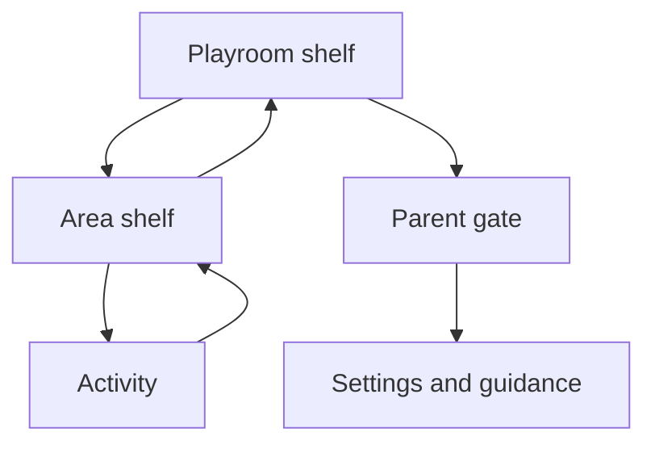

# Layla Board: research and implementation specification

**Version:** 1.0, 27 October 2026 | **Repository:** `lboard` | **Status:** implementation brief, not an implemented application

## 1. Executive summary

Layla Board is a private, offline-capable iPad playroom for Layla, age four. Its promise is: **touch something inviting and something understandable, delightful and reversible happens**. It is a collection of original digital toys, not a curriculum, feed or reward system. Build a substantial first release of 20 toys across 10 areas, with no account, backend, tracking, advertising, subscription, links in the child interface or notifications. Every toy works without reading or sound, supports immediate experimentation and permits an easy exit. Prefer real-time response over elaborate animation.

The creative concept is **The Little Workshop Garden**: a friendly illustrated room opening into a garden, with tactile objects, paper-like surfaces and a small cast of original, non-gendered creatures. The toys feel related through material, color and sound, but each has its own meaningful action. No characters or assets are copied from reference apps. This is a design hypothesis, not a claim that Layla will like any particular aesthetic. Observe her choices and adapt.

Recommended stack: React + TypeScript + Vite; DOM/SVG for accessible controls and discrete objects, Canvas 2D for painting and bounded particle effects; Web Audio for short local sounds; a versioned service worker for a fully precached release. Host over HTTPS on GitHub Pages or Netlify. Home Screen standalone is app-like, not a guaranteed kiosk or immersive full-screen experience. Guided Access is the device-level option.

## 2. Methodology and evidence boundaries

Research completed 27 October 2026 using Canadian and US pediatric guidance, NAEYC, peer-reviewed studies and meta-analyses, official vendor material, W3C, Apple, WebKit and MDN. Sources were selected for relevance to ages 3.5–5, child interaction, app mechanics and current platform behavior. Product analysis is based on public descriptions and available reviews, not a hands-on usability audit; claims about friction, accessibility and manipulation are therefore marked **unverified** when not documented. Vendor marketing is evidence of stated product features, not proof of learning, safety or enjoyment. Pricing, features and OS behavior can change.

**Evidence key:** E = direct research or authoritative guidance; X = extrapolation from relevant evidence; H = design hypothesis requiring Layla/device testing. Activity references point to the source ledger below. No cited study validates these proposed individual toys. Activity values are opportunities for play, not promised outcomes or therapeutic effects. Designs apply to a range of children; no developmental milestone is a prerequisite or diagnosis.

## 3. Child development findings

| Finding and implications | Confidence / boundary | Design decision |
|---|---|---|
| NAEYC emphasizes active, strengths-based, context-sensitive play and inquiry [1]. | E, professional guidance, not a test of this app. | Offer choice, experiment, pretend and room for adult conversation. |
| Guided play review found advantages for some maths, shape, spatial and task-switching outcomes, but individual outcomes drew on few studies [2]. | E; mostly non-digital educational contexts; not proof of app transfer. | Add optional prompts to a few toys; keep free play available. |
| Touchscreen learning meta-analysis found varied effects across studies [3]. | E, heterogeneous studies; not evidence all screens teach. | Assess actual use, do not market learning outcomes or replace physical play. |
| Preschoolers' touchscreen performance varies with motor development; younger children often find dragging more demanding than tapping [4,5]. | E, specific devices and samples; no universal target size follows. | Large targets, generous drop zones, tap-to-place alternative, no precision demands. |
| Congruent dragging helped a numerical estimation task in 5–6-year-olds [6]. | E, narrow older sample; no universal superiority over taps. | Offer meaningful direct manipulation and an alternative. |
| Pretend, music, art, observation and sorting give opportunities for language, creativity and exploration. | X from play guidance [1,2]; specific app effects unproven. | Use familiar objects with multiple responses, no graded outcomes. |
| A quiet toy can invite noticing feelings or taking a breath. | H; no evidence this tool treats anxiety or teaches regulation. | No diagnosis, monitoring, forced breathing cadence or emotion scoring. |
| CPS recommends limiting routine sedentary screen use for ages 2–5 to about one hour or less daily and protecting active play, sleep and relationships [7]. AAP recommends a family media plan and attention to context [8]. | E, guidance is family-level, not a session prescription. | No retention prompts; adults decide timing. Optional shared play; no timer pressure. |
| Physical materials provide resistance, weight, smell and social context absent from a screen. | X, medium limitation. | Describe digital actions as playful simulations, not equivalent to Montessori materials or real science. |

## 4. Competitive and inspiration analysis

Public-source review, not direct hands-on testing. Accessibility, friction and independent navigation require device validation; an omission below is not a finding of failure. The proposed lessons are original interpretations, not asset or interface copying.

| Reference | Documented feature / engagement | Navigation, visual and audio implications | Friction, commercial pattern or unknown | Lesson |
|---|---|---|---|---|
| Pok Pok [9] | Open-ended toys, no winning; handcrafted sound and art; broad exploration. | Toy-first, quieter audiovisual presentation; claimed self-guided. | Subscription [10]; actual accessibility and toy depth unverified. | Sensory restraint and agency; make each object rewarding on first touch. |
| Toca Boca World / Kitchen [11] | World and kitchen pretend play; everyday objects invite stories. | Illustrative scenes and character reactions; exact accessibility unverified. | World has an in-app shop [12]; age suitability and commercial exposure vary by product. | Combine familiar props in unexpected ways, without a shop. |
| Sago Mini World [13] | Collection of playful mini experiences. | Small scenes can support independent exploration; listed as easy navigation. | Subscription, access may depend on plan; frustration and accessibility unverified. | A coherent library with diverse mechanics and offline access. |
| Khan Academy Kids [14] | Free, no ads or subscriptions; structured early learning. | Clear activity choices and curriculum cues; specific accessibility unverified. | More instructional framing may compete with open-ended play; product details require testing. | Offer optional focused tasks without turning the playground into a syllabus. |
| PBS Kids Games / Scribbles and Ink [15] | PBS offers games and an art-and-story experience; offline play is promoted. | Creative output can enter a narrative; accessibility unverified. | Brand/character familiarity contributes to appeal; exact game-level navigation varies. | Let creations become scene props; avoid external navigation. |
| Endless Alphabet [16] | Animated talking letters, word puzzles, no high scores or failure. | Letters themselves respond; audio makes language playful. | Sound reliance may exclude some; cannot assess actual accessibility without testing. | Pair visual letters with optional voice and forgiving placement. |
| Crayola Create and Play [17] | Multiple art, colouring and creative activities. | Familiar media and choices encourage experimentation. | Subscription [18]; clutter and accessibility unverified. | Limit visible tools while retaining a rich art surface. |
| LEGO DUPLO World [19] | Familiar construction brand and app. | Concrete parts can support spatial exploration; exact mechanics unverified. | Purchase model, accessibility and friction unverified. | Large physical-looking construction pieces, original visual language. |

**Differentiation:** one coherent miniature workshop-garden; simple physical rules that combine; quiet optional surprises; no commercial prompts; locally persistent preferences; art and make-believe alongside tactile controls. Test this differentiation with Layla rather than assuming a proprietary advantage. Bimi Boo and generic Montessori apps were considered as categories but omitted as individual analyses because reliable, specific evidence about their current interaction and accessibility was insufficient.

## 5. Principles and measurable design defaults

1. **First touch matters.** A visible response begins on pointer-down; resulting state is immediately understandable. Avoid forced tutorials, welcome narration and loading gates.
2. **Make agency visible.** Controls are large and visually distinct; changes persist until changed or reset. Invite the child to try combinations. No right answer in pretend and creative toys.
3. **Forgive and recover.** Free exploration never ends in failure. Structured challenges have no timer, score, buzzer or negative label. Reset is reversible where feasible and never automatic mid-play.
4. **Quiet by default.** No idle animations except rare, subtle ambience; no autoplay music or competing narration; user can silence everything. No flashing.
5. **A child can leave.** A consistent large home control returns to the activity shelf in one tap. All activities are available immediately, no unlocks.
6. **Preserve the rest of childhood.** No streaks, rewards for returning, social comparison, ads, push, infinite auto-advance, or guilt on leaving.
7. **Accessible from the start.** Touch, pointer, keyboard and VoiceOver paths; visual and audible alternatives; reduced motion and sound controls. No required complex gesture or colour-only instruction.

## 6. Information architecture and screen design



**Playroom shelf:** landscape: 5 large illustrated area tiles per page, two pages, visible next/previous arrows; portrait: 3 tiles per page with same arrows. Tiles combine an original icon and readable label for adults, but do not depend on text. Tapping goes to a shelf of two or more activity cards. No swipe required. Page position is transient. A small unobtrusive parent icon is in a protected corner, separate from child navigation. The child does not see web links, install help or status messages.

**Activity screen:** persistent Home/area-back control at upper left, activity name accessible but visually optional, large stage centered inside safe area, optional reset in a protected but visible corner, contextual tools along an edge. At least 70% of usable space is play stage on common landscape iPads. Never cover primary objects with navigation. Give calm screen equivalent entry and exit. Home returns to originating area shelf; shelf back returns to main shelf. Navigation does not demand a confirmation. A toy retains in-memory state when returning during the session; reload may reset art and play state. Preferences persist.

**Parent gate:** parent icon opens neutral overlay with a hold-to-reveal button requiring a continuous 3-second hold, release/cancel resets progress, followed by a simple written adult arithmetic prompt with three large choices, randomized from a small local bank. A correct answer opens settings; Close is always visible. No punitive lockout, collecting answers, biometrics or claim of security. A determined child may pass; Guided Access/Screen Time control the device. VoiceOver/keyboard equivalent: focus Hold, activate to reveal prompt, select answer; do not make hold the only accessible method. Parent settings are text-based, scrollable and zoomable.

## 7. Shared interaction contract

- CSS pixels, not device pixels: primary child objects target **80 × 80 CSS px or larger** where feasible; navigation at least **64 × 64**, 16 px separation; controls never below 44 × 44 except documented dense art surfaces with a larger invisible hit region. These are project targets, not research-derived universal thresholds. W3C 24 px minimum has exceptions [20]; Apple recommends 44 points [21], which are not identical units. Verify on real devices at actual scale.
- Hit areas may exceed illustration, never overlap ambiguously. If overlapped, resolve by closest center, then topmost; active pointer owns its object. Do not put important controls under system edges. No reliance on colour alone; use shape, patterns, labels and distinct sounds.
- Pointer-down: immediate visual press or lift. Movement beyond 8 CSS px starts drag; below threshold release is tap. Objects track the finger with stable initial offset, pointer capture, bounded positions and no sudden jump. Snap on release to the closest eligible zone within 40 CSS px of its boundary, or when the object overlaps the zone by 20%; animate at most 180 ms. A broad target should also accept tap object then tap target, with selected outline and tap empty to cancel. These numbers are starting hypotheses, tune via observation. No timeout for selected state.
- `pointercancel`, lost capture, app background, orientation change or interruption releases the pointer and restores the last committed state; never leave a stuck drag. One pointer owns each movable item; support independent two-finger instrument strikes and painting where feasible, ignore accidental extra contacts elsewhere. Never require multi-touch. Handle palm contacts conservatively, no silent deletion.
- Tap keyboard/VoiceOver alternative uses semantic controls, selection and destination controls; keyboard Enter/Space activates, arrows move focus. Announce meaningful state changes, not every animation frame. Canvas must have a labeled DOM toolbar and accessible equivalents for creative placement; painting itself has limited fidelity through assistive technology and must have stamp/colour controls as an alternative.
- Direct manipulation uses `touch-action: none` on the play surface, not globally; preserve scrolling and pinch zoom in settings. Use `overscroll-behavior` where supported. System edge, Control Center and browser gestures cannot be reliably disabled by web code. Safe insets and generous edge buffers reduce accidental activation; Guided Access can help. Do not disable browser zoom globally.
- Hints: after 12 seconds of **no interaction** only, optionally show a single subtle outline on one object, once per entry, no auto-playing audio; disable in calm mode. Cancel on contact. No text comprehension required. All effects can be skipped. Screen reader labels describe action and current state.

## 8. Activity catalogue and scoring

The following catalogue is a buildable concept inventory. Each record has individual mechanics, value, visual and audio/feedback, behavior, accessibility and platform note. Shared touch, visual, audio, lifecycle and accessibility contracts above and below apply to **every** activity. A source key is included per activity; evidence supports the general principle, not the toy's claimed effect. **L/M/H** complexity refers to relative one-developer effort after shared infrastructure, not commitments. Priority **R1** = initial 20, **R2** = next, **R3** = later.

Scoring: each of enjoyment (J), developmental fit (D), tactile quality (T), replay (R), creative freedom (C), feasibility (F), distinctiveness (U) is 1–5, subjective pre-test. Effort (E) is 1 = high, 5 = low. Weighted score = `4J + 3D + 3T + 3R + 3C + 2F + 2E + 2U`, maximum 110. Scores are estimates, not evidence or predictions; R1 also balances areas and avoids all high-effort scenes. Rank ties by catalogue order. A higher score does not guarantee release inclusion. Re-score after observation.

### 01. Switchboard · Busy Board · R1

- **Play and value:** Flip switches and slide a dimmer to power three lamps; explore causal combinations. Intended play value is exploration and agency, not a measured outcome.
- **Interaction / expected behavior:** Tap or drag; each state persists, no failure. Child may repeat, combine or leave at any time. Touch: tap, with drag where described; no precision or multitouch required.
- **Visual:** Wood panel, three different lamp shapes. **Sound and feedback:** Soft click; lamps brighten proportionally. Visual response remains when muted; reduced motion substitutes immediate state.
- **Outcome and access:** No failure or prescribed finish. Use shared generous targets and tap alternative, recognizable shapes and screen-reader labels.
- **Build:** L; Pointer events, safe-area layout and lifecycle cancellation. **Priority:** R1. **Evidence:** [1, 4, 21] supports general play/interaction principles; the specific design is a hypothesis.

### 02. Latch House · Busy Board · R1

- **Play and value:** Open three doors with a bolt, rotating knob or simple latch to reveal tiny scenes. Intended play value is exploration and agency, not a measured outcome.
- **Interaction / expected behavior:** Drag or tap hardware then door; close and reopen. Child may repeat, combine or leave at any time. Touch: tap, with drag where described; no precision or multitouch required.
- **Visual:** Pastel doors with distinct hardware. **Sound and feedback:** Thunks and quiet character peeks. Visual response remains when muted; reduced motion substitutes immediate state.
- **Outcome and access:** No score or punitive failure; repeat or reset freely. Use shared generous targets and tap alternative, recognizable shapes and screen-reader labels.
- **Build:** M; Pointer events, safe-area layout and lifecycle cancellation. **Priority:** R1. **Evidence:** [1, 4] supports general play/interaction principles; the specific design is a hypothesis.

### 03. Gear Garden · Busy Board · R2

- **Play and value:** Place three large gears on pegs; turning one moves connected gears. Intended play value is exploration and agency, not a measured outcome.
- **Interaction / expected behavior:** Drag or tap-place; disconnected gears stay still; no failure. Child may repeat, combine or leave at any time. Touch: tap, with drag where described; no precision or multitouch required.
- **Visual:** Visible tooth-shaped discs on a garden board. **Sound and feedback:** Gentle ticking only while moving; linked rotation. Visual response remains when muted; reduced motion substitutes immediate state.
- **Outcome and access:** No failure or prescribed finish. Use shared generous targets and tap alternative, recognizable shapes and screen-reader labels.
- **Build:** M; Pointer events, safe-area layout and lifecycle cancellation. **Priority:** R2. **Evidence:** [1, 4] supports general play/interaction principles; the specific design is a hypothesis.

### 04. Zip and Reveal · Busy Board · R2

- **Play and value:** Move a zipper up or down to uncover a reversible fabric picture. Intended play value is exploration and agency, not a measured outcome.
- **Interaction / expected behavior:** Drag anywhere on track or tap endpoints; no precision. Child may repeat, combine or leave at any time. Touch: tap, with drag where described; no precision or multitouch required.
- **Visual:** Wide fabric seam and oversized pull. **Sound and feedback:** Short cloth slide; picture gradually reveals. Visual response remains when muted; reduced motion substitutes immediate state.
- **Outcome and access:** No score or punitive failure; repeat or reset freely. Use shared generous targets and tap alternative, recognizable shapes and screen-reader labels.
- **Build:** L; Pointer events, safe-area layout and lifecycle cancellation. **Priority:** R2. **Evidence:** [4, 21] supports general play/interaction principles; the specific design is a hypothesis.

### 05. Little Piano · Music · R1

- **Play and value:** Play six pitched keys alone or together; invent melodies. Intended play value is exploration and agency, not a measured outcome.
- **Interaction / expected behavior:** Tap or slide across keys; no score; multi-touch optional. Child may repeat, combine or leave at any time. Touch: tap, with drag where described; no precision or multitouch required.
- **Visual:** Six wide ivory keys with shaped note marks. **Sound and feedback:** Warm short sampled notes, key depresses. Visual response remains when muted; reduced motion substitutes immediate state.
- **Outcome and access:** No score or punitive failure; repeat or reset freely. Use shared generous targets and tap alternative, recognizable shapes and screen-reader labels.
- **Build:** M; Web Audio gesture unlock, bounded voices and interruption recovery. **Priority:** R1. **Evidence:** [1, 24] supports general play/interaction principles; the specific design is a hypothesis.

### 06. Drum Basket · Music · R1

- **Play and value:** Strike three drums and a shaker, exploring rhythm and contrasting timbres. Intended play value is exploration and agency, not a measured outcome.
- **Interaction / expected behavior:** Tap freely, repeated taps retrigger; volume bounded. Child may repeat, combine or leave at any time. Touch: tap, with drag where described; no precision or multitouch required.
- **Visual:** Round drum skins and a chunky shaker. **Sound and feedback:** Soft drum hits with visible ripples. Visual response remains when muted; reduced motion substitutes immediate state.
- **Outcome and access:** No failure or prescribed finish. Use shared generous targets and tap alternative, recognizable shapes and screen-reader labels.
- **Build:** L; Web Audio gesture unlock, bounded voices and interruption recovery. **Priority:** R1. **Evidence:** [1, 24] supports general play/interaction principles; the specific design is a hypothesis.

### 07. Sound Mixer · Music · R2

- **Play and value:** Toggle four short loops and adjust each level to create a layered soundscape. Intended play value is exploration and agency, not a measured outcome.
- **Interaction / expected behavior:** Tap toggles or adjust sliders; all off is valid. Child may repeat, combine or leave at any time. Touch: tap, with drag where described; no precision or multitouch required.
- **Visual:** Four animal musicians and large sliders. **Sound and feedback:** Synchronized soft loops, clear on/off state. Visual response remains when muted; reduced motion substitutes immediate state.
- **Outcome and access:** No score or punitive failure; repeat or reset freely. Use shared generous targets and tap alternative, recognizable shapes and screen-reader labels.
- **Build:** H; Web Audio gesture unlock, bounded voices and interruption recovery. **Priority:** R2. **Evidence:** [1, 24] supports general play/interaction principles; the specific design is a hypothesis.

### 08. Echo Rhythm · Music · R2

- **Play and value:** Choose to echo a two- or three-beat pattern on two drums. Intended play value is exploration and agency, not a measured outcome.
- **Interaction / expected behavior:** Tap or skip; mistakes invite replay without judgment. Child may repeat, combine or leave at any time. Touch: tap, with drag where described; no precision or multitouch required.
- **Visual:** Two distinct drums and a friendly listener. **Sound and feedback:** Optional pattern plays once, visual pulses accompany beats. Visual response remains when muted; reduced motion substitutes immediate state.
- **Outcome and access:** No score or punitive failure; repeat or reset freely. Use shared generous targets and tap alternative, recognizable shapes and screen-reader labels.
- **Build:** M; Web Audio gesture unlock, bounded voices and interruption recovery. **Priority:** R2. **Evidence:** [2, 24] supports general play/interaction principles; the specific design is a hypothesis.

### 09. Animal Friends · Animal World · R1

- **Play and value:** Touch or offer a toy to three animals and observe different reactions. Intended play value is exploration and agency, not a measured outcome.
- **Interaction / expected behavior:** Tap or tap-place toy; no feeding obligation. Child may repeat, combine or leave at any time. Touch: tap, with drag where described; no precision or multitouch required.
- **Visual:** Original cat, bird and rabbit in a garden. **Sound and feedback:** Gentle distinct vocalizations and small gestures. Visual response remains when muted; reduced motion substitutes immediate state.
- **Outcome and access:** No score or punitive failure; repeat or reset freely. Use shared generous targets and tap alternative, recognizable shapes and screen-reader labels.
- **Build:** M; Pointer events, safe-area layout and lifecycle cancellation. **Priority:** R1. **Evidence:** [1, 8] supports general play/interaction principles; the specific design is a hypothesis.

### 10. Habitat Homes · Animal World · R1

- **Play and value:** Move animals between pond, meadow and tree; reveal suitable homes without penalties. Intended play value is exploration and agency, not a measured outcome.
- **Interaction / expected behavior:** Drag or tap-place; all combinations elicit a response. Child may repeat, combine or leave at any time. Touch: tap, with drag where described; no precision or multitouch required.
- **Visual:** Three habitats and chunky animal pieces. **Sound and feedback:** Soft movement and contextual sound. Visual response remains when muted; reduced motion substitutes immediate state.
- **Outcome and access:** No score or punitive failure; repeat or reset freely. Use shared generous targets and tap alternative, recognizable shapes and screen-reader labels.
- **Build:** M; Pointer events, safe-area layout and lifecycle cancellation. **Priority:** R1. **Evidence:** [1, 2] supports general play/interaction principles; the specific design is a hypothesis.

### 11. Creature Orchestra · Animal World · R2

- **Play and value:** Arrange four animals on a stage and tap each to make a different call. Intended play value is exploration and agency, not a measured outcome.
- **Interaction / expected behavior:** Place and tap; no correct arrangement. Child may repeat, combine or leave at any time. Touch: tap, with drag where described; no precision or multitouch required.
- **Visual:** Simple stage, original varied animals. **Sound and feedback:** Individual calls can overlap within a cap. Visual response remains when muted; reduced motion substitutes immediate state.
- **Outcome and access:** No failure or prescribed finish. Use shared generous targets and tap alternative, recognizable shapes and screen-reader labels.
- **Build:** M; Pointer events, safe-area layout and lifecycle cancellation. **Priority:** R2. **Evidence:** [1, 24] supports general play/interaction principles; the specific design is a hypothesis.

### 12. Pond Life · Animal World · R3

- **Play and value:** Move a leaf and observe frogs, fish and ripples responding in the pond. Intended play value is exploration and agency, not a measured outcome.
- **Interaction / expected behavior:** Drag or tap leaf; animals return after brief reactions. Child may repeat, combine or leave at any time. Touch: tap, with drag where described; no precision or multitouch required.
- **Visual:** Layered water, reeds and pond creatures. **Sound and feedback:** Soft water plinks and gentle ripples. Visual response remains when muted; reduced motion substitutes immediate state.
- **Outcome and access:** No score or punitive failure; repeat or reset freely. Use shared generous targets and tap alternative, recognizable shapes and screen-reader labels.
- **Build:** M; Pointer events, safe-area layout and lifecycle cancellation. **Priority:** R3. **Evidence:** [1, 8] supports general play/interaction principles; the specific design is a hypothesis.

### 13. Finger Paint · Creative Studio · R1

- **Play and value:** Draw free strokes with four colours and two brushes. Intended play value is exploration and agency, not a measured outcome.
- **Interaction / expected behavior:** Drag; tap makes dot; undo last stroke, clear confirmation. Child may repeat, combine or leave at any time. Touch: tap, with drag where described; no precision or multitouch required.
- **Visual:** Off-white paper, large paint daubs and tool tray. **Sound and feedback:** Quiet brush texture, immediate ink. Visual response remains when muted; reduced motion substitutes immediate state.
- **Outcome and access:** No score or punitive failure; repeat or reset freely. Use shared generous targets and tap alternative, recognizable shapes and screen-reader labels.
- **Build:** M; Canvas coordinates, DPR cap, resize preservation and accessible DOM tools. **Priority:** R1. **Evidence:** [1, 3, 4] supports general play/interaction principles; the specific design is a hypothesis.

### 14. Sticker Stories · Creative Studio · R1

- **Play and value:** Place and reposition reusable objects to invent scenes. Intended play value is exploration and agency, not a measured outcome.
- **Interaction / expected behavior:** Drag or tap-place; select and move or remove; no limits on meaning. Child may repeat, combine or leave at any time. Touch: tap, with drag where described; no precision or multitouch required.
- **Visual:** Three backdrop choices and eight original stickers. **Sound and feedback:** Soft paper peel, tiny bounce on placement. Visual response remains when muted; reduced motion substitutes immediate state.
- **Outcome and access:** No score or punitive failure; repeat or reset freely. Use shared generous targets and tap alternative, recognizable shapes and screen-reader labels.
- **Build:** M; Canvas coordinates, DPR cap, resize preservation and accessible DOM tools. **Priority:** R1. **Evidence:** [1, 2] supports general play/interaction principles; the specific design is a hypothesis.

### 15. Mirror Maker · Creative Studio · R2

- **Play and value:** Draw or stamp on one half and see a mirrored pattern appear. Intended play value is exploration and agency, not a measured outcome.
- **Interaction / expected behavior:** Draw or place stamps; undo; no correct pattern. Child may repeat, combine or leave at any time. Touch: tap, with drag where described; no precision or multitouch required.
- **Visual:** Folded paper with subtle center line. **Sound and feedback:** Soft pencil and mirrored marks. Visual response remains when muted; reduced motion substitutes immediate state.
- **Outcome and access:** No failure or prescribed finish. Use shared generous targets and tap alternative, recognizable shapes and screen-reader labels.
- **Build:** M; Canvas coordinates, DPR cap, resize preservation and accessible DOM tools. **Priority:** R2. **Evidence:** [1, 2] supports general play/interaction principles; the specific design is a hypothesis.

### 16. Pattern Print · Creative Studio · R2

- **Play and value:** Stamp shapes and textures onto a long paper strip. Intended play value is exploration and agency, not a measured outcome.
- **Interaction / expected behavior:** Tap to stamp; optional pattern prompt; open-ended. Child may repeat, combine or leave at any time. Touch: tap, with drag where described; no precision or multitouch required.
- **Visual:** Large sponge stamps and paper. **Sound and feedback:** Muted stamp tap and imprint. Visual response remains when muted; reduced motion substitutes immediate state.
- **Outcome and access:** No score or punitive failure; repeat or reset freely. Use shared generous targets and tap alternative, recognizable shapes and screen-reader labels.
- **Build:** L; Canvas coordinates, DPR cap, resize preservation and accessible DOM tools. **Priority:** R2. **Evidence:** [1, 2] supports general play/interaction principles; the specific design is a hypothesis.

### 17. Colour Kitchen · Science Lab · R1

- **Play and value:** Combine two coloured drops in a bowl and see a consistent result. Intended play value is exploration and agency, not a measured outcome.
- **Interaction / expected behavior:** Tap or drag two drops; reset bowl; labels/shapes distinguish colours. Child may repeat, combine or leave at any time. Touch: tap, with drag where described; no precision or multitouch required.
- **Visual:** Three coloured droppers and a translucent bowl. **Sound and feedback:** Plop and gradual swirl. Visual response remains when muted; reduced motion substitutes immediate state.
- **Outcome and access:** No score or punitive failure; repeat or reset freely. Use shared generous targets and tap alternative, recognizable shapes and screen-reader labels.
- **Build:** M; Bounded 2D animation, explicit simulated rules and pointer cancellation. **Priority:** R1. **Evidence:** [1, 3] supports general play/interaction principles; the specific design is a hypothesis.

### 18. Float or Sink · Science Lab · R1

- **Play and value:** Place four objects in water to discover each preset response. Intended play value is exploration and agency, not a measured outcome.
- **Interaction / expected behavior:** Tap-place or drag; repeat without judgment. Child may repeat, combine or leave at any time. Touch: tap, with drag where described; no precision or multitouch required.
- **Visual:** Clear tank, wood, stone, leaf and cork. **Sound and feedback:** Soft splash; object settles at surface or bottom. Visual response remains when muted; reduced motion substitutes immediate state.
- **Outcome and access:** No score or punitive failure; repeat or reset freely. Use shared generous targets and tap alternative, recognizable shapes and screen-reader labels.
- **Build:** M; Bounded 2D animation, explicit simulated rules and pointer cancellation. **Priority:** R1. **Evidence:** [1, 3] supports general play/interaction principles; the specific design is a hypothesis.

### 19. Magnet Table · Science Lab · R2

- **Play and value:** Move a magnet near assorted objects; selected pieces follow. Intended play value is exploration and agency, not a measured outcome.
- **Interaction / expected behavior:** Drag magnet or tap target; labels identify simulated materials. Child may repeat, combine or leave at any time. Touch: tap, with drag where described; no precision or multitouch required.
- **Visual:** Horseshoe magnet and mixed material tokens. **Sound and feedback:** Small metallic click, attraction is visible. Visual response remains when muted; reduced motion substitutes immediate state.
- **Outcome and access:** No score or punitive failure; repeat or reset freely. Use shared generous targets and tap alternative, recognizable shapes and screen-reader labels.
- **Build:** M; Bounded 2D animation, explicit simulated rules and pointer cancellation. **Priority:** R2. **Evidence:** [1, 3] supports general play/interaction principles; the specific design is a hypothesis.

### 20. Shadow Theatre · Science Lab · R3

- **Play and value:** Move a lamp or shape to see its shadow change direction and size. Intended play value is exploration and agency, not a measured outcome.
- **Interaction / expected behavior:** Drag or tap-position lamp; no win condition. Child may repeat, combine or leave at any time. Touch: tap, with drag where described; no precision or multitouch required.
- **Visual:** Warm lamp, screen and three cutout shapes. **Sound and feedback:** Quiet slide; smooth shadow transform. Visual response remains when muted; reduced motion substitutes immediate state.
- **Outcome and access:** No score or punitive failure; repeat or reset freely. Use shared generous targets and tap alternative, recognizable shapes and screen-reader labels.
- **Build:** H; Bounded 2D animation, explicit simulated rules and pointer cancellation. **Priority:** R3. **Evidence:** [1, 3] supports general play/interaction principles; the specific design is a hypothesis.

### 21. Block Builder · Building · R1

- **Play and value:** Stack and arrange chunky blocks to make structures. Intended play value is exploration and agency, not a measured outcome.
- **Interaction / expected behavior:** Drag or tap-place; forgiving placement, undo; no collapse penalty. Child may repeat, combine or leave at any time. Touch: tap, with drag where described; no precision or multitouch required.
- **Visual:** Six reusable rounded blocks, roomy floor. **Sound and feedback:** Soft wooden knock; place snaps gently. Visual response remains when muted; reduced motion substitutes immediate state.
- **Outcome and access:** No score or punitive failure; repeat or reset freely. Use shared generous targets and tap alternative, recognizable shapes and screen-reader labels.
- **Build:** M; Pointer capture, snap and responsive stage transform. **Priority:** R1. **Evidence:** [1, 4] supports general play/interaction principles; the specific design is a hypothesis.

### 22. Track Maker · Building · R1

- **Play and value:** Place three track sections then send a ball along the assembled path. Intended play value is exploration and agency, not a measured outcome.
- **Interaction / expected behavior:** Tap-place or drag; disconnected pieces visibly stop ball; no failure. Child may repeat, combine or leave at any time. Touch: tap, with drag where described; no precision or multitouch required.
- **Visual:** Large curved and straight sections and a ball. **Sound and feedback:** Click on join, rolling sound on play. Visual response remains when muted; reduced motion substitutes immediate state.
- **Outcome and access:** No failure or prescribed finish. Use shared generous targets and tap alternative, recognizable shapes and screen-reader labels.
- **Build:** H; Pointer capture, snap and responsive stage transform. **Priority:** R1. **Evidence:** [1, 4] supports general play/interaction principles; the specific design is a hypothesis.

### 23. Shape Mosaic · Building · R2

- **Play and value:** Fill a scene or freely arrange shapes on a magnetic board. Intended play value is exploration and agency, not a measured outcome.
- **Interaction / expected behavior:** Drag or tap-place; broad targets; free mode and optional outlines. Child may repeat, combine or leave at any time. Touch: tap, with drag where described; no precision or multitouch required.
- **Visual:** Large patterned circles, triangles and squares. **Sound and feedback:** Soft magnet pop and placement halo. Visual response remains when muted; reduced motion substitutes immediate state.
- **Outcome and access:** No failure or prescribed finish. Use shared generous targets and tap alternative, recognizable shapes and screen-reader labels.
- **Build:** M; Pointer capture, snap and responsive stage transform. **Priority:** R2. **Evidence:** [2, 4] supports general play/interaction principles; the specific design is a hypothesis.

### 24. Ramp Run · Building · R3

- **Play and value:** Adjust one ramp angle and release a ball to observe its path. Intended play value is exploration and agency, not a measured outcome.
- **Interaction / expected behavior:** Drag or tap angle presets; reset ball, no score. Child may repeat, combine or leave at any time. Touch: tap, with drag where described; no precision or multitouch required.
- **Visual:** Wide ramp, ball and soft catch basket. **Sound and feedback:** Rolling then soft bump. Visual response remains when muted; reduced motion substitutes immediate state.
- **Outcome and access:** No score or punitive failure; repeat or reset freely. Use shared generous targets and tap alternative, recognizable shapes and screen-reader labels.
- **Build:** M; Pointer capture, snap and responsive stage transform. **Priority:** R3. **Evidence:** [1, 3] supports general play/interaction principles; the specific design is a hypothesis.

### 25. Picnic Kitchen · Pretend · R1

- **Play and value:** Combine pretend ingredients on a plate and serve a creature. Intended play value is exploration and agency, not a measured outcome.
- **Interaction / expected behavior:** Drag or tap-place; every combination accepted. Child may repeat, combine or leave at any time. Touch: tap, with drag where described; no precision or multitouch required.
- **Visual:** Bowl, plate, six playful foods and friend. **Sound and feedback:** Chop/plop and delighted nonverbal reaction. Visual response remains when muted; reduced motion substitutes immediate state.
- **Outcome and access:** No score or punitive failure; repeat or reset freely. Use shared generous targets and tap alternative, recognizable shapes and screen-reader labels.
- **Build:** M; Pointer events, safe-area layout and lifecycle cancellation. **Priority:** R1. **Evidence:** [1, 2] supports general play/interaction principles; the specific design is a hypothesis.

### 26. Garden Patch · Pretend · R1

- **Play and value:** Plant seeds, water and watch flowers grow on request. Intended play value is exploration and agency, not a measured outcome.
- **Interaction / expected behavior:** Tap-place seeds, tap or drag can; growth is quick and repeatable. Child may repeat, combine or leave at any time. Touch: tap, with drag where described; no precision or multitouch required.
- **Visual:** Three soil pots, watering can, varied blooms. **Sound and feedback:** Gentle pour and rustle. Visual response remains when muted; reduced motion substitutes immediate state.
- **Outcome and access:** No score or punitive failure; repeat or reset freely. Use shared generous targets and tap alternative, recognizable shapes and screen-reader labels.
- **Build:** M; Pointer events, safe-area layout and lifecycle cancellation. **Priority:** R1. **Evidence:** [1, 3] supports general play/interaction principles; the specific design is a hypothesis.

### 27. Dress-up Friends · Pretend · R2

- **Play and value:** Choose outfits and accessories for an original character. Intended play value is exploration and agency, not a measured outcome.
- **Interaction / expected behavior:** Tap garment then character or drag; remove freely. Child may repeat, combine or leave at any time. Touch: tap, with drag where described; no precision or multitouch required.
- **Visual:** Inclusive character, large garment pieces. **Sound and feedback:** Fabric rustle and subtle pose. Visual response remains when muted; reduced motion substitutes immediate state.
- **Outcome and access:** No failure or prescribed finish. Use shared generous targets and tap alternative, recognizable shapes and screen-reader labels.
- **Build:** M; Pointer events, safe-area layout and lifecycle cancellation. **Priority:** R2. **Evidence:** [1, 2] supports general play/interaction principles; the specific design is a hypothesis.

### 28. Little Shop · Pretend · R3

- **Play and value:** Put pretend items in a basket and hand them to a customer. Intended play value is exploration and agency, not a measured outcome.
- **Interaction / expected behavior:** Tap-place or drag; no money calculation required. Child may repeat, combine or leave at any time. Touch: tap, with drag where described; no precision or multitouch required.
- **Visual:** Market stall and reusable produce. **Sound and feedback:** Basket thud and friendly greeting. Visual response remains when muted; reduced motion substitutes immediate state.
- **Outcome and access:** No score or punitive failure; repeat or reset freely. Use shared generous targets and tap alternative, recognizable shapes and screen-reader labels.
- **Build:** M; Pointer events, safe-area layout and lifecycle cancellation. **Priority:** R3. **Evidence:** [1, 2] supports general play/interaction principles; the specific design is a hypothesis.

### 29. Counting Picnic · Early Learning · R1

- **Play and value:** Place one to five berries on plates; optional spoken count follows each placement. Intended play value is exploration and agency, not a measured outcome.
- **Interaction / expected behavior:** Free placement or optional request; no timer, no wrong buzzer. Child may repeat, combine or leave at any time. Touch: tap, with drag where described; no precision or multitouch required.
- **Visual:** Five spacious plates and berries with distinct outlines. **Sound and feedback:** Optional count and quiet plop; visual numerals optional. Visual response remains when muted; reduced motion substitutes immediate state.
- **Outcome and access:** No failure or prescribed finish. Use shared generous targets and tap alternative, recognizable shapes and screen-reader labels.
- **Build:** M; Pointer events, safe-area layout and lifecycle cancellation. **Priority:** R1. **Evidence:** [2, 6] supports general play/interaction principles; the specific design is a hypothesis.

### 30. Shape Sorter · Early Learning · R1

- **Play and value:** Place three shapes into generous matching outlines. Intended play value is exploration and agency, not a measured outcome.
- **Interaction / expected behavior:** Tap-place or drag; mismatch returns gently, free play remains. Child may repeat, combine or leave at any time. Touch: tap, with drag where described; no precision or multitouch required.
- **Visual:** Large differently coloured and patterned shapes. **Sound and feedback:** Soft click and brief outline fill. Visual response remains when muted; reduced motion substitutes immediate state.
- **Outcome and access:** No failure or prescribed finish. Use shared generous targets and tap alternative, recognizable shapes and screen-reader labels.
- **Build:** L; Pointer events, safe-area layout and lifecycle cancellation. **Priority:** R1. **Evidence:** [2, 4] supports general play/interaction principles; the specific design is a hypothesis.

### 31. Pattern Train · Early Learning · R2

- **Play and value:** Continue a two-item repeating train pattern with optional guidance. Intended play value is exploration and agency, not a measured outcome.
- **Interaction / expected behavior:** Tap next car; any choice remains visible, suggestion is optional. Child may repeat, combine or leave at any time. Touch: tap, with drag where described; no precision or multitouch required.
- **Visual:** Train cars marked by shape and colour. **Sound and feedback:** Friendly coupling click; optional visual hint. Visual response remains when muted; reduced motion substitutes immediate state.
- **Outcome and access:** No score or punitive failure; repeat or reset freely. Use shared generous targets and tap alternative, recognizable shapes and screen-reader labels.
- **Build:** M; Pointer events, safe-area layout and lifecycle cancellation. **Priority:** R2. **Evidence:** [2, 4] supports general play/interaction principles; the specific design is a hypothesis.

### 32. Letter Garden · Early Learning · R2

- **Play and value:** Touch large letters in Layla’s name to hear names and see related original images. Intended play value is exploration and agency, not a measured outcome.
- **Interaction / expected behavior:** Tap any order; no reading or spelling prerequisite. Child may repeat, combine or leave at any time. Touch: tap, with drag where described; no precision or multitouch required.
- **Visual:** Five large seed packets spelling LAYLA. **Sound and feedback:** Optional recorded letter names with visual highlight. Visual response remains when muted; reduced motion substitutes immediate state.
- **Outcome and access:** No score or punitive failure; repeat or reset freely. Use shared generous targets and tap alternative, recognizable shapes and screen-reader labels.
- **Build:** L; Pointer events, safe-area layout and lifecycle cancellation. **Priority:** R2. **Evidence:** [1, 2] supports general play/interaction principles; the specific design is a hypothesis.

### 33. Picture Pairs · Early Learning · R3

- **Play and value:** Find pairs among four face-down cards, then optionally six. Intended play value is exploration and agency, not a measured outcome.
- **Interaction / expected behavior:** Tap; unmatched cards turn back slowly, no time limit or negative sound. Child may repeat, combine or leave at any time. Touch: tap, with drag where described; no precision or multitouch required.
- **Visual:** Large tiles with clearly distinct objects. **Sound and feedback:** Soft flip and matched glow. Visual response remains when muted; reduced motion substitutes immediate state.
- **Outcome and access:** No score or punitive failure; repeat or reset freely. Use shared generous targets and tap alternative, recognizable shapes and screen-reader labels.
- **Build:** M; Pointer events, safe-area layout and lifecycle cancellation. **Priority:** R3. **Evidence:** [2, 4] supports general play/interaction principles; the specific design is a hypothesis.

### 34. Cloud Window · Calm Corner · R1

- **Play and value:** Move clouds slowly to reveal an illustrated sky. Intended play value is exploration and agency, not a measured outcome.
- **Interaction / expected behavior:** Drag or tap cloud to move; no objective. Child may repeat, combine or leave at any time. Touch: tap, with drag where described; no precision or multitouch required.
- **Visual:** Low-contrast sky and three large clouds. **Sound and feedback:** Silence by default; optional very soft wind. Visual response remains when muted; reduced motion substitutes immediate state.
- **Outcome and access:** No score or punitive failure; repeat or reset freely. Use shared generous targets and tap alternative, recognizable shapes and screen-reader labels.
- **Build:** L; Pointer events, safe-area layout and lifecycle cancellation. **Priority:** R1. **Evidence:** [1, 7] supports general play/interaction principles; the specific design is a hypothesis.

### 35. Feelings Faces · Calm Corner · R1

- **Play and value:** Choose facial features for a character and explore optional feeling words. Intended play value is exploration and agency, not a measured outcome.
- **Interaction / expected behavior:** Tap parts; no claim that a face proves a feeling. Child may repeat, combine or leave at any time. Touch: tap, with drag where described; no precision or multitouch required.
- **Visual:** Friendly neutral face, large eye and mouth options. **Sound and feedback:** Optional gentle voice labels, no evaluative sound. Visual response remains when muted; reduced motion substitutes immediate state.
- **Outcome and access:** No score or punitive failure; repeat or reset freely. Use shared generous targets and tap alternative, recognizable shapes and screen-reader labels.
- **Build:** M; Pointer events, safe-area layout and lifecycle cancellation. **Priority:** R1. **Evidence:** [1, 8] supports general play/interaction principles; the specific design is a hypothesis.

### 36. Breathing Blossom · Calm Corner · R2

- **Play and value:** A flower slowly opens and closes as an optional breathing companion. Intended play value is exploration and agency, not a measured outcome.
- **Interaction / expected behavior:** Tap to start or stop; no instruction to match cadence or measure breathing. Child may repeat, combine or leave at any time. Touch: tap, with drag where described; no precision or multitouch required.
- **Visual:** One calm flower against a quiet background. **Sound and feedback:** Silence or optional soft tone; no pulse or flash. Visual response remains when muted; reduced motion substitutes immediate state.
- **Outcome and access:** No score or punitive failure; repeat or reset freely. Use shared generous targets and tap alternative, recognizable shapes and screen-reader labels.
- **Build:** L; Pointer events, safe-area layout and lifecycle cancellation. **Priority:** R2. **Evidence:** [7, 8] supports general play/interaction principles; the specific design is a hypothesis.

### 37. Sand Tray · Calm Corner · R2

- **Play and value:** Trace paths through virtual sand and smooth it with a large tool. Intended play value is exploration and agency, not a measured outcome.
- **Interaction / expected behavior:** Drag to trace or tap stamps; one-tap smooth with undo. Child may repeat, combine or leave at any time. Touch: tap, with drag where described; no precision or multitouch required.
- **Visual:** Matte sand, shell and wide rake. **Sound and feedback:** Quiet granular sound only while moving. Visual response remains when muted; reduced motion substitutes immediate state.
- **Outcome and access:** No score or punitive failure; repeat or reset freely. Use shared generous targets and tap alternative, recognizable shapes and screen-reader labels.
- **Build:** M; Pointer events, safe-area layout and lifecycle cancellation. **Priority:** R2. **Evidence:** [1, 4] supports general play/interaction principles; the specific design is a hypothesis.

### 38. Bubble Meadow · Surprise · R1

- **Play and value:** Tap or gently move bubbles to create small transformations. Intended play value is exploration and agency, not a measured outcome.
- **Interaction / expected behavior:** Tap or drag; finite set replenishes only on request; no score. Child may repeat, combine or leave at any time. Touch: tap, with drag where described; no precision or multitouch required.
- **Visual:** Translucent pastel bubbles on meadow. **Sound and feedback:** Soft pop and brief tiny star. Visual response remains when muted; reduced motion substitutes immediate state.
- **Outcome and access:** No score or punitive failure; repeat or reset freely. Use shared generous targets and tap alternative, recognizable shapes and screen-reader labels.
- **Build:** L; Pointer events, safe-area layout and lifecycle cancellation. **Priority:** R1. **Evidence:** [1, 4] supports general play/interaction principles; the specific design is a hypothesis.

### 39. Silly Machine · Surprise · R1

- **Play and value:** Choose two inputs, turn a crank and reveal a playful combined output. Intended play value is exploration and agency, not a measured outcome.
- **Interaction / expected behavior:** Tap choices and crank or drag crank; all combinations work. Child may repeat, combine or leave at any time. Touch: tap, with drag where described; no precision or multitouch required.
- **Visual:** Three ingredient buttons, large crank and window. **Sound and feedback:** Mechanical clicks followed by quiet reveal. Visual response remains when muted; reduced motion substitutes immediate state.
- **Outcome and access:** No score or punitive failure; repeat or reset freely. Use shared generous targets and tap alternative, recognizable shapes and screen-reader labels.
- **Build:** M; Pointer events, safe-area layout and lifecycle cancellation. **Priority:** R1. **Evidence:** [1, 2] supports general play/interaction principles; the specific design is a hypothesis.

### 40. Peekaboo Garden · Surprise · R2

- **Play and value:** Open leaves and doors to find a small set of creatures. Intended play value is exploration and agency, not a measured outcome.
- **Interaction / expected behavior:** Tap objects in any order; discoveries repeat, no collection. Child may repeat, combine or leave at any time. Touch: tap, with drag where described; no precision or multitouch required.
- **Visual:** Oversized foliage with distinct silhouettes. **Sound and feedback:** Rustle and friendly sound; gentle reveal. Visual response remains when muted; reduced motion substitutes immediate state.
- **Outcome and access:** No score or punitive failure; repeat or reset freely. Use shared generous targets and tap alternative, recognizable shapes and screen-reader labels.
- **Build:** M; Pointer events, safe-area layout and lifecycle cancellation. **Priority:** R2. **Evidence:** [1, 4] supports general play/interaction principles; the specific design is a hypothesis.

### 41. Balloon Parade · Surprise · R3

- **Play and value:** Choose a balloon shape and move it around a small scene. Intended play value is exploration and agency, not a measured outcome.
- **Interaction / expected behavior:** Tap-select and tap-place or drag; no popping required. Child may repeat, combine or leave at any time. Touch: tap, with drag where described; no precision or multitouch required.
- **Visual:** Soft balloons, grounded scene and ribbons. **Sound and feedback:** Soft squeak; balloon follows with modest lag. Visual response remains when muted; reduced motion substitutes immediate state.
- **Outcome and access:** No score or punitive failure; repeat or reset freely. Use shared generous targets and tap alternative, recognizable shapes and screen-reader labels.
- **Build:** M; Pointer events, safe-area layout and lifecycle cancellation. **Priority:** R3. **Evidence:** [1, 4] supports general play/interaction principles; the specific design is a hypothesis.

### 42. Weather Window · Science Lab · R2

- **Play and value:** Choose sun, rain or snow and see one scene respond. Intended play value is exploration and agency, not a measured outcome.
- **Interaction / expected behavior:** Tap state; no weather claims beyond simple illustration. Child may repeat, combine or leave at any time. Touch: tap, with drag where described; no precision or multitouch required.
- **Visual:** Garden window, three weather tiles. **Sound and feedback:** Optional rain or breeze, gentle visual state. Visual response remains when muted; reduced motion substitutes immediate state.
- **Outcome and access:** No score or punitive failure; repeat or reset freely. Use shared generous targets and tap alternative, recognizable shapes and screen-reader labels.
- **Build:** L; Bounded 2D animation, explicit simulated rules and pointer cancellation. **Priority:** R2. **Evidence:** [1, 3] supports general play/interaction principles; the specific design is a hypothesis.

## 9. Prioritized activity matrix

Scores are ordered as J/D/T/R/C/F/E/U; see formula in section 8.

| Rank | Activity | Area | Scores | Total / 110 | Complexity | Release |
|---:|---|---|---|---:|---|---|
| 1 | Drum Basket | Music | 5/5/5/5/5/5/4/4 | 106 | L | R1 |
| 2 | Finger Paint | Creative Studio | 5/5/5/5/5/4/3/5 | 104 | M | R1 |
| 3 | Sticker Stories | Creative Studio | 5/5/5/5/5/4/3/5 | 104 | M | R1 |
| 4 | Colour Kitchen | Science Lab | 5/5/5/5/5/4/3/5 | 104 | M | R1 |
| 5 | Block Builder | Building | 5/5/5/5/5/4/3/5 | 104 | M | R1 |
| 6 | Picnic Kitchen | Pretend | 5/5/5/5/5/4/3/5 | 104 | M | R1 |
| 7 | Garden Patch | Pretend | 5/5/5/5/5/4/3/5 | 104 | M | R1 |
| 8 | Silly Machine | Surprise | 5/5/5/5/5/4/3/5 | 104 | M | R1 |
| 9 | Little Piano | Music | 5/5/5/5/5/4/3/4 | 102 | M | R1 |
| 10 | Sand Tray | Calm Corner | 5/5/5/5/5/4/3/4 | 102 | M | R2 |
| 11 | Animal Friends | Animal World | 5/5/4/5/5/4/3/5 | 101 | M | R1 |
| 12 | Track Maker | Building | 5/5/5/5/5/3/2/5 | 100 | H | R1 |
| 13 | Bubble Meadow | Surprise | 5/5/5/4/4/5/4/4 | 100 | L | R1 |
| 14 | Switchboard | Busy Board | 5/5/5/4/3/5/5/4 | 99 | L | R1 |
| 15 | Dress-up Friends | Pretend | 5/5/4/5/5/4/3/4 | 99 | M | R2 |
| 16 | Latch House | Busy Board | 5/5/5/4/4/4/3/5 | 98 | M | R1 |
| 17 | Float or Sink | Science Lab | 5/5/5/4/4/4/3/5 | 98 | M | R1 |
| 18 | Gear Garden | Busy Board | 5/5/5/5/4/3/2/5 | 97 | M | R2 |
| 19 | Mirror Maker | Creative Studio | 4/5/4/5/5/4/3/5 | 97 | M | R2 |
| 20 | Magnet Table | Science Lab | 5/5/5/5/4/3/2/5 | 97 | M | R2 |
| 21 | Shadow Theatre | Science Lab | 4/5/5/5/5/3/2/5 | 96 | H | R3 |
| 22 | Cloud Window | Calm Corner | 4/5/4/4/5/5/4/4 | 96 | L | R1 |
| 23 | Shape Mosaic | Building | 4/5/5/4/5/4/3/4 | 95 | M | R2 |
| 24 | Little Shop | Pretend | 4/5/4/5/5/4/3/4 | 95 | M | R3 |
| 25 | Feelings Faces | Calm Corner | 4/5/4/5/5/4/3/4 | 95 | M | R1 |
| 26 | Pattern Print | Creative Studio | 4/5/4/4/5/5/4/3 | 94 | L | R2 |
| 27 | Peekaboo Garden | Surprise | 5/5/4/4/4/4/3/4 | 93 | M | R2 |
| 28 | Weather Window | Science Lab | 4/5/4/4/4/5/4/4 | 93 | L | R2 |
| 29 | Ramp Run | Building | 4/5/5/4/4/4/3/4 | 92 | M | R3 |
| 30 | Balloon Parade | Surprise | 4/5/4/4/5/4/3/4 | 92 | M | R3 |
| 31 | Shape Sorter | Early Learning | 4/5/5/4/3/5/4/3 | 91 | L | R1 |
| 32 | Sound Mixer | Music | 4/4/4/5/5/3/2/5 | 90 | H | R2 |
| 33 | Letter Garden | Early Learning | 4/5/4/4/3/5/4/4 | 90 | L | R2 |
| 34 | Habitat Homes | Animal World | 4/5/4/4/4/4/3/4 | 89 | M | R1 |
| 35 | Creature Orchestra | Animal World | 4/4/4/4/5/4/3/4 | 89 | M | R2 |
| 36 | Pond Life | Animal World | 4/5/4/4/4/4/3/4 | 89 | M | R3 |
| 37 | Counting Picnic | Early Learning | 4/5/4/4/4/4/3/4 | 89 | M | R1 |
| 38 | Zip and Reveal | Busy Board | 4/5/5/3/2/5/5/3 | 87 | L | R2 |
| 39 | Pattern Train | Early Learning | 4/5/4/3/3/4/3/3 | 81 | M | R2 |
| 40 | Echo Rhythm | Music | 4/5/4/3/2/4/3/3 | 78 | M | R2 |
| 41 | Picture Pairs | Early Learning | 4/5/4/3/2/4/3/3 | 78 | M | R3 |
| 42 | Breathing Blossom | Calm Corner | 3/4/3/3/2/5/4/3 | 72 | L | R2 |

## 10. Detailed activity specifications

### Switchboard
Initial: three switches off, lamps off, dimmer halfway. Each tap changes its associated lamp only; visual state, accessible name and audio reflect state. Sliding dimmer changes brightness of enabled lamps from 25–100%, never to a strobe. Tap track sets value; keyboard uses arrows. Switches maintain state when navigating away during the session. Reset restores initial values. Press feedback starts immediately, no transition blocks input.

### Latch House
Three doors have independent states `closed/latched`, `closed/unlatched`, `open`. Touch bolt to toggle; touch knob to rotate 90 degrees; touch latch to lift. A locked door gently jiggles once without sound when tapped; opening an unlocked door reveals a static little scene with one optional touch reaction. Tapping open door closes it; locking is always explicit. Each control has an enlarged nonoverlapping hitbox. Accessible buttons expose door state and action. No random surprise or sudden noise.

### Little Piano and Drum Basket
Predecode local samples before entering where possible; trigger on pointer-down after synchronously initiating `AudioContext.resume()` inside a trusted gesture. Piano keys are independently addressable and have visual pressed states; at most eight simultaneously sounding voices globally, oldest fades over 20 ms if exceeded. Note release/decay is bounded. On `pointercancel` clear key visuals and stop sustained voices. No melody, background loop or metronome starts by itself. An audio-disabled user can still see key presses and note labels. Drum repeat triggers immediately but a rate cap prevents clipping and amplification.

### Finger Paint
Canvas stores a model of strokes `{color, width, points}` in memory; pointer coordinates normalized to stage dimensions so resize redraws, with point sampling bounded. Draw from pointer-down, rendering a dot without requiring movement. Four colours and two brush sizes are large labelled controls. Undo removes one stroke; clear opens a child-readable visual confirmation with Cancel and Clear. Add a keyboard/VoiceOver accessible stamp picker and grid placement, clearly identified as an alternative rather than equivalent freehand painting. No automatic export or remote upload; artwork may be lost after reload and parent guidance says so. Limit strokes/points and show a gentle capacity state rather than silently discarding.

### Colour Kitchen
Provide red, yellow and blue droppers with different shapes. The bowl accepts two inputs; each input creates a visible drop and a visual token. Use deterministic artist-paint approximations: red+yellow=orange, yellow+blue=green, blue+red=purple; matching pairs retain their color. Results are illustrative, not a scientific model of pigments or screen light. When full, additional input has no effect until the clearly visible empty-bowl control is activated. Tap dropper then bowl or drag. Result persists until reset; label resulting colour with optional voice and a distinct pattern.

### Track Maker
On a 3-by-2 invisible grid, offer two straights and a curve; tap piece then cell or drag. Snap with a visible preview and 40 px tolerance. Rotate a selected piece by a large rotate button, 90 degrees per tap; no twist gesture required. Tap ball to run from the start along connected endpoints. At an unconnected endpoint the ball slows and stops, with a visible gap; no buzzer. Pieces can be moved and ball reset. Graph connectivity, rather than general physics, determines path; bound traversal to prevent infinite loops. Re-layout grid on orientation change while preserving model coordinates.

### Picnic Kitchen
Reusable six ingredients can be put on a plate in any order; food is not consumed. Each placement creates a visible stack with slight offsets; cap at 12, offering remove rather than silently ignoring. Tap character to serve and play one of three subdued responses based on combination, never imply a food is bad. Clear plate returns pieces to tray; user may skip serving entirely. Every ingredient has an accessible label and tap-to-place alternative.

### Feelings Faces
A character has three eye and three mouth options; choosing a feature swaps it in place. Four optional feeling word buttons provide a human-recorded word and matching text, without declaring that the face necessarily represents that emotion. No camera, face recognition, recordings, inference, diagnosis, or tracking. Reset returns neutral face. All expression combinations remain available. Calm mode turns off optional voice by default but parent may enable it.

### Silly Machine
Three input choices per slot, two slots and a crank. Each of the nine pairs maps deterministically to an original small visual output; same input gives same result. Choosing a slot is optional: an empty slot shows a neutral symbol and also works. Tap crank or drag 90 degrees; animation runs for at most 700 ms and can be interrupted by Home. Reveal is quiet, no flash, and persists. Reduced motion swaps the output instantly. No hidden rare outcome, reward schedule or forced replay.

## 11. Visual identity and design tokens

**Art direction:** rounded hand-cut paper and softly painted wood, delicate grain baked into static assets, low-detail backgrounds; original recurring creatures with distinct silhouettes and expressive but restrained movement. Avoid babyish speech, gender stereotyping, brand lookalikes, tiny decorative targets and unnecessary text. Distinguish actionable elements by rim, depth, shape and response, not sparkle. Produce SVG illustrations locally with a documented license and no remote fonts or imagery.

| Token | Value / use |
|---|---|
| Canvas | `#FFF9EF` warm paper; surfaces `#FFFFFF` |
| Ink | `#24344A` primary text and outlines |
| Coral | `#E97565` accent, use dark ink for text |
| Sky | `#8BC8D4` secondary, dark ink |
| Leaf | `#9BC69A` garden, dark ink |
| Honey | `#F0CE78` accent, dark ink |
| Lavender | `#C9B9DF` quiet accent, dark ink |
| Spacing | 8 px base; 16 px between targets; 24 px scene margins plus safe insets |
| Corners | 16–24 px controls; organic illustration edges, avoid masking hitboxes |
| Depth | Soft one-direction shadow, e.g. `0 4px 0 #B9A99A` on light wood; pressed moves 2 px; never encode state only via shadow |
| Type | Locally bundled, licensed rounded humanist sans, with system fallback; minimum 18 px parent text, 16 px secondary; no critical reading for child. Confirm selected font license. |
| Icons | Simple filled silhouettes, 2–3 internal details, consistent 3 px stroke at design scale, accessible labels; home is a house, back is arrow. |

Text contrast target WCAG AA 4.5:1, large text 3:1; essential non-text UI boundaries/states 3:1 against adjacent colors [20]. Palette swatches are not a blanket contrast certification: verify actual pairs, focus states and illustrations. Support system text scaling, settings reflow and landscape/portrait without clipping. No text embedded in critical image assets.

## 12. Motion and sound

Motion should explain cause: 80–120 ms press, 120–180 ms snap, 200–400 ms small response; 700 ms maximum for a reveal; input remains available. Use transform/opacity where practical, no parallax, flashing, screen shakes or constant movement. Respect `prefers-reduced-motion` plus parent override; effective reduced motion if either is true. Replace spatial motion with immediate state or brief static outline. No essential information is conveyed by movement alone.

All audio is local, original or properly licensed, short, gentle, with low default gain; master defaults 0.6, effects 0.6, music 0.3, music off until deliberately started. These are relative linear gain defaults, not calibrated sound-pressure guarantees. Device volume and headphones govern actual loudness; recommend adult review at a comfortable volume. Separate master mute, effects and music; mute means all output including narration. No sudden loud sounds; normalize assets, cap polyphony and use a limiter conservatively without relying on it to make unsafe source audio safe. On exit/background stop loops, release voices; don't resume music automatically. Captions or visual indicators accompany meaningful audio. Avoid repetitive automatic prompts.

## 13. Parent controls, privacy and device guidance

Settings: master sound on/off; separate effects and music sliders 0–100%; music play opt-in; reduced motion toggle; calm mode; activity selection list; reset preferences. Defaults are sound on at low relative gain, music off, all activities enabled, reduced motion follows system, calm mode off. Changes save immediately in local preferences; a status line confirms. Reset asks adult confirmation, resets settings and enabled activities only, not browser caches or artworks. Keep at least one activity enabled; calm mode filters shelf to Calm Corner and suppresses hints and optional ambience, without destroying normal selection; turning it off restores selection. Parent can always reach settings to undo it. No account, ads, analytics, tracking, remote logs, notifications, camera, microphone, location, purchase, outbound child UI or external links. Local storage is not encrypted or secure; do not store personal information, session behavior or age. Network requests limited to same-origin application assets; enforce a CSP compatible with deployed assets.

**Home Screen:** open deployed HTTPS URL in Safari on iPad, Share, View More if needed, Add to Home Screen, enable Open as Web App if offered, Add [22]. Labels differ by iPadOS version. Open the Home Screen icon once online, allow offline preparation to finish, then test in airplane mode. Separate Safari and installed app storage behavior can differ; prepare and test the installed copy. A visual parent-only offline-ready indicator should report actual cache completion, not merely service-worker registration.

**Guided Access:** Settings > Accessibility > Guided Access, enable it and set a passcode; open the Home Screen app and start Guided Access using the appropriate triple-click of the top/Home button; configure options and start. End using the device's configured passcode or accessibility method. Steps vary by device and OS [23]. Guided Access can restrict app switching and optionally screen areas; test on the actual iPad. The web parent gate is accidental-entry friction, not device-level security.

## 14. Technical architecture and operations

**Recommendation:** React + TypeScript + Vite, strict TS, small dependency footprint. React manages navigation, semantic controls and low-frequency state. SVG/DOM makes controls scalable, inspectable and accessible. Canvas 2D handles drawing and bounded scene effects; retain semantic DOM alternatives. CSS transforms handle simple motion; `requestAnimationFrame` only while active. No general physics engine, 3D renderer, animation framework or backend for R1. A small deterministic simulation is easier to test and maintain. Use a reviewed build-time PWA plugin or explicit service worker; avoid CDN and runtime dependencies. All fonts, audio and art are bundled with license records.

```text
src/
  app/            shell, router, lifecycle
  activities/     registry and one folder per toy
  components/     controls, shelves, accessible drag alternative
  engine/         pointer, coordinate transforms, animation scheduler
  audio/          audio context, buses, samples, voice limits
  preferences/    schema, migration, validation
  styles/         tokens, responsive layouts
  assets/         locally licensed art, fonts, sounds
  sw/             offline lifecycle and cache manifest
public/           manifest, icons, fallback
```

Registry entries: stable `id`, area, title, icon, component loader, enabled-by-default, supportsReducedMotion. Toy interface: mount with preferences/audio, pause/resume, dispose; ephemeral state owned by app session, cleaned on app close. Use localStorage for versioned preferences only, validate and fall back to defaults on malformed data or storage failure. Example `lboard.preferences.v1` contains `soundEnabled`, `effectsVolume`, `musicVolume`, `musicEnabled`, `reducedMotion`, `calmMode`, `enabledActivityIds`. Clamp numbers, ignore unknown IDs, migrate explicitly. Wrap all writes in try/catch, operate in memory if blocked and show parent-only notice. No play history or analytics.

**Hosting:** GitHub Pages project deployment needs Vite `base: '/lboard/'`, manifest `id`, `start_url`, `scope` and asset URLs within that path; Netlify root deployment uses `/`. Derive paths from `import.meta.env.BASE_URL`, no hard-coded root paths. Use hash navigation or single entry with no server fallback requirement, so direct reload/offline routes work. Manifest includes name, short name, `display: standalone`, scope/start URL, theme/background colours and 192/512 icons; add Apple touch icon and viewport `width=device-width, initial-scale=1, viewport-fit=cover`. Do not assume orientation lock, true immersive mode, wake lock, persistent storage, native haptics, browser gesture suppression or indefinite background execution.

**Offline and updates:** service worker only on HTTPS or localhost [25]. Generate a release manifest of every shell, activity chunk, image, font and audio asset. Install versioned cache atomically using all-or-nothing `addAll`; only signal ready after completed cache and the active worker controls the installed page. First install may need a reload before offline readiness; expose an adult-facing retry. Navigation serves cached shell for in-scope URLs; hashed assets cache-first; no network use for child data. Do not cache arbitrary external requests. New worker waits while a play session is open; parent settings offers “Update ready: restart” after user confirms, or update activates after all old clients close. Keep old cache until new worker activates; never force reload during play. Test two-version mixed-client behavior and avoid deleting assets still in use. Storage can be evicted or cleared [26]; online revisit re-caches. Offline cannot work before successful first preparation, after eviction, or on first launch of a never-installed update. Inform adult, recover gracefully.

**Audio:** shared singleton `AudioContext`, master -> effects/music buses -> output; initiate/resume synchronously in first real touch or keyboard activation, handle rejected resume and `interrupted`/`suspended` states, retry on a later gesture [24,27]. Avoid a blocking “enable audio” interstitial. Preload and decode short compressed local samples; show visuals even if audio fails. On `visibilitychange`/`pagehide`, pause loops and stop or fade one-shots; on return do not auto-start music. Test silent switch, volume, Bluetooth, interruptions and standalone behavior on real devices, since policies vary.

**Performance:** budget targets, not guarantees: first usable shell under 3 seconds on target iPad with warm cache; touch feedback next rendered frame and aim under 100 ms end-to-end; 60 fps target during simple interactions, no requirement to sustain it in every effect; total precache target <= 30 MB and initial JS <= 300 KB compressed, measured and justified if exceeded. Cap Canvas DPR at 2 and adjust for memory; constrain particles, concurrent sounds, dimensions and timers. Stop render loops when idle or hidden. Test heat, battery and memory over 20 minutes; avoid background work. No audio or animation dependent on network.

## 15. Functional and nonfunctional requirements

| ID | Requirement | Verification |
|---|---|---|
| F01 | 20 R1 activities, two in each of 10 areas, all playable without reading. | Inventory and observed navigation. |
| F02 | Each toy responds to direct touch, supports reset or repeat where meaningful, and has a one-tap route to area shelf. | Manual interaction checklist. |
| F03 | No forced progression, advertising, external links, notifications, tracking, account or purchases. | Source and network audit; UI inspection. |
| F04 | Preferences and enabled activities persist locally, validated and recover from storage failure. | Reload, invalid data and denied-storage tests. |
| F05 | Master mute, separate effects/music, reduced motion, calm mode, activity selection and reset operate as specified. | Settings tests and interruption checks. |
| F06 | Offline-ready indicator requires complete installed cache and active controller. | Fresh installed Home Screen session then airplane-mode restart. |
| F07 | Drag tasks offer tap-select and tap-place; no required multitouch, long press, precision gesture or audio. | Real-device and keyboard/VoiceOver walkthrough. |
| N01 | WCAG 2.2 AA is the target for applicable web content; assess rather than claim conformance. | Automated checks plus manual keyboard, VoiceOver, contrast and zoom tests. |
| N02 | Protect local-only operation; all third-party assets are licensed and locally bundled. | Dependency, license, CSP and network inspection. |
| N03 | Orientation changes, interruption, pointer cancellation and failed audio never trap user. | Device tests across each toy. |
| N04 | No autoplay sound, flashing, surprise loud audio, or reward pressure. | Sensory and design review. |
| N05 | Build reproducibly with lockfile; `npm ci`, typecheck, lint, unit and production build pass. | CI and clean checkout. |

## 16. Acceptance criteria and test strategy

**Release gate:** all F/N requirements above pass on the actual target iPad and at least one other supported iPad model. Record model, iPadOS, Safari/Home Screen context, date, and failures. Support target: current iPadOS and one previous major version, subject to actual device availability; unsupported devices receive usable progressive fallback, not an invented guarantee.

1. Install from online Safari, open Home Screen, wait for parent-only ready state, close, enable airplane mode, relaunch and play every R1 toy including sound assets. Simulate missing asset and interrupted precache; ready must remain false. Reconnect and retry. Test storage eviction/clearing recovery.
2. Install version A, begin toy, deploy B, confirm A remains playable and unchanged; update deliberately from parent settings or after all old clients close; verify B boots offline after preparation. Test GitHub Pages subpath and Netlify root separately.
3. On both orientations and split-view widths, test safe insets, keyboard zoom, controls, repositioning and cancellation mid-drag; no clipping, invisible targets, unintended scrolling or lost committed toy state. System gestures remain possible.
4. Repeatedly tap instruments, drag across keys, use two fingers, background during playback and return. No stuck notes, runaway volume, unrequested music or blocking failure when audio cannot start. Confirm mute suppresses all audio.
5. Navigate all toys using keyboard and VoiceOver, check target semantics and focus return, touch alternatives, contrast and reduced-motion settings. Record gaps, especially expressive drawing; do not claim all canvas tasks fully equivalent without user testing.
6. Conduct short, voluntary observed sessions with Layla and caregiver. Give only the iPad and a neutral invitation, no coaching initially. Observe first tap, entry/exit, accidental touches, repeat choices, frustration and whether she chooses to stop. Ask open questions afterward; do not instrument her behavior or store identifiable data. Repeat on another day if she wants. A single child's response informs personalization, not population-level conclusions. Stop immediately if uncomfortable.
7. Unit-test scoring/registry, snap geometry, state transitions, settings migration, audio voice cap and service-worker version handling; automated browser tests for navigation and settings. Verify UI and touch on actual iPad, not simulator alone. Conduct checks at normal and reduced motion, muted and sound on.

## 17. Roadmap and delivery order

**Phase 0: foundation and feasibility.** Confirm target iPad, supported iPadOS and hosting. Establish asset licenses, prototype audio unlock, safe areas, offline update and touch cancel in a throwaway branch. Measure baseline. No toy is considered complete solely from simulator results.

**Phase 1: production foundation.** Shell, registry, activity shelf, navigation, tokens, responsive layout, pointer/accessible alternative, audio engine, parent gate, settings and offline lifecycle. Build and test on deployed subpath and Home Screen.

**Phase 2: initial complete release.** Deliver the 20 R1 activities in vertical slices: Switchboard, Latch House; Little Piano, Drum Basket; Animal Friends, Habitat Homes; Finger Paint, Sticker Stories; Colour Kitchen, Float or Sink; Block Builder, Track Maker; Picnic Kitchen, Garden Patch; Counting Picnic, Shape Sorter; Cloud Window, Feelings Faces; Bubble Meadow, Silly Machine. Each includes original art, responsive feedback, reset/re-entry, accessible route and offline assets. Polish sound and visuals across the entire collection before release.

**Phase 3: observe and refine.** Test with Layla, adjust hitboxes, favorite themes and sound based on observations; fix genuine friction. Do not optimize time-on-app. Review offline update and energy budgets.

**Phase 4: expansion.** Add R2 toys in priority order after observation, especially Gear Garden, Sound Mixer, Mirror Maker and Sand Tray; add R3 selectively. Update asset budgets and test full offline cache for each release. No seasonal scarcity or artificial unlocking.

## 18. Assumptions, open questions and risks

- The iPad model, OS version, storage, use of headphones, deployment owner and URL are unknown. Validate them before platform sign-off. A typical iPad is not a performance specification.
- Layla's interests, sensory preferences, language, accessibility needs and favorite activities are unknown. Colour, characters, target sizes, hints and initial selection are hypotheses until observed; avoid assuming preferences from gender.
- R1 is deliberately substantial. Art, bespoke audio, accessibility alternatives, offline and testing are major work; estimate only after foundation spike. If capacity is limited, preserve cohesive end-to-end quality and communicate any scope reduction rather than relabel a prototype as complete.
- Some science models are simplifications. Never suggest simulations prove real-world behavior; accompany real-world exploration with adult supervision where appropriate.
- Offline caches and local preferences can disappear under OS storage pressure. Home Screen installation does not provide a kiosk or guaranteed full-screen mode. Audio policies and browser behavior vary by OS and must be validated.
- Parent gate deters accidental access, not deliberate bypass. Guided Access is optional and controlled by iPad, not this app. Do not promise physical safety, medical benefits, educational achievement or compliance certification.
- Static hosting is public unless separately restricted by host; no authentication means anyone with the URL may access the app. Do not embed family photos, names beyond the chosen app title, secrets, API keys or identifying data. No telemetry means problems are discovered through direct testing rather than remote monitoring.

## 19. Bibliography and direct sources

All URLs accessed during research 27 October 2026. Evidence scope is specified in text; official vendor claims are attributed, not independently verified.

1. NAEYC, Developmentally Appropriate Practice: https://www.naeyc.org/resources/developmentally-appropriate-practice and preschool technology examples: https://www.naeyc.org/resources/topics/technology-and-media/preschoolers-and-kindergartners/
2. Skene et al., 2022, guided play systematic review and meta-analysis: https://pubmed.ncbi.nlm.nih.gov/35018635/ and full text https://pmc.ncbi.nlm.nih.gov/articles/PMC9545698/
3. Touchscreen learning meta-analysis: https://pmc.ncbi.nlm.nih.gov/articles/PMC6305619/
4. Touchscreen interaction and motor skills in children 3–6: https://www.sciencedirect.com/science/article/abs/pii/S1071581914001426
5. Yadav et al., touch target and drag study ages 4–10: https://doi.org/10.1002/hbe2.305
6. Wu et al., numerical estimation and dragging, ages 5–6: https://pubmed.ncbi.nlm.nih.gov/38889478/
7. Canadian Paediatric Society, screen time and preschool children: https://cps.ca/en/documents/position/screen-time-and-preschool-children
8. AAP, 5 Cs for toddlers and preschoolers: https://www.healthychildren.org/English/family-life/Media/Pages/kids-and-screen-time-5-cs-questions-for-toddlers-and-preschoolers.aspx ; family media plan: https://www.healthychildren.org/English/family-life/Media/Pages/how-to-make-a-family-media-use-plan.aspx
9. Pok Pok FAQs: https://playpokpok.com/faqs/
10. Common Sense Media Pok Pok review: https://www.commonsensemedia.org/app-reviews/pok-pok-playroom
11. Toca Boca official app list: https://www.tocaboca.com/apps
12. Toca Boca World product listing: https://play.google.com/store/apps/details?id=com.tocaboca.tocalifeworld
13. Sago Mini World: https://sagomini.com/world/ and Canadian product listing: https://apps.apple.com/ca/app/sago-mini-world-kids-games/id874425722
14. Khan Academy Kids: https://www.khanacademy.org/kids and pricing: https://www.khanacademy.org/kids/pricing
15. PBS Kids apps: https://pbskids.org/apps ; Scribbles and Ink: https://parents.prod.pbskids.org/parents/shows/scribbles-and-ink ; offline: https://pbskids.org/videos/watch/pbs-kids-games-app-play-offline/842463
16. Originator, Endless Alphabet: https://originatorkids.com/endless-alphabet/
17. Crayola apps: https://www.crayola.com/feature/apps
18. Crayola Create and Play subscription FAQ: https://www.crayola.com/en-ca/faqs/do-you-offer-helpful-tips-for-using-the-create-and-play-subscription-app-faq
19. LEGO app list: https://www.lego.com/en-gb/apps
20. WCAG 2.2: https://www.w3.org/TR/WCAG22/ ; target size explanation: https://www.w3.org/WAI/WCAG22/Understanding/target-size-minimum
21. Apple accessibility control sizes: https://developer.apple.com/design/human-interface-guidelines/accessibility and buttons: https://developer.apple.com/design/human-interface-guidelines/buttons
22. Apple, Add website as iPad web app: https://support.apple.com/guide/ipad/open-as-web-app-ipad8f1f7a29/27/ipados/27 ; WebKit standalone behavior: https://webkit.org/blog/13878/
23. Apple, Guided Access: https://support.apple.com/en-ca/guide/ipad/ipada16d1374/ipados
24. MDN Web Audio best practices: https://developer.mozilla.org/en-US/docs/Web/API/Web_Audio_API/Best_practices
25. MDN service worker lifecycle: https://developer.mozilla.org/en-US/docs/Web/API/Service_Worker_API/Using_Service_Workers
26. WebKit storage quotas and eviction: https://webkit.org/blog/14403/updates-to-storage-policy/
27. WebKit user activation issue: https://bugs.webkit.org/show_bug.cgi?id=247614 ; audio interruption example: https://bugs.webkit.org/show_bug.cgi?id=220879
28. MDN Pointer Events and capture: https://developer.mozilla.org/en-US/docs/Web/API/Pointer_events ; touch-action: https://developer.mozilla.org/en-US/docs/Web/CSS/Reference/Properties/touch-action
