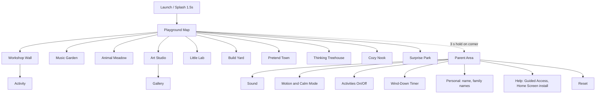

# Layla Board: Research and Product Specification (v1.0, 27 Oct 2026)

> Imported from the research artifact https://claude.ai/artifact/AAcfCR9rtzHZ74EaaXzME1 on 28 Oct 2026.
> This is the second, fuller research pass (49 activities, 21 in Release 1). It complements
> `LAYLA_BOARD_RESEARCH_AND_SPEC.md`; where they differ, this document is newer.

**Project:** Layla Board (repository `lboard`) **Audience for this document:** the coding agent and any human developer building the app **Version:** 1.0, 27 October 2026 **Status:** Authoritative specification. Where this document and a later chat instruction conflict, the later instruction from the parent wins.

---

## How to Read This Document

Every recommendation carries one of three evidence tags so the builder knows how much weight it can bear:

| Tag                                       | Meaning                                                                                                                 | How to treat it                                                         |
|-------------------------------------------|-------------------------------------------------------------------------------------------------------------------------|-------------------------------------------------------------------------|
| `[E]` Evidence   | Backed by peer-reviewed research, a professional body (AAP, CPS, NAEYC), a standard (WCAG), or platform documentation   | Treat as a requirement unless testing with Layla clearly contradicts it |
| `[P]` Practice   | Consistent pattern in award-winning preschool apps or published designer guidance, without controlled studies behind it | Strong default; can be changed after playtesting                        |
| `[H]` Hypothesis | Our design judgment, informed by the above but not directly tested                                                      | Build it, then validate in playtests (Section 19)                       |

Source references look like **\[S12\]** and resolve to the bibliography in Section 3.

Requirement keywords: **MUST** (release blocker), **SHOULD** (expected unless there is a documented reason), **MAY** (optional).

---

## 1. Executive Summary

Layla Board is a private, offline, ad-free iPad playground for one four-year-old. It runs as a Home Screen web app with no backend, no accounts, and no tracking. The original busy-board concept stays at the heart of it, and grows into ten themed play areas holding 49 specified activities, of which **21 ship in Release 1** so the first version already feels like a full playroom.

### What the Research Says, in Seven Points

1.  **Time and company matter more than any feature.** Both the Canadian Paediatric Society and the AAP recommend keeping routine screen time for 2 to 5 year olds under about an hour a day and favour adults playing alongside \[S1\]\[S2\]\[S4\]. Layla Board is built to support short, shared sessions, and it never tries to extend them.
2.  **Manipulative design is the industry norm and must be designed out.** In a study of apps used by 160 children aged 3 to 5, only 20% had no manipulative features such as parasocial pressure, fake timers, navigation traps, and lures to keep playing \[S10\]. Layla Board has none of these by specification.
3.  **Pace matters.** Four-year-olds showed weaker executive function right after nine minutes of a fast-paced cartoon compared with slower educational TV or drawing \[S12\]. Our motion and sound budgets are deliberately calm.
4.  **Tapping is easy; dragging is hard; pinching and rotating are harder still.** Research on preschool touch input shows tap and slide are reliable, drag is error-prone under age five (fingers lift mid-drag), and pinch/rotate are the hardest \[S14\]\[S16\]\[S22\]. Every Layla Board drag has a tap-and-tap fallback, and no core interaction needs pinch or rotate.
5.  **Young children do not read informal symbols.** Progress bars, mini-maps, and abstract icons often mean nothing to preschoolers \[S20\]. Navigation uses pictures of the actual destination plus spoken labels.
6.  **The best preschool apps are toys, not tests.** Pok Pok, Toca Boca, and Sago Mini share a philosophy: no winning, no losing, no text, child-led play \[S25\]\[S27\]\[S28\]. Structured apps like Khan Academy Kids show measurable literacy gains when the learning goal is clear \[S29\]. Layla Board blends both, weighted towards open-ended play.
7.  **Digital is not a substitute for real materials.** Children learned more when an adult taught alongside an app or a physical puzzle than from the app alone, and only time with the physical puzzle predicted learning a week later \[S13\]. "Montessori-inspired" here is a visual and pedagogical influence, not a claim of equivalence.

### What We Recommend Building

- **Platform:** Vite + TypeScript + React 19, SVG for most scenes, Canvas 2D for painting and particles, a small hand-written Web Audio engine, and a Workbox service worker. Hosted on Netlify (preferred) or GitHub Pages. (Section 15)
- **Shape of the app:** A Playground Map home screen with ten illustrated "rooms." Tap a room, see two to six toys, tap a toy, play. Maximum navigation depth is two taps from home. (Section 10)
- **Release 1 (21 activities across all 10 areas):** Light Switch Wall, Door and Latch Panel, Gear Wall, Rainbow Xylophone, Drum Circle, Animal Band Mixer, Barn Doors Peekaboo, Feed the Friends, Finger Paint, Stamp Pad, Magic Mirror, Colour Mixing Pots, Sink or Float Tub, Shape Pictures, Little Kitchen, Teddy Care Clinic, Counting Critters, Letter Friends, Breathing Balloon, Starry Night, Bubble Pop Field. (Section 20)
- **Parent area:** reached by a three-second hold on a corner icon. Sound, separate music and effects volume, reduced motion, calm mode, per-activity visibility, gentle wind-down timer, reset, plus Guided Access and Home Screen instructions. (Section 14)

### Top Three Technical Risks

1.  **iPadOS Web Audio is fragile** after backgrounding and in Home Screen apps; WebKit has open bugs where audio silently stops \[S38\]\[S41\]\[S42\]. Mitigation is specified in Section 16.4.
2.  **Illustration production** is the largest effort item. The visual system (Section 12) is designed so shapes can be built as code-friendly flat SVG rather than hand-painted art.
3.  **Scope.** 49 activities is a library, not a backlog. Release 1 caps at 21; anything else waits for playtest evidence.

---

## 2. Research Methodology

### 2.1 Questions We Set Out to Answer

1.  What do professional bodies say about tablet use for ages 3.5 to 5, and how should that shape product limits?
2.  Which properties of apps predict learning or wellbeing, and which predict harm?
3.  What can preschool hands reliably do on a touchscreen?
4.  What do the best-regarded preschool apps do well, and where do they slip into manipulation?
5.  What are the real constraints of iPadOS Safari Home Screen apps in 2026 (audio, storage, gestures, orientation)?

### 2.2 Source Types and Priority

| Priority | Source type                      | Examples used                                                                                                                                                                                         |
|----------|----------------------------------|-------------------------------------------------------------------------------------------------------------------------------------------------------------------------------------------------------|
| 1        | Professional guidance            | Canadian Paediatric Society 2022 statement, AAP "Media and Young Minds," NAEYC and Fred Rogers Center joint statement                                                                                 |
| 2        | Peer-reviewed research           | JAMA Network Open (Radesky 2022), Pediatrics (Lillard and Peterson 2011), Psychological Science in the Public Interest (Hirsh-Pasek 2015), IDC/CHI/IJHCS papers from the UW CHiLL Lab and UF INIT Lab |
| 3        | Standards and platform docs      | WCAG 2.2, Apple support and HIG, MDN, WebKit Bugzilla                                                                                                                                                 |
| 4        | Practitioner and product sources | Pok Pok press kit and founder interviews, Sago Mini and Toca Boca designer interviews, Common Sense Media reviews, App Store listings                                                                 |
| 5        | Secondary summaries              | Used only to locate primary material, and flagged where relied on                                                                                                                                     |

### 2.3 Method

- Searched each topic area with targeted queries, then traced claims back to the originating paper or organization where possible.
- Recorded each finding with its evidence strength and whether it was measured in the target age group. Several key touch studies used children aged 5 to 10; where a finding is extrapolated down to age four, it is marked.
- Analysed competitor apps through their own published design philosophy, independent reviews (Common Sense Media, Educational App Store), and App Store listings, rather than by copying any interface.
- Built a weighted scoring model for activities and computed it in code so rankings are reproducible (Section 8).

### 2.4 Limitations

- Most screen-time evidence is about video, not interactive play. The Lillard study measured television, and its effect on interactive apps is an extrapolation `[H]`.
- AAP policy statements expire five years after publication unless reaffirmed \[S4\]; "Media and Young Minds" (2016) is still the most cited AAP statement for this age group, but the builder should not quote its specifics as current AAP policy without checking aap.org.
- Some competitor details (Crayola Create and Play, Montessori busy-board apps) come from general product knowledge rather than fresh sources in this round and are marked as such.
- Research on iPadOS PWA storage eviction is inconsistent between sources (Section 16.6). The design tolerates either behaviour.
- No user research with Layla has happened yet. Section 19 defines how to run it.

---

## 3. Source Bibliography

All links were checked as reachable at the time of research (October 2026).

### Professional Guidance

- **\[S1\]** Canadian Paediatric Society, Digital Health Task Force. *Screen time and preschool children: Promoting health and development in a digital world* (November 2022), index page: https://cps.ca/tools-outils/digital-media-and-screen-time
- **\[S2\]** Canadian Paediatric Society. *Screen time: A clinician's guide to counselling parents of young children* (the "4 Ms"): https://cps.ca/uploads/tools/CPS_ScreenTime-EN.pdf
- **\[S3\]** Canadian Paediatric Society blog, *We need to talk: Rethinking our relationship with screens* (Nov 2022): https://cps.ca/en/blog-blogue/we-need-to-talk-rethinking-our-relationship-with-screens
- **\[S4\]** AAP Council on Communications and Media. *Media and Young Minds*. Pediatrics 138(5), 2016. DOI: https://doi.org/10.1542/peds.2016-2591 (summary PDF: https://www.health.mn.gov/docs/people/wic/localagency/topicmonth/media.pdf)
- **\[S5\]** NPR coverage of the 2016 AAP guidelines: https://www.wuwf.org/2016-10-20/american-academy-of-pediatrics-lifts-no-screens-under-2-rule
- **\[S6\]** NAEYC and Fred Rogers Center. *Technology and Interactive Media as Tools in Early Childhood Programs Serving Children from Birth through Age 8* (2012): https://www.naeyc.org/node/1366 ; key messages: https://www.fredrogersinstitute.org/resources/key-messages-of-the-naeyc/fred-rogers-center-position-statement-on-technology-and-interactive-media-in-early-childhood-programs
- **\[S7\]** NAEYC, *Technology and Interactive Media* (Young Children, Sept 2017): https://www.naeyc.org/resources/pubs/yc/sep2017/technology-and-interactive-media

### Learning Science and Child Development

- **\[S8\]** Hirsh-Pasek, K., Zosh, J. M., Golinkoff, R. M., Gray, J. H., Robb, M. B., and Kaufman, J. (2015). *Putting Education in "Educational" Apps: Lessons From the Science of Learning*. Psychological Science in the Public Interest 16(1). Summary: https://www.psychologicalscience.org/?p=111346 ; record: https://pure.psu.edu/en/publications/putting-education-in-educational-apps-lessons-from-the-science-of/
- **\[S9\]** Bold Science summary of the four pillars, including the point that touch actions alone do not count as "active" learning: https://boldscience.org/what-makes-an-app-educational/
- **\[S12\]** Lillard, A. S., and Peterson, J. (2011). *The Immediate Impact of Different Types of Television on Young Children's Executive Function*. Pediatrics 128(4):644 to 649. https://pmc.ncbi.nlm.nih.gov/articles/PMC9923845 ; DOI 10.1542/peds.2010-1919
- **\[S13\]** Eisen, S., and Lillard, A. S. (2019). *Learning from apps and objects: The human touch*. Mind, Brain, and Education. Summary: https://boldscience.org/?p=5482 ; poster: https://amshq.org/wp-content/uploads/2019/02/learning-from-apps-and-objects-the-human-touch-2018-conference.pdf
- **\[S45\]** Hiniker, A., Suh, H., Cao, S., and Kientz, J. A. (2016). *Screen Time Tantrums: How Families Manage Screen Media Experiences for Toddlers and Preschoolers*. CHI 2016. Project page: https://depts.washington.edu/chilllab/?p=178 ; press summary: https://www.washington.edu/news/2016/05/05/two-minute-warnings-make-kids-screen-time-tantrums-worse/

### Manipulative Design

- **\[S10\]** Radesky, J., Hiniker, A., McLaren, C., et al. (2022). *Prevalence and Characteristics of Manipulative Design in Mobile Applications Used by Children*. JAMA Network Open 5(6):e2217641. Summary: https://deceptive.design/articles/prevalence-and-characteristics-of-manipulative-design-in-mobile-applications-used-by-children ; press: https://michiganmedicine.org/health-lab/design-tricks-commonly-used-monetize-young-childrens-app-use
- **\[S11\]** Radesky, J. Testimony to the US Senate Commerce Committee (cites Meyer et al., *How educational are "educational" apps for young children?*): https://www.commerce.senate.gov/services/files/4D82755F-D188-46F8-B063-DAC676ADCC5E

### Touch Interaction and Child-Computer Interaction

- **\[S14\]** Anthony, L., Hiniker, A., and Kientz, J. A. *Playful Interfaces: Designing Interactive Experiences for Children*. UXPA Magazine: https://oldmagazine.uxpa.org/?p=11776 ; bibliography: https://init.cise.ufl.edu/wp-content/uploads/sites/378/2018/06/anthony-hiniker-kientz-uxpa2018-bibliography.pdf
- **\[S15\]** Anthony, L. (2019). *Physical dimensions of children's touchscreen interactions: Lessons from five years of study on the MTAGIC project*. IJHCS. Preprint: https://init.cise.ufl.edu/wp-content/uploads/sites/378/2019/03/anthony-et-al-IJHCS2019-MTAGIC-final-preprint.pdf
- **\[S16\]** Study of 42 children aged 18 to 42 months using touch devices (CHI PLAY 2018), DOI 10.1145/3242671.3242693: https://unpaywall.org/10.1145%2F3242671.3242693
- **\[S17\]** Cassidy, B. (2009). Drag-and-drop study findings for children (Jammo project): https://garage.maemo.org/pipermail/jammo-ux-core/2009-March/000005.html
- **\[S18\]** Sesame Workshop. *Best Practices: Designing Touch Tablet Experiences for Preschoolers*, summary via Joan Ganz Cooney Center: https://joanganzcooneycenter.org/?p=19607
- **\[S19\]** Hiniker, A., et al. (2015). *Touchscreen Prompts for Preschoolers*. IDC 2015: https://depts.washington.edu/chilllab/?p=186
- **\[S20\]** Hiniker, A., et al. (2016). *Hidden symbols: How informal symbolism in digital interfaces disrupts usability for preschoolers*. IJHCS 90:53 to 67: https://faculty.washington.edu/alexisr/HiddenSymbols.pdf
- **\[S21\]** Chen, et al. (2020). Children's cognitive and motor development and touchscreen interaction (ICMI 2020): https://init.cise.ufl.edu/wp-content/uploads/sites/378/2017/03/chen-et-al-ICMI2020.pdf
- **\[S22\]** *Ability of children to perform touchscreen gestures and follow prompting techniques when using mobile apps* (Korean Pediatric Society, 2020; 90 children aged 2 to 8): https://oalib-perpustakaan.upi.edu/Record/doaj_882f4a54da2249d9a2b669eea2a5ca9d/Details
- **\[S23\]** Woodward, J., et al. (2020). *Examining Fitts' and FFitts' Law Models for Children's Pointing Tasks on Touchscreens*. AVI 2020: https://init.cise.ufl.edu/wp-content/uploads/sites/378/2021/05/woodward-et-al-AVI2020.pdf
- **\[S24\]** Hourcade, J. P., Bederson, B. B., and Druin, A. *Accuracy, Target Reentry and Fitts' Law Performance of Preschool Children Using Mice*: https://drum.lib.umd.edu/handle/1903/535

### Products Studied

- **\[S25\]** Pok Pok press kit: https://www.playpokpok.com/press/press-kit/ ; Educational App Store review: https://www.educationalappstore.com/app/pok-pok
- **\[S26\]** Pok Pok founders interview: https://joinhampton.com/blog/from-disney-designer-to-app-store-royalty
- **\[S27\]** *The Toca Boca Story* (interview excerpts): https://collect.readwriterespond.com/toca-boca-story ; Kill Screen on Toca Boca design: https://www.killscreen.com/what-designers-can-learn-about-play-children/ ; Common Sense review of Toca Life City: https://www.commonsensemedia.org/app-reviews/toca-life-city
- **\[S28\]** Sago Sago interview, Kidscreen (2015): https://kidscreen.com/2015/04/09/sago-sago-dishes-on-developing-for-the-preschool-market ; Sago Mini overview: https://en.wikipedia.org/wiki/Sago_Mini ; Jinja's Garden Apple Design Award 2026 coverage: https://gori.me/en/apps/ipad-app-news/167337/
- **\[S29\]** Khan Academy Kids RCT (UMass Amherst): https://blog.khanacademy.org/khan-academy-kids-improves-pre-literacy-skills-in-preschoolers-research-confirms/ ; EdWeek coverage: https://www.edweek.org/leadership/khan-app-boosted-early-literacy-parent-teaching-in-small-trial/2020/05
- **\[S30\]** Common Sense Media review, Endless Alphabet: https://www.commonsensemedia.org/app-reviews/endless-alphabet
- **\[S31\]** Bimi Boo Learning Academy App Store listing: https://apps.apple.com/app/id1475467785
- **\[S46\]** PBS KIDS Games, Common Sense review: https://www.commonsensemedia.org/app-reviews/pbs-kids-games ; Educational App Store review: https://www.educationalappstore.com/app/pbs-kids-games
- **\[S47\]** LEGO DUPLO World, Common Sense review: https://www.commonsensemedia.org/app-reviews/lego-duplo-world ; Educational App Store review: https://www.educationalappstore.com/app/lego-duplo-world

### Standards and Platform

- **\[S33\]** W3C, *Understanding SC 2.3.1 Three Flashes or Below Threshold*: https://www.w3.org/WAI/WCAG21/Understanding/three-flashes-or-below-threshold
- **\[S34\]** W3C, *Understanding SC 2.5.8 Target Size (Minimum)*: https://www.w3.org/WAI/WCAG22/Understanding/target-size-minimum.html
- **\[S35\]** Apple HIG 44 by 44 point minimum hit target (secondary summary): https://app.uxcel.com/courses/mobile-design/ios-app-design-712/minimum-tap-target-size-8996
- **\[S36\]** Apple Support, *Use Guided Access with iPhone or iPad*: https://support.apple.com/en-us/ht202612 ; iPad User Guide: https://support.apple.com/en-au/guide/ipad/ipada16d1374/ios
- **\[S37\]** iOS 26 and iPadOS 26 Home Screen web app behaviour (heise): https://heise.de/-10749652 ; commentary: https://mjtsai.com/blog/?p=49472
- **\[S38\]** WebKit Bug 291892, AudioContext silent in Home Screen web apps after relaunch: https://bugs.webkit.org/show_bug.cgi?id=291892
- **\[S39\]** WebKit Bug 251532, Web Audio muted by silent switch; `navigator.audioSession.type = 'playback'` workaround: https://bugs.webkit.org/show_bug.cgi?id=251532
- **\[S40\]** MDN, *AudioSession: type property*: https://developer.mozilla.org/en-US/docs/Web/API/AudioSession/type
- **\[S41\]** WebKit Bug 283419, AudioContext stays "running" but silent after interruption: https://bugs.webkit.org/show_bug.cgi?id=283419
- **\[S42\]** WebKit Bug 263627, AudioContext not consistently resumed on foreground: https://bugs.webkit.org/show_bug.cgi?id=263627
- **\[S43\]** unmute.js (reference technique, not a recommended dependency): https://github.com/swevans/unmute
- **\[S44\]** iOS PWA limitations overview (secondary, used cautiously): https://www.magicbell.com/blog/pwa-ios-limitations-safari-support-complete-guide

---

## 4. Child Development Findings

### 4.1 Screen Use Guidance for Ages 3.5 to 5

| Finding                                                                                                                                                                                       | Source       | Tag | Design consequence                                                                                     |
|-----------------------------------------------------------------------------------------------------------------------------------------------------------------------------------------------|--------------|-----|--------------------------------------------------------------------------------------------------------|
| CPS recommends limiting routine screen time for ages 2 to 5 to under one hour per day, avoiding screens in the hour before bed, and following the 4 Ms: minimize, mitigate, be mindful, model | \[S1\]\[S2\] | E   | Optional parent wind-down timer; optional "bedtime lock" window; no feature that stretches sessions    |
| AAP: for ages 2 to 5, about one hour a day of high-quality content, with adults co-viewing or co-playing                                                                                      | \[S4\]\[S5\] | E   | Activities support two people at once (multitouch, shared instruments); parent tips in the parent area |
| NAEYC and Fred Rogers Center: technology helps when used intentionally and appropriately, as a tool among many                                                                                | \[S6\]\[S7\] | E   | Every activity has a stated play value; parent area suggests an off-screen follow-up per activity      |
| Children learn more from an app when an adult engages alongside; a physical puzzle was more efficient than the app equivalent                                                                 | \[S13\]      | E   | Never claim digital equivalence to Montessori materials; include "Try it for real" ideas for parents   |
| Transitions away from screens go better with routines and natural stopping points, and worse with a parent's two-minute warning; technology-mediated endings were more successful             | \[S45\]      | E   | Wind-down is delivered by the app as a story ending (characters yawn, lights dim), not as a countdown  |

### 4.2 What Makes Interactive Play Valuable

Hirsh-Pasek and colleagues identify four pillars that predict learning: **active** (minds-on, not just tapping), **engaged** (not distracted by bells and whistles), **meaningful** (connected to the child's life), and **socially interactive**, all in service of a learning goal \[S8\]. Physical actions alone, such as tapping or tilting, do not count as active learning \[S9\].

**Design consequences:** - Every activity must invite a decision or prediction from the child (which colour next, what will this switch do, where will the water go). Tap-anything-for-noise is allowed in the Surprise area only. - Decorative animation that is not caused by the child is limited (Section 13). - Content draws from Layla's real world: her name, kitchen, bath, pets, weather outside. Personalization is local and parent-entered. - Two-player affordances (two drummers, two painters) support social play with a parent.

### 4.3 Developmental Domains at This Age

The table summarizes typical capabilities around ages 3.5 to 5 and how they shape design. These are well-established developmental norms; specific ages vary widely between children **\[E for broad norms, H for exact thresholds\]**.

| Domain                      | Typical capability (3.5 to 5)                                                           | Design response                                                                                          |
|-----------------------------|-----------------------------------------------------------------------------------------|----------------------------------------------------------------------------------------------------------|
| Fine motor                  | Reliable taps and slides; drags often break; pinch and rotate unreliable \[S16\]\[S22\] | Tap-first, drag optional, no required pinch or rotate                                                    |
| Cause and effect            | Strong interest in "what happens if"; repeats actions to confirm results                | Consistent, immediate, repeatable responses; same action, same result (with occasional delight variants) |
| Creativity and pretend      | Rich pretend play, narratives, role play                                                | Open-ended kitchens, clinics, shops; no correct answers                                                  |
| Music and rhythm            | Can keep a simple beat with support; enjoys call and response                           | Pentatonic instruments (nothing sounds wrong); echo games without failure                                |
| Colour, shape, space        | Names basic colours and shapes; learning spatial words (on, under, next to)             | Spoken labels on touch; building and mixing activities                                                   |
| Numeracy                    | Counts small sets; subitizes 1 to 4; learning one-to-one correspondence                 | Counting up to 10 with spoken numbers; objects move as they are counted                                  |
| Literacy                    | Recognizes own name and some letters; phonological play                                 | Name builder with her name, letter sounds, rhymes; no reading required anywhere                          |
| Memory and sequence         | Can follow 2 to 3 step sequences                                                        | Pattern Train (AB, AAB), recipes in Little Kitchen with picture steps                                    |
| Emotion and self-regulation | Naming feelings, beginning strategies for calming                                       | Feelings Faces, Breathing Balloon, Calm Corner                                                           |
| Attention                   | Short focused bouts; easily overwhelmed by competing stimuli \[S12\]                    | One focal element at a time, quiet idle states, no attract loops                                         |

### 4.4 Open-Ended Versus Structured Play

Both have value. Open-ended play builds agency, creativity, and persistence without fear of failure; this is the core philosophy of Pok Pok, Toca Boca, and Sago Mini \[S25\]\[S27\]\[S28\]. Structured play with clear goals can produce measurable learning gains, as in the Khan Academy Kids trial where pre-literacy scores rose from the 34th to 47th percentile over ten weeks \[S29\].

**Recommendation:** About 75% of activities are open-ended. The remaining 25% (Early Learning, a few Science items) have a soft goal, but failure is never punished: wrong choices produce a gentle, interesting response and the child can always keep playing `[P]`.

### 4.5 Feedback for Four-Year-Olds

- Respond within 100 ms of touch, visually and with sound **\[H, informed by S17 on feedback during drag\]**.
- Praise the act, not the child, and keep it brief. No "Great job!" after every tap; open-ended play rewards itself through the result **`[P]`\[S25\]**.
- Use natural consequences ("the tower falls, the blocks bounce") instead of buzzers or red X marks **`[P]`\[S47\]**.
- Novices learn gestures from animated demonstrations more readily than from symbols; Hiniker's work found audio cues suited 2-year-olds while 5-year-olds benefited from visual demonstration \[S19\]\[S21\]. Layla Board uses both: a looping ghost-hand demo plus a short spoken hint, only after five seconds without interaction.

### 4.6 Sensory Load and Calm

Fast pacing can reduce executive function immediately afterwards \[S12\]. Pok Pok reports that calm, handmade art and gentle sound particularly help neurodivergent children regulate \[S25\]. Layla Board defaults to calm and lets the parent turn intensity down further (Calm Mode), never up beyond defaults.

---

## 5. Competitive App Analysis

### 5.1 Summary Table

| Product                                            | Model                                        | Core strength                                                                         | Main weakness for our purpose                                 | Manipulative patterns observed                            | Key lesson                                             |
|----------------------------------------------------|----------------------------------------------|---------------------------------------------------------------------------------------|---------------------------------------------------------------|-----------------------------------------------------------|--------------------------------------------------------|
| **Pok Pok**                                        | Subscription, no ads                         | Calm, wordless, no failure; "curiosity rewarded with play, not prizes" \[S25\]        | Subscription; less structured learning                        | None reported                                             | Calm art and sound, toy metaphor, no menus or language |
| **Toca Boca (Kitchen, Life, World)**               | Paid apps, then free-to-play World with shop | Open-ended toys; "no winning, no losing, no stress, no high scores, no rules" \[S27\] | Toca Boca World has an in-app shop for new content            | In-app shop lures in World (not in the older single apps) | Kitchen-style cause and effect, silly reactions        |
| **Sago Mini (World, School)**                      | Subscription (Piknik) \[S28\]                | No text or voiceover, autonomy and ownership, weekly playtests \[S28\]                | Content locked behind subscription                            | Subscription upsell outside child area                    | Wordless design, character warmth, playtesting cadence |
| **Khan Academy Kids**                              | Free, nonprofit                              | Evidence of learning gains in an RCT \[S29\]                                          | Linear path can feel like school; lots of narration           | Minimal; some reward collectibles                         | Clear learning goals, scaffolding difficulty           |
| **PBS KIDS Games**                                 | Free, no ads, no IAP \[S46\]                 | Huge library, offline download, curriculum-backed                                     | Branded characters dominate; navigation dense for 4-year-olds | Character pull can stretch sessions (parent-reported)     | Free can be ethical; offline-first                     |
| **LEGO DUPLO World**                               | Freemium plus subscription \[S47\]           | Open-ended building, no buzzers or negative feedback \[S47\]                          | Locked content visible to kids drives purchase requests       | Locked packs shown in child view                          | Never show locked or purchasable content to a child    |
| **Endless Alphabet**                               | Paid                                         | Monsters act out word meanings; self-paced; delightful \[S30\]                        | Drag-and-drop letters is hard for younger children            | None notable                                              | Animation that explains meaning is memorable           |
| **Bimi Boo**                                       | Subscription, no ads \[S31\]                 | 1,500+ activities, learning path, progress tracking \[S31\]                           | Some reviews report frustration; breadth over depth           | Learning path and progress tracking encourage "one more"  | Variety is not the same as depth                       |
| **Crayola Create and Play** (product knowledge)    | Subscription                                 | Rich art tools, colouring                                                             | Busy interface, many menus                                    | Subscription prompts                                      | Art tools need very few options to be usable           |
| **Montessori busy-board apps** (product knowledge) | Mostly free with ads                         | Simple cause and effect                                                               | Often ad-supported and visually cluttered                     | Ads, interstitials                                        | The concept works; the execution usually does not      |

### 5.2 Detailed Notes

**Pok Pok.** Won the 2021 Apple Design Award and a 2023 App Store Award \[S25\]. Its press kit states there are no rules, instructions, menus, or language, and no possibility for failure \[S25\]. Founders compare it to art supplies, wooden blocks, or a marble run: no right or wrong way to use them \[S26\]. A grown-ups area holds play guidance and offline ideas \[S25\]. *Learn:* a single consistent sound and art language across every toy; toy metaphors; offline activity tips for parents. *Avoid:* nothing to avoid ethically, but Layla Board should be warmer and more personal (her name, her family) than a mass-market product can be.

**Toca Boca.** The company framed its business as digital toys with strict parameters around open play \[S27\]. Toca Kitchen's strength is food that reacts silly and differently to each cooking method and character. Common Sense notes the open-ended, kids-in-charge play but also limitations in depth \[S27\]. *Learn:* combinatorial cause and effect (ingredient times tool times character) creates replay without content volume. *Avoid:* shop-driven content expansion.

**Sago Mini.** Built without text or voiceover, centred on autonomy and ownership \[S28\]. Its Jinja's Garden won an Apple Design Award in 2026 for interaction, built wordless for four-year-olds after three years of child testing \[S28\]. *Learn:* wordless navigation works for this age; test with real children often. *Avoid:* consolidating into subscription bundles that put locked content in front of children.

**Khan Academy Kids.** In a randomized trial with about 50 four and five year olds from low-income families, ten weeks of home use at about 13 minutes a day moved pre-literacy scores from roughly the 34th to 47th percentile \[S29\]. Researchers credited interest, scaffolding, and appropriate difficulty \[S29\]. *Learn:* short daily sessions can be enough; scaffolding matters. *Avoid:* making the whole app a lesson path.

**PBS KIDS Games.** Free, ad-free, no in-app purchases, offline downloads \[S46\]. *Learn:* ethical design is possible without monetization pressure. *Avoid:* dense multi-character menus that a four-year-old cannot parse alone.

**LEGO DUPLO World.** Praised for no wrong answers, buzzers, or negative feedback \[S47\]. Common Sense flags in-app purchases and notes each scene has only a few parts to play with \[S47\]. User reviews describe meltdowns when new paid packs appear (secondary). *Learn:* building with snapping pieces; no failure states. *Avoid:* showing locked content to children.

**Endless Alphabet.** Common Sense calls it simple yet powerful, self-paced, and more vocabulary than alphabet \[S30\]. *Learn:* animated meaning makes words stick. *Avoid:* drag-only letter placement; we add tap-to-place.

**Bimi Boo.** Over 1,500 activities with a learning path and parent progress tracking \[S31\]. *Learn:* parents value seeing what a child played. *Avoid:* progress tracking that becomes a completion treadmill. Layla Board shows the parent a simple "recently played" list only, with no scores.

### 5.3 Manipulative Patterns to Ban

From Radesky et al. \[S10\], these are prohibited in Layla Board:

| Pattern                           | Example in the wild                      | Layla Board rule                                                         |
|-----------------------------------|------------------------------------------|--------------------------------------------------------------------------|
| Parasocial relationship pressure  | Character looks sad when you leave       | Characters never react to leaving; goodbye is neutral or cheerful        |
| Fabricated time pressure          | Timers, "hurry!"                         | No timers in child-facing play                                           |
| Navigation constraints            | Hidden or delayed exit                   | Home button always visible and always works in one tap                   |
| Lures and rewards to keep playing | Unlockables, streaks, daily gifts, stars | No currency, no unlocks, no streaks, no collectibles that grow over time |
| Advertising and purchase prompts  | Ads, shop                                | None, ever                                                               |
| Autoplay into next activity       | Next game starts automatically           | Activities never chain; the child chooses                                |

### 5.4 Opportunities for a Distinct Experience

1.  **Personal.** Layla's name in Letter Friends, her own colour palette pick, a parent-recorded voice line (Release 3). No commercial app can be this personal.
2.  **Physical-feeling busy board.** Most apps abandoned realistic mechanisms. Satisfying switches, latches, and gears with tactile sound design are an underserved niche.
3.  **Calm by default.** A playground that is bright but never loud.
4.  **Shared play.** Two-handed and two-person instruments and art designed for parent co-play, which the AAP recommends \[S4\].
5.  **Honest endings.** A built-in story-style wind-down, informed by \[S45\].

---

## 6. Design Principles

These ten principles decide every ambiguous call. If a feature violates one, it does not ship.

1.  **Toy, not test.** Every activity is fun to touch before it teaches anything. **`[P]`\[S25\]\[S27\]**
2.  **Every touch answers.** Visual response within 100 ms and audio within 50 ms of the touch, always. `[H]`
3.  **Nothing to read.** Navigation and instructions work with zero reading. Text appears only as content (letters, her name). **`[E]`\[S20\]\[S28\]**
4.  **Tap first.** All goals are reachable by tapping. Drag is a bonus path, never the only path. **`[E]`\[S14\]\[S22\]**
5.  **Big and forgiving.** Hit areas at least twice Apple's adult minimum, generous snapping, no penalties for near misses. **`[E]`\[S15\]\[S35\]**
6.  **No wrong, only different.** Mistakes produce interesting results, never buzzers or red marks. **`[P]`\[S47\]**
7.  **Calm is the default.** One focal motion at a time, no idle attract loops, no flashing. **`[E]`\[S12\]\[S33\]**
8.  **The child decides when to go.** No timers, streaks, unlocks, or emotional pressure; exits are always one tap. **`[E]`\[S10\]**
9.  **Better together.** Multitouch everywhere it makes sense so a parent can play too. **`[E]`\[S4\]\[S13\]**
10. **Private and offline.** No network calls during play, no analytics, no external links in the child area. **\[Requirement\]**

---

## 7. Activity Catalogue

### 7.0 Conventions for Every Activity

- **Complexity:** S (1 to 2 dev days), M (3 to 5 days), L (6 to 10 days), excluding illustration time.
- **Priority:** R1 = Release 1, R2 = Release 2, R3 = Release 3, Backlog.
- **Gestures:** "Tap" includes a press with up to 12 pt of finger wander. "Tap-tap" means tap an object to pick it up, then tap a destination to place it. Every drag below also supports tap-tap (Section 9.3).
- **Shared rules:** all activities follow Section 9 (interaction), Section 13 (audio and motion budgets), and Section 14 (safety). These are not repeated per activity.
- **Idle hint:** after 5 s with no touch, a ghost hand demonstrates one possible action once, then stays quiet for 30 s **`[H]`\[S19\]**.
- **Every activity is reachable in two taps from home and exits in one tap.**

---

### Area A. Workshop Wall (Digital Busy Board)

A warm wooden-toned wall in a sunny workshop. Each activity is a panel the camera zooms into.

#### A1. Light Switch Wall

- **Description:** A row of chunky switches (rocker, toggle, pull cord, push button, dimmer slider) each wired to something in a little dollhouse cutaway: ceiling lamp, fairy lights, fish tank light, porch lantern, night sky window.
- **Play value:** Cause and effect, mapping controls to outcomes, prediction ("which switch is the fish tank?"), on/off concept.
- **Mechanics:** Tapping a switch flips it with a mechanical throw; its wire glows briefly from switch to target and the target turns on. The dimmer slides continuously. Turning all lights off makes the room go to night, and a sleepy cat opens its eyes (two glowing dots) as a surprise.
- **Expected behaviour:** Rapid toggling, then deliberate testing of each switch, then hunting for the all-off night surprise.
- **Gestures:** Tap (switches, cord); slide (dimmer, with tap-on-track to jump).
- **Visual:** Oversized switches about 120 pt tall with bevelled plastic and metal plates; cutaway house with warm/cool lighting states.
- **Sound:** Distinct click per switch type (rocker thunk, toggle snap, cord zip-click), soft electrical hum when lamp is on, cat purr at night.
- **Feedback and animation:** Switch throw 90 ms with overshoot; wire glow travel 250 ms; room lighting crossfade 300 ms (never a flash).
- **Outcome model:** Open-ended.
- **Difficulty and accessibility:** Very easy. Lighting changes crossfade to avoid flashes; reduced motion removes wire travel.
- **Complexity:** S.
- **Safari notes:** Use SVG with CSS filter-free lighting (opacity overlays) to keep 60 fps; avoid `filter: blur()` on large layers.
- **Priority:** R1.
- **Evidence:** Cause-and-effect focus and tap reliability \[S14\]\[S22\]; flash safety \[S33\].

#### A2. Door and Latch Panel

- **Description:** A panel of six little doors, each closed with a different mechanism: sliding bolt, hook-and-eye, turn latch, magnetic catch, push-to-open cupboard, flip-up hatch. Behind each is a small surprise (a friendly animal, a toy, an echo).
- **Play value:** Fine motor sequencing (undo latch, then open), object permanence and anticipation, peekaboo joy.
- **Mechanics:** Mechanism first, then door. Bolt slides with a short slide or a tap (auto-slides). Door swings open with a creak. Contents rotate from a pool of 30 so repeat visits differ.
- **Expected behaviour:** Opening every door, closing them, reopening to see if the surprise changed.
- **Gestures:** Tap; optional short slide on bolts.
- **Visual:** Painted wooden doors in six palette colours, brass hardware, chunky hinges.
- **Sound:** Bolt scrape, latch clink, creak, a short character sound from inside.
- **Feedback and animation:** Door swing with 3D-ish skew (CSS `rotateY` on a flat SVG) 350 ms; peeking character blink.
- **Outcome model:** Open-ended.
- **Difficulty and accessibility:** Two-step mechanisms add gentle challenge; tap alone always completes the latch.
- **Complexity:** M (content pool).
- **Safari notes:** `transform-style: preserve-3d` is fine on iPadOS; keep perspective on a wrapper, not per frame.
- **Priority:** R1.
- **Evidence:** Two-step actions within preschool capability \[S22\]; peekaboo surprise is a classic early childhood pattern `[P]`.

#### A3. Zipper and Buckle Pouch

- **Description:** A fabric pouch with a big zipper, a side-release buckle, a snap button, and a velcro flap. Undoing each reveals pocket contents (shells, buttons, a tiny note with a drawing).
- **Play value:** Self-care fine motor practice (mirrors real dressing skills), persistence.
- **Mechanics:** Zipper pull follows the finger along its track; letting go keeps position (no snapping back). Tap on the pull auto-zips in either direction. Buckle opens by tapping both side tabs (two fingers) or one tab twice.
- **Expected behaviour:** Zipping back and forth for the sound.
- **Gestures:** Slide along a constrained path (forgiving: finger may wander 60 pt off track); tap.
- **Visual:** Felt textures, stitched edges.
- **Sound:** Rich zip sound that pitches with speed; buckle click; velcro rip.
- **Feedback and animation:** Fabric bulge along the zip; contents tumble out softly.
- **Outcome model:** Open-ended.
- **Difficulty and accessibility:** Constrained-path dragging is easier than free drag; still offers tap fallback.
- **Complexity:** M.
- **Safari notes:** Zip sound should be a granular loop with `playbackRate` tied to speed; clamp rate changes to avoid clicks.
- **Priority:** R3.
- **Evidence:** Drag losses under age 5 \[S14\] motivate constrained path plus tap fallback. Real zippers matter more than digital ones; parent tip suggests a real zipper board \[S13\].

#### A4. Gear Wall

- **Description:** A pegboard with a hand crank. A tray holds gears of three sizes. Placing gears on pegs so they mesh makes a chain; turning the crank spins them all, and the last gear turns a fan, a music box, or a little carousel.
- **Play value:** Spatial reasoning, simple machines, cause and effect through a chain, direction reversal (meshing gears turn opposite ways).
- **Mechanics:** Tap-tap or drag a gear to a peg; it snaps if within 70 pt. Meshing is precomputed by peg spacing so any placement on adjacent pegs works. Crank turns via circular drag or by tapping the crank (spins three turns). Unconnected gears do not spin, which shows the gap.
- **Expected behaviour:** Filling pegs randomly, cranking, then purposely bridging gaps to reach the carousel.
- **Gestures:** Tap-tap or drag; circular drag (optional; tap alternative).
- **Visual:** Bright plastic gears with big teeth, one palette colour per size.
- **Sound:** Ratchet ticks proportional to speed; music box plays a short pentatonic tune when connected.
- **Feedback and animation:** Gears rotate with correct ratio and direction; disconnected gear wobbles once.
- **Outcome model:** Soft goal (connect to the toy), unlimited free play.
- **Difficulty and accessibility:** Pegs only allow valid positions; no rotation precision needed.
- **Complexity:** M.
- **Safari notes:** Rotate SVG groups with `transform` updated in rAF; precompute gear ratios.
- **Priority:** R1.
- **Evidence:** Rotation gestures are hard for this age \[S16\], so the crank has a tap path. Simple machine exploration supports active learning \[S8\].

#### A5. Knobs and Dials Machine

- **Description:** A friendly machine with a big rotary dial, a faucet knob, and a volume knob. The faucet controls water into a glass; the volume knob controls a radio's loudness (capped); the dial selects one of five pictures on a little screen.
- **Play value:** Continuous control, more versus less, mapping rotation to quantity.
- **Mechanics:** Knobs turn with circular drag or with tap on left/right halves (step). The glass fills and overflows into a drain (never makes a mess state).
- **Expected behaviour:** Maximizing everything, then fine control.
- **Gestures:** Circular drag (optional), tap halves.
- **Visual:** Retro radio styling in palette colours.
- **Sound:** Detent clicks, water flow loudness tied to faucet, radio plays a soft melody.
- **Feedback and animation:** Water level and stream thickness animate smoothly.
- **Outcome model:** Open-ended.
- **Difficulty and accessibility:** Rotation is hard \[S16\]; halves-tap is the primary path.
- **Complexity:** M.
- **Safari notes:** Compute angle from pointer relative to knob centre with `atan2`; ignore jumps over 90 degrees per event.
- **Priority:** Backlog.
- **Evidence:** \[S16\] for rotate difficulty.

#### A6. Chain Reaction Contraption

- **Description:** A Rube Goldberg style machine with five stages: a lever drops a ball, the ball rolls down a ramp, hits dominoes, which ring a bell, which wakes a bird that pops out. The child can toggle three "switch points" that change the path (ball goes left to a drum or right to the dominoes).
- **Play value:** Sequencing, prediction, multi-step causality.
- **Mechanics:** Tap lever to start. Tap a switch point (big arrow plate) to flip it. Reset is automatic after the run.
- **Expected behaviour:** Repeat runs, changing one switch at a time.
- **Gestures:** Tap.
- **Visual:** Wooden track pieces, a cutaway contraption; camera gently follows the ball.
- **Sound:** Each stage has its own sound; the full run is a little musical phrase.
- **Feedback and animation:** Precomputed animation paths (not physics) for reliability.
- **Outcome model:** Open-ended with variations.
- **Difficulty and accessibility:** Camera pan disabled in reduced motion; the whole machine fits on screen instead.
- **Complexity:** L.
- **Safari notes:** Use scripted tweens, not a physics engine.
- **Priority:** R2.
- **Evidence:** Multi-step sequencing within 2 to 3 steps at this age **\[E, broad norm\]**; prediction supports active learning \[S8\].

---

### Area B. Music Garden (Musical Playground)

A garden stage under a big tree. All melodic instruments use the C major pentatonic scale (C D E G A) so any combination sounds pleasant `[P]`.

#### B1. Rainbow Xylophone

- **Description:** Eight large bars in rainbow order, longest to shortest, played by tapping. A mallet character follows the last tap.
- **Play value:** Pitch and size relationship, colour, free musical expression.
- **Mechanics:** Each bar plays its note on touch-down, polyphonic up to 8 voices; sliding a finger across bars plays a glissando. A "song seeds" button (picture of a music box) plays a five-note phrase with matching bars glowing, then waits for Layla to play anything (no correctness).
- **Expected behaviour:** Glissandos, both hands, playing with a parent.
- **Gestures:** Tap, slide, multitouch.
- **Visual:** Bars at least 110 pt wide; wooden end posts; glow on strike.
- **Sound:** Sampled or synthesized marimba-like tone with short decay; no reverb tail over 1.5 s.
- **Feedback and animation:** Bar dips 6 pt and wobbles; tiny note sprite floats up (reduced motion: none).
- **Outcome model:** Open-ended.
- **Difficulty and accessibility:** Large targets; note names spoken optionally (parent setting).
- **Complexity:** S.
- **Safari notes:** Trigger on `pointerdown`, not `click`. Pre-decode all notes. Voice limit with oldest-voice stealing.
- **Priority:** R1.
- **Evidence:** Music and rhythm exploration; responsive sound `[P]`; tap reliability \[S22\].

#### B2. Drum Circle

- **Description:** Five drums (bass drum, two bongos, a tambourine, a shaker) arranged in an arc, plus a cymbal that only plays softly.
- **Play value:** Rhythm, beat keeping, loud versus soft, turn-taking with a parent.
- **Mechanics:** Each drum responds to touch-down. Velocity is approximated by touch area (`pointer.width`) where available, else fixed. The shaker plays on a quick back-and-forth slide or a tap.
- **Expected behaviour:** Banging, then patterns, then copying a parent.
- **Gestures:** Tap, multitouch, slide.
- **Visual:** Patterned drum skins in palette colours.
- **Sound:** Natural samples; master limiter keeps peaks under control.
- **Feedback and animation:** Skin ripple and drum bounce 120 ms.
- **Outcome model:** Open-ended.
- **Difficulty and accessibility:** Visual pulse on each hit supports deaf or hard-of-hearing play.
- **Complexity:** S.
- **Safari notes:** `pointer.width` reports contact size on iPadOS in some versions; treat as optional.
- **Priority:** R1.
- **Evidence:** Co-play recommendation \[S4\]; multitouch shared play `[P]`.

#### B3. Wind Chime Tree

- **Description:** A tree with hanging chimes, bells, and seed pods. Brushing a finger across the branches rings everything it touches; a breeze button sends a gentle gust.
- **Play value:** Sensory exploration, gentle sound, calm.
- **Mechanics:** Swept finger triggers chimes it crosses (hit test along the path between pointer events so fast swipes do not skip). Chimes swing with simple pendulum motion.
- **Expected behaviour:** Long sweeping gestures.
- **Gestures:** Slide, tap.
- **Visual:** Soft pastel tree with brass and glass chimes.
- **Sound:** Pentatonic chimes with long but soft decay.
- **Feedback and animation:** Swing amplitude proportional to swipe speed, damped.
- **Outcome model:** Open-ended.
- **Difficulty and accessibility:** Calm-friendly; available in Calm Mode.
- **Complexity:** S.
- **Safari notes:** Interpolate hit tests between events using coalesced events where supported (`getCoalescedEvents` is supported in Safari 17+; feature-detect).
- **Priority:** R2.
- **Evidence:** Calm design \[S12\]\[S25\].

#### B4. Animal Band Mixer

- **Description:** Five animal musicians on stage (frog on bass, bird on flute, bear on drums, cat on piano, duck on shaker). Tapping a musician toggles their loop on or off. All loops are tempo-locked and in the same key.
- **Play value:** Layering, part and whole, listening, cause and effect in music.
- **Mechanics:** Loops start on the next bar boundary so they never clash. A "conductor baton" button makes everyone play a short final flourish and stop.
- **Expected behaviour:** Turning everyone on, then experimenting with combinations; dancing.
- **Gestures:** Tap.
- **Visual:** Animals bob to the beat only when playing (no idle bobbing).
- **Sound:** Eight-bar loops at 96 BPM, original compositions, gentle mix.
- **Feedback and animation:** Spotlight on playing musicians; beat-synced bounce.
- **Outcome model:** Open-ended.
- **Difficulty and accessibility:** Very easy; reduced motion disables bobbing.
- **Complexity:** M (audio sync).
- **Safari notes:** Schedule loops with `AudioBufferSourceNode.start(when)` against `audioContext.currentTime`; never use `setTimeout` for musical timing.
- **Priority:** R1.
- **Evidence:** Distinctive layering mechanic; no direct study `[H]`.

#### B5. Rhythm Echo

- **Description:** A friendly parrot claps a short rhythm (2 to 4 beats); Layla taps the big drum to answer. Any answer gets a delighted response; a close match adds a little dance.
- **Play value:** Auditory memory, rhythm, turn-taking.
- **Mechanics:** Parrot pattern, then a listening window of 3 s. Matching is lenient (within 200 ms per beat). No failure response; the parrot just plays the next pattern.
- **Expected behaviour:** Copying, then making up her own rhythms, which the parrot then copies back (role reversal mode after three rounds).
- **Gestures:** Tap.
- **Visual:** Parrot on a perch, beat dots appear as she taps (not a progress bar, just glowing footprints).
- **Sound:** Claps, drum.
- **Feedback and animation:** Parrot head bobs only while performing.
- **Outcome model:** Soft goal, never punished.
- **Difficulty and accessibility:** Patterns adapt: start with two even beats.
- **Complexity:** M.
- **Safari notes:** Latency compensation: measure output latency via `audioContext.outputLatency` where available and offset the match window.
- **Priority:** R2.
- **Evidence:** Call and response is common early music practice `[P]`; avoid informal symbols \[S20\].

---

### Area C. Animal Meadow (Animal World)

#### C1. Barn Doors Peekaboo

- **Description:** A big red barn with six doors and a hayloft window. Tapping a door opens it to reveal an animal that makes its sound and does a little action; tap again and it does a different action.
- **Play value:** Animal names and sounds, anticipation, vocabulary.
- **Mechanics:** Animals shuffle each visit. Optional spoken name on reveal (parent setting, default on).
- **Expected behaviour:** Opening all doors, repeatedly.
- **Gestures:** Tap.
- **Visual:** Original stylized farm animals in the house style.
- **Sound:** Natural-sounding but gentle animal calls; no sudden loud roars.
- **Feedback and animation:** Door swing, animal pop-out with squash and stretch.
- **Outcome model:** Open-ended.
- **Difficulty and accessibility:** Captions as pictures only; volume-normalized calls.
- **Complexity:** S.
- **Safari notes:** Normalize all animal samples to the same loudness (LUFS) offline.
- **Priority:** R1.
- **Evidence:** Tap reliability \[S22\]; the original busy board concept.

#### C2. Feed the Friends

- **Description:** Four animals (rabbit, dog, bird, horse) and a basket of foods. Give an animal a food and it reacts: favourite foods earn a happy dance, others a funny "not for me" face and the food gets placed back.
- **Play value:** Nurturing, categorization (what animals eat), empathy, humour.
- **Mechanics:** Tap-tap or drag food to an animal's mouth zone (large, 200 pt). Animals get "full" after three foods and nap briefly, then wake (no hunger meter, no needs pressure).
- **Expected behaviour:** Testing every food on every animal for the reactions.
- **Gestures:** Tap-tap, drag.
- **Visual:** Animals at child eye level, expressive faces.
- **Sound:** Munching, happy noises, a silly "bleh."
- **Feedback and animation:** Mouth opens as food approaches (anticipation cue), chewing animation.
- **Outcome model:** Open-ended with discoverable preferences.
- **Difficulty and accessibility:** Generous mouth targets.
- **Complexity:** M.
- **Safari notes:** Standard.
- **Priority:** R1.
- **Evidence:** Nurturing play in Sago Mini apps \[S28\]; drag fallback \[S14\]. Animals never express sadness at being left (anti-parasocial pressure) \[S10\].

#### C3. Pond Life

- **Description:** A pond with lily pads, frogs, fish, a duck family, and a dragonfly. Touching water makes ripples; tapping a frog makes it jump to another pad; a day/night button changes the scene with fireflies at night.
- **Play value:** Habitat awareness, sensory play, gentle discovery.
- **Mechanics:** Ripple shader-like effect in Canvas; creatures avoid the finger slightly, then return.
- **Expected behaviour:** Swishing water, chasing fish.
- **Gestures:** Tap, slide.
- **Visual:** Soft blues and greens; layered parallax (disabled in reduced motion).
- **Sound:** Water lapping, frog croaks, duck quacks, night crickets (soft).
- **Feedback and animation:** Ripples expand and fade over 1 s.
- **Outcome model:** Open-ended.
- **Difficulty and accessibility:** Available in Calm Mode.
- **Complexity:** M.
- **Safari notes:** Ripple via 2D canvas with low-res buffer scaled up, capped at 30 fps to save battery.
- **Priority:** R2.
- **Evidence:** Calm sensory play \[S25\].

#### C4. Baby and Parent Match

- **Description:** Baby animals wander in; Layla taps a baby, then a parent animal. If they match, they nuzzle and walk off together; if not, the parent sniffs, shakes its head kindly, and the baby keeps looking.
- **Play value:** Matching, vocabulary (lamb, calf, chick), family concept.
- **Mechanics:** Three pairs per round, then new animals arrive automatically after a pause (no score).
- **Expected behaviour:** Guessing, then learning pairs.
- **Gestures:** Tap-tap.
- **Visual:** Same character family style.
- **Sound:** Baby and parent calls that sound related.
- **Feedback and animation:** Nuzzle animation.
- **Outcome model:** Soft goal.
- **Difficulty and accessibility:** Sound cue helps (matching calls).
- **Complexity:** S.
- **Safari notes:** Standard.
- **Priority:** Backlog.
- **Evidence:** Matching is age-appropriate **\[E, broad norm\]**.

---

### Area D. Art Studio (Creative Studio)

All art activities share a palette rail of 10 colours plus a rainbow, a single big "new page" button (with an undo-able clear), and auto-save of the last three creations per tool to IndexedDB. A "gallery" shows saved pictures as framed thumbnails.

#### D1. Finger Paint

- **Description:** A big canvas with thick paint. Choose a colour from paint pots and paint with fingers; colours blend where wet paint overlaps.
- **Play value:** Creativity, colour mixing discovery, fine motor control, self-expression.
- **Mechanics:** Up to five fingers paint at once (each pointer a stroke). Brush size follows pressure proxy where available, else fixed thick. Wet blending: strokes within 3 s of each other mix by averaging pigment in a low-res wetness map `[H]`. Tools: finger paint, sponge stamp, spray (soft), eraser (shown as a little water cloth).
- **Expected behaviour:** Whole-hand smearing, then deliberate shapes.
- **Gestures:** Slide, multitouch.
- **Visual:** Canvas texture, paint has subtle sheen.
- **Sound:** Soft squish noise tied to stroke speed; can be muted per tool.
- **Feedback and animation:** Paint appears under finger instantly (no lag).
- **Outcome model:** Open-ended.
- **Difficulty and accessibility:** No precision needed.
- **Complexity:** M.
- **Safari notes:** Canvas sized to device pixels capped at 2x; draw with `lineTo` segments plus round caps; use `getCoalescedEvents` for smooth lines; save via `toBlob` to IndexedDB.
- **Priority:** R1.
- **Evidence:** Open-ended creative tools are central in all top apps \[S25\]\[S27\]; NAEYC creativity emphasis \[S6\].

#### D2. Stamp Pad

- **Description:** A tray of big rubber stamps (animals, shapes, leaves, stars, footprints) and ink pads. Tap anywhere to stamp; slide to leave a trail of stamps.
- **Play value:** Pattern making, composition, cause and effect, counting by accident.
- **Mechanics:** Each stamp has 3 animated variants (a stamped cat sometimes winks once). Stamps rotate slightly at random for a handmade feel. Size switch: small, medium, big.
- **Expected behaviour:** Covering the page, then making scenes.
- **Gestures:** Tap, slide.
- **Visual:** Ink with slight imperfection texture.
- **Sound:** Satisfying "thunk" with small pitch variation per stamp.
- **Feedback and animation:** Stamp press 80 ms, ink spreads 120 ms.
- **Outcome model:** Open-ended.
- **Difficulty and accessibility:** Easiest creative tool, great entry point.
- **Complexity:** S.
- **Safari notes:** Pre-render stamp sprites to offscreen canvases.
- **Priority:** R1.
- **Evidence:** Tap reliability \[S22\]; open-ended \[S25\].

#### D3. Magic Mirror

- **Description:** A symmetry drawing board. Whatever Layla draws is mirrored 2, 4, 6, or 8 ways around the centre (kaleidoscope), with glowing colour trails.
- **Play value:** Symmetry, pattern, spatial reasoning, beautiful results from any scribble.
- **Mechanics:** Choose mirror count by tapping one of four big flower icons (2 to 8 petals). Rainbow auto-colour option cycles hue along the stroke.
- **Expected behaviour:** Spirals, delight, repeated new pages.
- **Gestures:** Slide.
- **Visual:** Dark navy background option for glow, or paper white.
- **Sound:** Soft shimmer pitched by distance from centre.
- **Feedback and animation:** Strokes appear simultaneously in all mirrors.
- **Outcome model:** Open-ended.
- **Difficulty and accessibility:** Glow trails do not pulse or flash.
- **Complexity:** S.
- **Safari notes:** Draw once into a wedge path and replicate with canvas transforms.
- **Priority:** R1.
- **Evidence:** Patterns and symmetry as early math **\[E, broad norm\]**; distinctive and highly rewarding `[H]`.

#### D4. Tap-to-Fill Colouring

- **Description:** Original line drawings (her room, a train, a garden) where tapping a region floods it with the chosen colour or a pattern (dots, stripes, sparkles).
- **Play value:** Colour choice, region recognition, satisfying completion.
- **Mechanics:** Regions are SVG paths, so fills are instant and never "leak." Tapping a filled region with the same colour cycles to pattern variants.
- **Expected behaviour:** Rapid filling.
- **Gestures:** Tap.
- **Visual:** Bold outlines, at least 4 pt, regions at least 60 pt across.
- **Sound:** Soft "fwoomp" fill sound.
- **Feedback and animation:** Fill grows radially from the tap point in 200 ms.
- **Outcome model:** Open-ended (no "finish" state).
- **Difficulty and accessibility:** Large regions only.
- **Complexity:** M (art).
- **Safari notes:** SVG fill swap; radial reveal with a clip-path circle animation.
- **Priority:** R3.
- **Evidence:** Practice in Crayola and Bimi Boo apps (product knowledge) `[P]`.

#### D5. Sticker Scenes

- **Description:** Background scenes (beach, space, forest, city street) and a sticker drawer. Place stickers anywhere; some stickers animate when tapped (a car drives a little, a rocket lifts off).
- **Play value:** Storytelling, composition, vocabulary, imaginative play.
- **Mechanics:** Tap sticker in drawer to pick, tap scene to place, or drag. Placed stickers can be moved, enlarged (tap a "grow" button while selected, no pinch), or flicked off-screen to remove.
- **Expected behaviour:** Crowded scenes, parent narration.
- **Gestures:** Tap-tap, drag, flick (optional, with trash-can tap alternative).
- **Visual:** Sticker die-cut white border.
- **Sound:** Peel and press sounds.
- **Feedback and animation:** Sticker wobble on place.
- **Outcome model:** Open-ended; scenes save automatically.
- **Difficulty and accessibility:** No pinch required \[S16\].
- **Complexity:** M.
- **Safari notes:** Keep stickers as DOM/SVG nodes for hit-testing; cap at 60 stickers per scene.
- **Priority:** R2.
- **Evidence:** Pinch difficulty \[S16\]; storytelling \[S8 meaningful pillar\].

---

### Area E. Little Lab (Science)

#### E1. Colour Mixing Pots

- **Description:** Three paint jars (red, yellow, blue) plus white and black, and a big mixing bowl. Pour two or more colours in and stir to see the new colour; the result can be poured into a "colour shelf" of little jars that she keeps for the session and can use in Finger Paint.
- **Play value:** Colour theory discovery, prediction, cause and effect, ownership.
- **Mechanics:** Tap a jar to pour a splash (each tap adds one part). Stir by circular slide or by tapping the spoon (auto-stirs). Mix uses subtractive-feeling mixing (RYB model approximated, Section 9.6) so red plus blue gives purple, not grey. Empty bowl via a drain plug tap.
- **Expected behaviour:** Pouring everything in, discovering brown, then deliberate two-colour mixes.
- **Gestures:** Tap, optional circular slide.
- **Visual:** Glossy jars, swirl patterns while stirring.
- **Sound:** Glug pour, stirring swish, a little "ta-da" chime on a new colour.
- **Feedback and animation:** Swirl blends over 800 ms.
- **Outcome model:** Open-ended discovery.
- **Difficulty and accessibility:** Colour names spoken optionally; colour shelf labels use the colour itself plus a picture of a real-world object of that colour for colour-blind support (purple = grapes).
- **Complexity:** M.
- **Safari notes:** Canvas swirl with simple noise texture; precompute mix lookup.
- **Priority:** R1.
- **Evidence:** Active, minds-on prediction \[S8\]; colour learning **\[E, broad norm\]**. Cross-link to Finger Paint supports ownership.

#### E2. Sink or Float Tub

- **Description:** A bathtub-sized tank and a shelf of objects (apple, rock, rubber duck, key, leaf, coin, sponge, toy boat, spoon, cork). Put an object in to see if it sinks or floats.
- **Play value:** Prediction and testing (proto-scientific method), vocabulary.
- **Mechanics:** Before dropping, the object hovers over the water and two big picture buttons appear: "up" (floating duck icon) and "down" (rock on bottom). Choosing is optional: she can also just drop it. Objects then float or sink with buoyant motion. A "guess board" with two picture columns shows where things ended up (pictures only).
- **Expected behaviour:** Testing everything, re-testing favourites.
- **Gestures:** Tap-tap, drag.
- **Visual:** Clear water with caustics-like gentle shimmer (static texture, slowly drifting).
- **Sound:** Splash sized to object, bloop, bubbles.
- **Feedback and animation:** Bob for floaters, slow sink with bubbles for sinkers.
- **Outcome model:** Soft goal (prediction), never wrong in a punishing way: a wrong prediction makes the duck mascot say "Oh, surprise!" in a delighted tone.
- **Difficulty and accessibility:** Prediction step skippable.
- **Complexity:** M.
- **Safari notes:** Scripted motion curves per object (no physics engine).
- **Priority:** R1.
- **Evidence:** Prediction supports active learning \[S8\]; no failure feedback \[S47\].

#### E3. Magnet Table

- **Description:** A big horseshoe magnet that follows her finger across a table of objects (paperclips, nails, spoon, pencil, toy car, coins, a wooden block). Metal objects slide toward and stick to the magnet.
- **Play value:** Magnetism discovery, classification (sticks / does not stick).
- **Mechanics:** Magnet follows finger with slight lag; attraction strength falls with distance. Shake gesture (fast back-and-forth slide) drops everything.
- **Expected behaviour:** Collecting everything magnetic.
- **Gestures:** Drag (magnet is the only thing dragged; losing contact is harmless), tap to drop all.
- **Visual:** Wood table texture.
- **Sound:** Click when objects attach.
- **Feedback and animation:** Objects tremble when within range.
- **Outcome model:** Open-ended.
- **Difficulty and accessibility:** Drag loss does nothing bad; magnet stays where it was.
- **Complexity:** M.
- **Safari notes:** Simple per-frame attraction, max 20 objects.
- **Priority:** R3.
- **Evidence:** Science exploration `[P]`; drag losses safe by design \[S14\].

#### E4. Weather Window

- **Description:** A window onto a garden. Big buttons with pictures (sun, cloud, rain, snow, wind, rainbow) change the weather, and the garden responds: puddles form, a snowman can be built by tapping snow, flowers open in sun, a kite flies in wind.
- **Play value:** Weather vocabulary, cause and effect over time, seasonal understanding.
- **Mechanics:** Weather layers combine (sun plus rain makes a rainbow appear). Tap puddles to splash; tap snow pile three times to build a snowman.
- **Expected behaviour:** Trying combinations to find the rainbow.
- **Gestures:** Tap.
- **Visual:** Soft painted sky gradients.
- **Sound:** Ambient weather beds, soft and never stormy-loud; no thunder cracks.
- **Feedback and animation:** Particles capped (rain max 150 drops).
- **Outcome model:** Open-ended with discoverable combinations.
- **Difficulty and accessibility:** Reduced motion lowers particle counts and speed.
- **Complexity:** M.
- **Safari notes:** Particles in canvas, pause when the activity is not visible.
- **Priority:** R2.
- **Evidence:** Meaningful pillar: connects to real weather outside \[S8\]. Parent tip: look out the real window together.

#### E5. Torch and Shadows

- **Description:** A dark bedroom. Layla moves a torch (flashlight) beam to find hidden things, and places toy figures in front of a lamp to cast shadows on the wall that grow as the toy moves closer to the light.
- **Play value:** Light and shadow, size and distance, gentle suspense.
- **Mechanics:** Torch follows finger; things in the beam come alive softly (a sleepy owl blinks). Shadow mode: tap-tap a figure onto a track between lamp and wall; slide it along to change shadow size.
- **Expected behaviour:** Searching, then shadow experiments.
- **Gestures:** Drag, tap-tap, slide.
- **Visual:** Dim but never scary: warm night-light tones, friendly shapes.
- **Sound:** Soft discovery chimes.
- **Feedback and animation:** Beam is a soft radial gradient mask.
- **Outcome model:** Open-ended.
- **Difficulty and accessibility:** Avoid scary imagery; parent can skip in settings.
- **Complexity:** M.
- **Safari notes:** Radial gradient mask via canvas `globalCompositeOperation = 'destination-out'`.
- **Priority:** R3.
- **Evidence:** Distinctive science play `[H]`.

#### E6. Ramp Run

- **Description:** Adjustable ramps and balls of different kinds (bouncy ball, marble, toy car, egg-shaped wobbler). Raise or lower ramps and release objects to see which goes furthest.
- **Play value:** Gravity, slope, speed, prediction.
- **Mechanics:** Three ramps with big up/down handle buttons. Tap an object to place it at the top; tap "go" lever. Objects behave differently (wobbler rolls crooked).
- **Expected behaviour:** Steepest ramp, repeated races.
- **Gestures:** Tap.
- **Visual:** Wooden blocks and tracks.
- **Sound:** Rolling sounds tied to speed, a bell at the far end.
- **Feedback and animation:** Lightweight custom physics (1D along track then simple projectile).
- **Outcome model:** Open-ended.
- **Difficulty and accessibility:** All controls are taps.
- **Complexity:** L.
- **Safari notes:** Fixed-step physics at 120 Hz internal, render at display rate.
- **Priority:** R3.
- **Evidence:** Science exploration `[P]`.

---

### Area F. Build Yard (Building and Making)

#### F1. Block Tower

- **Description:** A play mat with a bin of chunky blocks (cubes, arches, cylinders, triangles). Stack them into towers that can wobble and topple satisfyingly.
- **Play value:** Spatial reasoning, balance, persistence, the joy of knocking down.
- **Mechanics:** Tap-tap a block from the bin, then tap above the tower or mat; the block drops into place with snapping to a coarse grid (half-block steps). Simplified stability rule: a block falls if its centre of mass overhangs its support by more than half its width. Big "knock" button (a toy wrecking ball) topples everything with bouncy physics.
- **Expected behaviour:** Tall towers, deliberate toppling, repeat.
- **Gestures:** Tap-tap, drag.
- **Visual:** Wooden and painted blocks, soft shadows.
- **Sound:** Wood clacks pitched by block size; tumble cascade.
- **Feedback and animation:** Wobble preview before a fall (300 ms warning shake).
- **Outcome model:** Open-ended.
- **Difficulty and accessibility:** Grid snapping means no precision.
- **Complexity:** L.
- **Safari notes:** Custom rigid-body-lite. If it feels wrong after a spike, lazy-load matter-js (only in this activity).
- **Priority:** R2.
- **Evidence:** Block play supports spatial skills **\[E, broad norm\]**; LEGO DUPLO World building with no failure \[S47\].

#### F2. Train Track Builder

- **Description:** A grid board with track pieces (straight, curve, bridge, tunnel, station). Lay track, then a little train runs along it, stopping at stations to pick up animal passengers.
- **Play value:** Spatial planning, sequencing, problem solving, pretend play.
- **Mechanics:** Tap a tile on the board to cycle through piece types (straight, curve in four orientations), or tap-tap from a tray. The train follows any connected path and turns back at dead ends (never crashes). A "loop helper" glows open ends.
- **Expected behaviour:** Long winding tracks; parent co-building loops.
- **Gestures:** Tap, tap-tap.
- **Visual:** Wooden railway style, original train design.
- **Sound:** Click-clack rhythm tied to speed, gentle whistle.
- **Feedback and animation:** Pieces pop into place.
- **Outcome model:** Open-ended.
- **Difficulty and accessibility:** Tap-to-cycle avoids rotation gestures \[S16\].
- **Complexity:** L.
- **Safari notes:** Path graph on grid; animate train along precomputed bezier segments.
- **Priority:** R2.
- **Evidence:** \[S16\] rotation difficulty; planning supports active learning \[S8\].

#### F3. Shape Pictures

- **Description:** Make pictures from big geometric shapes (circle, square, triangle, rectangle, half-circle, star). Some pages show a faint outline picture (a house, a rocket, a cat) to fill; others are free.
- **Play value:** Shape names and properties, part-whole, composition.
- **Mechanics:** Tap a shape in the tray, tap the canvas to place. Outline mode snaps shapes within 80 pt of matching slots. Tapping a placed shape changes its colour; a "turn" button rotates by 45 degrees (no rotate gesture). When an outline picture is complete, it comes alive (rocket launches gently).
- **Expected behaviour:** Completing outlines, then free creations.
- **Gestures:** Tap-tap, drag.
- **Visual:** Bright flat shapes.
- **Sound:** Shape names spoken on pick-up (optional), snap sound.
- **Feedback and animation:** Snap with small bounce.
- **Outcome model:** Soft goal in outline mode; open-ended in free mode.
- **Difficulty and accessibility:** Generous snapping.
- **Complexity:** M.
- **Safari notes:** SVG.
- **Priority:** R1.
- **Evidence:** Shapes and spatial reasoning **\[E, broad norm\]**; rotation by button \[S16\].

#### F4. Build-a-Vehicle

- **Description:** A workshop where Layla picks a body (car, boat, plane, rocket), wheels or propellers, a colour, and a driver animal, then takes it for a short scenic ride.
- **Play value:** Combinatorial creativity, choice making, pretend play.
- **Mechanics:** Three big choice carousels with left/right arrows plus tap-on-item. The ride is a short side-scrolling scene (10 to 15 s) she can tap to make the vehicle honk or jump. Odd combinations are allowed and celebrated (a boat with wheels drives into the water and floats).
- **Expected behaviour:** Silly combinations.
- **Gestures:** Tap.
- **Visual:** Modular vehicle parts in house style.
- **Sound:** Engine hums, honks.
- **Feedback and animation:** Assembly animation with bolts popping in.
- **Outcome model:** Open-ended.
- **Difficulty and accessibility:** Ride scrolls slowly; reduced motion shows the vehicle in a static scene with honk interactions.
- **Complexity:** M.
- **Safari notes:** Parallax layers as transformed SVG groups.
- **Priority:** R2.
- **Evidence:** Combinatorial play pattern from Toca Boca \[S27\] `[P]`.

---

### Area G. Pretend Town (Imaginative Play)

#### G1. Little Kitchen

- **Description:** A cozy kitchen with a fridge, cutting board, pot, oven, and blender. A hungry friend (rotating among four original characters) sits at the table. Make food and serve it.
- **Play value:** Pretend play, sequencing (wash, chop, cook), food vocabulary, nurturing.
- **Mechanics:** Open fridge (tap) for 12 ingredients. Tap-tap an ingredient to the board; tap the knife to chop (each tap cuts once). Put pieces in the pot (cooked, steams) or blender (smoothie in a colour mixed from ingredients, linking to E1). Serve on a plate; the friend reacts to every combination with a different expression and sound. Combinations follow Toca-style ingredient times tool rules for replay.
- **Expected behaviour:** Making the grossest possible soup and watching the reaction; making "favourite" meals.
- **Gestures:** Tap, tap-tap, drag.
- **Visual:** Warm kitchen palette, chunky utensils.
- **Sound:** Chops, sizzles, blender whirr (volume capped), munching.
- **Feedback and animation:** Steam, chop pieces scatter slightly.
- **Outcome model:** Open-ended.
- **Difficulty and accessibility:** Never shows burnt or dangerous states; no knives in hand gestures (knife is a big button).
- **Complexity:** L.
- **Safari notes:** Ingredient state machine (raw, chopped, cooked, blended) in data, not code branches.
- **Priority:** R1.
- **Evidence:** Combinatorial kitchen play \[S27\]; meaningful real-life connection \[S8\]; parent tip suggests cooking a real snack together \[S13\].

#### G2. Garden Patch

- **Description:** A small garden plot. Plant seeds, water them, give sun, and watch them grow over a short time-lapse into flowers, carrots, pumpkins, or sunflowers. Harvest and place produce in a basket that can be "taken" to Little Kitchen.
- **Play value:** Life cycles, patience in miniature, nurture, sequencing.
- **Mechanics:** Tap seed packet, tap soil spot to plant. Watering can and sun button. Each plant grows through 4 stages, advancing with each care action (no real-time waiting, no wilting).
- **Expected behaviour:** Watering repeatedly to watch growth.
- **Gestures:** Tap, tap-tap.
- **Visual:** Soil textures, cheerful plants with occasional faces (optional).
- **Sound:** Water pour, little growth "pop."
- **Feedback and animation:** Growth stage morph 600 ms.
- **Outcome model:** Soft goal (grow), open-ended.
- **Difficulty and accessibility:** No time pressure; no dying plants (avoids the guilt mechanics that pet-care games use).
- **Complexity:** M.
- **Safari notes:** Garden state persists in IndexedDB so she can come back to her garden. Parent can reset.
- **Priority:** R2.
- **Evidence:** Avoiding fabricated time pressure and "needs" guilt \[S10\].

#### G3. Dress-Up Wardrobe

- **Description:** A character (she chooses from four, including one that can be customized to look like her: hair, skin tone, glasses) and a wardrobe of hats, tops, bottoms, shoes, and accessories for weather and roles (raincoat, astronaut helmet, chef hat).
- **Play value:** Self-expression, identity, categorization (clothes for weather), role play.
- **Mechanics:** Tap a category tab (pictures of a hat, shirt, shoe), tap an item to put it on. A mirror button makes the character pose and do a silly dance.
- **Expected behaviour:** Mismatched outfits, role costumes.
- **Gestures:** Tap.
- **Visual:** Layered SVG clothing on a rigged character.
- **Sound:** Fabric swish, camera click on mirror.
- **Feedback and animation:** Spin on outfit change.
- **Outcome model:** Open-ended.
- **Difficulty and accessibility:** Diverse, inclusive defaults.
- **Complexity:** M (art heavy).
- **Safari notes:** SVG layer swap.
- **Priority:** R3.
- **Evidence:** Inclusive representation as practiced by Pok Pok and LEGO DUPLO World \[S25\]\[S47\] `[P]`.

#### G4. Teddy Care Clinic

- **Description:** A pretend clinic where toy patients (teddy, bunny, robot, dragon) come in with a small, non-scary problem (a sniffle, a tummy rumble, a scraped knee, a loose button). Use tools to help: thermometer, bandage, stethoscope, tissue, cup of water, blanket.
- **Play value:** Empathy, caregiving, reducing anxiety about doctor visits, tool vocabulary.
- **Mechanics:** Tap-tap a tool to the patient. Any tool gets a reaction; the "most helpful" ones make the patient visibly happier, and after three caring actions the patient waves and leaves happily. Stethoscope plays a heartbeat; thermometer shows a smiley.
- **Expected behaviour:** Bandaging everything; using the stethoscope repeatedly.
- **Gestures:** Tap-tap, drag.
- **Visual:** Soft pastel clinic, no needles, no blood.
- **Sound:** Gentle heartbeat, sneezes, giggles.
- **Feedback and animation:** Bandage sticks with a pat; patients sigh contentedly.
- **Outcome model:** Open-ended with gentle resolution.
- **Difficulty and accessibility:** Nothing frightening; problems are mild.
- **Complexity:** M.
- **Safari notes:** Standard.
- **Priority:** R1.
- **Evidence:** Nurturing pretend play in Sago Mini \[S28\] `[P]`; emotional development **\[E, broad norm\]**.

#### G5. Corner Shop

- **Description:** A little shop with shelves of fruit, toys, and bread. Layla can be the shopkeeper or the shopper. Coins are big, chunky tokens with 1 to 5 dots.
- **Play value:** Early numeracy (counting coins), social role play with a parent, turn-taking.
- **Mechanics:** Shopper mode: tap items into a basket, then pay by tapping coins onto the counter; the shopkeeper character counts aloud and accepts anything (no change math). Shopkeeper mode: animal customers ask for items by picture; she taps the item to hand it over.
- **Expected behaviour:** Buying everything, playing shop with a parent.
- **Gestures:** Tap, tap-tap.
- **Visual:** Market stall style.
- **Sound:** Cash register ding (soft), counting voice.
- **Feedback and animation:** Coins slide and stack.
- **Outcome model:** Open-ended.
- **Difficulty and accessibility:** No real currency symbols; dots only.
- **Complexity:** M.
- **Safari notes:** Standard.
- **Priority:** R3.
- **Evidence:** Counting in meaningful context \[S8\]; social play \[S4\]. No real money or shopping prompts, distinct from in-app purchases.

---

### Area H. Thinking Treehouse (Early Learning)

All Early Learning activities follow the "no wrong, only different" rule: a non-matching choice produces a curious, friendly response and gentle help after two misses (the correct option glows softly).

#### H1. Counting Critters

- **Description:** Ladybugs, fish, or stars appear in a scene (1 to 10). Tap each to count it; it hops into a jar and a voice counts aloud. When all are counted, the number appears big and the critters do a dance.
- **Play value:** One-to-one correspondence, cardinality, number words, subitizing small sets.
- **Mechanics:** Counted critters move into a jar so they cannot be double-counted (scaffold). Difficulty adapts silently: start at 1 to 5, grow to 10 if she completes several quickly.
- **Expected behaviour:** Counting along with the voice.
- **Gestures:** Tap.
- **Visual:** Critters at least 90 pt.
- **Sound:** Number words in a warm voice; rising pitch per count.
- **Feedback and animation:** Hop arc into jar.
- **Outcome model:** Soft goal.
- **Difficulty and accessibility:** Parent can set max number; voice language selectable (English default, French optional in R2).
- **Complexity:** S.
- **Safari notes:** Pre-recorded number audio, not TTS, for consistency.
- **Priority:** R1.
- **Evidence:** Clear learning goal plus active pillar \[S8\]; scaffolding credited in the Khan Academy Kids trial \[S29\].

#### H2. Sort It Out

- **Description:** Toys pile up in a playroom and three bins wait with a picture label (by colour, shape, or type, changing each round). Sort the toys into bins.
- **Play value:** Classification, attributes, executive function (switching rules).
- **Mechanics:** Tap-tap toy then bin. Wrong bin: the bin gently "burps" the toy back out with a funny sound.
- **Expected behaviour:** Sorting, then enjoying the burp.
- **Gestures:** Tap-tap, drag.
- **Visual:** Bins wide (at least 220 pt).
- **Sound:** Toy-specific landing sounds.
- **Feedback and animation:** Bin wiggles happily when it receives a matching toy.
- **Outcome model:** Soft goal.
- **Difficulty and accessibility:** Colour rounds use colour plus pattern cues for colour-blind support.
- **Complexity:** S.
- **Safari notes:** Standard.
- **Priority:** R2.
- **Evidence:** Sorting as early math **\[E, broad norm\]**.

#### H3. Pattern Train

- **Description:** A train with carriages in a colour or animal pattern (red, blue, red, blue, ?). Choose what comes next from three options to complete it, then the train departs.
- **Play value:** Patterns (AB, AAB, ABC), sequencing, prediction.
- **Mechanics:** Tap the option; it hops into the empty carriage. Patterns get longer with success.
- **Expected behaviour:** Completing several patterns.
- **Gestures:** Tap.
- **Visual:** Bright carriages.
- **Sound:** Each colour has a note so patterns are audible as melodies.
- **Feedback and animation:** Train chugs off, a new train arrives.
- **Outcome model:** Soft goal.
- **Difficulty and accessibility:** Audio patterns help non-visual learners.
- **Complexity:** S.
- **Safari notes:** Standard.
- **Priority:** R2.
- **Evidence:** Patterning predicts later math skills **\[E, broad norm; not sourced in this round\]**.

#### H4. Chunky Puzzles

- **Description:** Original illustrated jigsaws of 3, 4, 6, or 9 pieces with simple shapes, completed on a frame showing a faint image.
- **Play value:** Spatial reasoning, part-whole, persistence.
- **Mechanics:** Tap-tap a piece to its slot or drag. Pieces snap within 90 pt of the right slot; wrong slots are not accepted (piece returns softly). No rotation required.
- **Expected behaviour:** Repeating favourites.
- **Gestures:** Tap-tap, drag.
- **Visual:** Thick piece outlines.
- **Sound:** Click-in sound; completed picture animates.
- **Feedback and animation:** Completed puzzle comes alive briefly.
- **Outcome model:** Soft goal.
- **Difficulty and accessibility:** Piece count chosen by picture (3 dots, 4 dots, 6 dots).
- **Complexity:** M (art).
- **Safari notes:** SVG pieces with precomputed slot positions.
- **Priority:** R3.
- **Evidence:** \[S17\] snapping and feedback recommendations.

#### H5. Letter Friends

- **Description:** A row of letter characters. Tap a letter to hear its sound and name, and see a word starting with it act out its meaning (an Endless Alphabet-style idea in an original form). A special "My Name" mode builds L-A-Y-L-A with each letter greeting her.
- **Play value:** Letter recognition, phonological awareness, name recognition (her most meaningful word).
- **Mechanics:** Letter mode: free exploration. Name mode: letters of her name sit in a jumble; tap the next letter in order (gently highlighted if needed) and it jumps into place; when complete, all letters cheer and say "Layla!"
- **Expected behaviour:** Name mode on repeat; finding her letters in other words.
- **Gestures:** Tap.
- **Visual:** Each letter is a character with a simple face, in a consistent typeface designed for early readers (single-storey "a").
- **Sound:** Recorded letter sounds and names; avoid adding a schwa ("buh") where possible.
- **Feedback and animation:** Word meaning animation 2 to 3 s.
- **Outcome model:** Open-ended in letter mode; soft goal in name mode.
- **Difficulty and accessibility:** Name stored locally; parent can add family names (Mom, Dad, pets).
- **Complexity:** M.
- **Safari notes:** Name entered in parent area only.
- **Priority:** R1.
- **Evidence:** Meaningful pillar \[S8\]; Endless Alphabet animated meaning \[S30\]; avoid drag-only letter placement \[S14\].

#### H6. Memory Pairs

- **Description:** Four to eight face-down cards. Flip two at a time to find matching pictures.
- **Play value:** Working memory, attention.
- **Mechanics:** Tap to flip; mismatches flip back after 1.2 s. No timer, no move counter.
- **Expected behaviour:** Short rounds with a parent taking turns.
- **Gestures:** Tap.
- **Visual:** Large cards (min 140 pt).
- **Sound:** Flip sounds; matched pair characters "high five."
- **Feedback and animation:** Card flip 250 ms.
- **Outcome model:** Soft goal.
- **Difficulty and accessibility:** Start at 4 cards.
- **Complexity:** S.
- **Safari notes:** CSS 3D flip.
- **Priority:** Backlog.
- **Evidence:** Working memory play `[P]`.

---

### Area I. Cozy Nook (Calm Corner)

The Calm Corner uses a dusk palette, slower motion (all animation durations doubled), and a soft ambient music bed that is on by default here and off elsewhere.

#### I1. Breathing Balloon

- **Description:** A balloon character. Hold a finger on the balloon to breathe in with it (it grows), lift to breathe out (it shrinks). A guide mode has the balloon grow and shrink at a slow rhythm (4 s in, 6 s out) with a soft voice saying "in" and "out."
- **Play value:** Self-regulation, body awareness, calming routine.
- **Mechanics:** Press and hold drives inflation; release deflates. After five breaths, the balloon floats up and turns into a cloud, then a new balloon appears (gentle closure).
- **Expected behaviour:** Doing it with a parent at bedtime or after big feelings.
- **Gestures:** Press and hold.
- **Visual:** Soft gradient sky, balloon with a calm face.
- **Sound:** Soft whoosh, quiet ambient pad.
- **Feedback and animation:** Very slow easing.
- **Outcome model:** Guided routine, never scored.
- **Difficulty and accessibility:** Works with reduced motion (size change only).
- **Complexity:** S.
- **Safari notes:** Disable long-press callout (`-webkit-touch-callout: none`) and text selection on this element specifically.
- **Priority:** R1 (low cost, fills the Calm area).
- **Evidence:** Self-regulation focus in development guidance **\[E, broad norm\]**; slow pacing \[S12\].

#### I2. Snow Globe

- **Description:** A snow globe with a tiny scene (cabin, lighthouse, forest). Swirl a finger inside to stir the snow; it settles slowly.
- **Play value:** Calming, sensory, watching settle (practice in waiting).
- **Mechanics:** Swirl adds velocity to particles; they settle over about 8 s. Tap the base to switch scenes.
- **Expected behaviour:** Stir, watch, stir.
- **Gestures:** Slide.
- **Visual:** Glass highlight, soft snow.
- **Sound:** Faint music box and soft swish.
- **Feedback and animation:** Particle count 200 max.
- **Outcome model:** Open-ended.
- **Difficulty and accessibility:** Reduced motion lowers particle speed.
- **Complexity:** S.
- **Safari notes:** Device motion would be natural but requires a permission prompt in a gesture; skip it in R2, consider parent opt-in later.
- **Priority:** R2.
- **Evidence:** Calm sensory play \[S25\].

#### I3. Starry Night

- **Description:** A night sky over a sleeping village. Tap to place stars; each star plays a soft chime. Stars near each other connect with faint lines into a constellation that becomes a glowing animal shape when closed.
- **Play value:** Calm creativity, gentle music, shape recognition.
- **Mechanics:** Up to 30 stars. Closed polygon of 3 or more stars becomes a constellation creature (picked by vertex count: 3 = bird, 4 = fish, 5 = cat, and so on). Moon button dims everything for a goodnight ending.
- **Expected behaviour:** Making constellations, bedtime ritual.
- **Gestures:** Tap.
- **Visual:** Deep blue, warm yellow stars; stars twinkle slowly (opacity change under 1 Hz).
- **Sound:** Pentatonic celesta chimes.
- **Feedback and animation:** Constellation glow fade-in 1 s.
- **Outcome model:** Open-ended.
- **Difficulty and accessibility:** Twinkle disabled in reduced motion.
- **Complexity:** S.
- **Safari notes:** SVG.
- **Priority:** R1.
- **Evidence:** Calm design \[S25\]; flash safety \[S33\].

#### I4. Feelings Faces

- **Description:** A friendly character whose face she can change by tapping feeling bubbles (happy, sad, angry, scared, surprised, calm). The character shows the feeling with face and body, a voice names it, and offers one gentle idea (for angry: "Big feelings! Let's stomp like a dinosaur," and the character stomps).
- **Play value:** Emotion vocabulary, recognizing feelings in faces and bodies, coping ideas.
- **Mechanics:** Tap a feeling; character expresses it, then offers a coping action (stomp, hug a pillow, breathe with balloon, which links to I1).
- **Expected behaviour:** Exploring all feelings, using it to say how she feels.
- **Gestures:** Tap.
- **Visual:** Simple expressive faces, colours tied to feelings but faces carry the meaning.
- **Sound:** Gentle voice lines.
- **Feedback and animation:** Body language animations 1 to 2 s.
- **Outcome model:** Open-ended.
- **Difficulty and accessibility:** Never labels a feeling as bad.
- **Complexity:** M (voice and animation).
- **Safari notes:** Standard.
- **Priority:** R2.
- **Evidence:** Emotional development **\[E, broad norm\]**; parent co-use \[S4\].

---

### Area J. Surprise Park (Surprise Playground)

#### J1. Bubble Pop Field

- **Description:** Bubbles float up from a bubble machine. Pop them with taps; some hold surprises (a tiny bird flies out, a note plays, a flower drops).
- **Play value:** Hand-eye coordination, pure delight, low-stakes tapping.
- **Mechanics:** Bubbles large (90 to 160 pt) and slow. Popping is generous: a tap within 30% beyond the bubble edge counts. Multitouch pops multiple. The machine pauses when the screen has 12 bubbles (no endless pile-up).
- **Expected behaviour:** Furious popping, then hunting for surprise bubbles.
- **Gestures:** Tap, multitouch.
- **Visual:** Iridescent bubbles via soft gradient (no rapid colour cycling).
- **Sound:** Pop pitched by bubble size.
- **Feedback and animation:** Pop burst with droplets 200 ms.
- **Outcome model:** Open-ended.
- **Difficulty and accessibility:** Speed slider in parent area.
- **Complexity:** S.
- **Safari notes:** Canvas sprites.
- **Priority:** R1.
- **Evidence:** Fitts' law: larger, slower targets are easier for children \[S23\]\[S24\].

#### J2. Balloon Launch

- **Description:** Tap to inflate a balloon (each tap adds air), then let go to watch it zip around making a funny noise, or tie it and send it floating up with a little basket carrying a toy.
- **Play value:** Cause and effect, anticipation, humour.
- **Mechanics:** Inflate by taps or hold; "let go" big button sends it zooming on a scripted path; "tie" button sends it up gently.
- **Expected behaviour:** Maximum inflation, giggles at the zip noise.
- **Gestures:** Tap, press and hold.
- **Visual:** Bright balloon colours, sky.
- **Sound:** Squeaky deflation, comedic but not loud.
- **Feedback and animation:** Zip path is erratic but slow enough to follow.
- **Outcome model:** Open-ended.
- **Difficulty and accessibility:** Balloons never pop loudly (pop sound is soft).
- **Complexity:** S.
- **Safari notes:** Standard.
- **Priority:** Backlog.
- **Evidence:** Humour and anticipation `[P]`.

#### J3. Gentle Fireworks

- **Description:** A night sky over a lake. Tap the sky to launch a firework that blooms in the tapped spot as flowers, stars, or animal shapes, reflected in the water.
- **Play value:** Cause and effect, colour, wonder.
- **Mechanics:** Each tap launches one rocket; max four in the air at once. Shapes chosen by a shape button.
- **Expected behaviour:** Rapid tapping.
- **Gestures:** Tap.
- **Visual:** Blooms expand and fade over 1.5 s with no strobing and no full-screen brightness jumps.
- **Sound:** Soft whoosh and gentle "fwoom," never a bang.
- **Feedback and animation:** Particle bloom, reflection shimmer.
- **Outcome model:** Open-ended.
- **Difficulty and accessibility:** Must pass WCAG 2.3.1 by design: no element flashes more than three times per second, and blooms are small relative to the screen \[S33\].
- **Complexity:** M.
- **Safari notes:** Canvas with additive blending (`lighter`).
- **Priority:** R2.
- **Evidence:** \[S33\].

#### J4. Silly Mix-Up

- **Description:** A flip-book creature maker with three strips (head, body, legs) from different animals. Tap each strip to cycle, then tap the creature to hear its mixed-up sound and see it move (an elephant head on a frog body with bird legs hops and trumpets).
- **Play value:** Creativity, humour, animal knowledge, language play (silly names spoken: "Ele-frog-bird!").
- **Mechanics:** Each strip cycles through 8 animals; generated name and blended sound.
- **Expected behaviour:** Laughter, seeking the funniest mix.
- **Gestures:** Tap.
- **Visual:** Animal parts drawn on a shared skeleton so they align.
- **Sound:** Layered sounds from the source animals.
- **Feedback and animation:** Movement style from the legs strip.
- **Outcome model:** Open-ended.
- **Difficulty and accessibility:** Easy.
- **Complexity:** M (art alignment).
- **Safari notes:** SVG part swap.
- **Priority:** R2.
- **Evidence:** Humour and combinatorial play `[P]`; distinctive for Layla Board `[H]`.

---

### 7.11 Catalogue Summary

| Area                  | Activities                                                                                                                       | Count  |
|-----------------------|----------------------------------------------------------------------------------------------------------------------------------|--------|
| A. Workshop Wall      | Light Switch Wall, Door and Latch Panel, Zipper and Buckle Pouch, Gear Wall, Knobs and Dials Machine, Chain Reaction Contraption | 6      |
| B. Music Garden       | Rainbow Xylophone, Drum Circle, Wind Chime Tree, Animal Band Mixer, Rhythm Echo                                                  | 5      |
| C. Animal Meadow      | Barn Doors Peekaboo, Feed the Friends, Pond Life, Baby and Parent Match                                                          | 4      |
| D. Art Studio         | Finger Paint, Stamp Pad, Magic Mirror, Tap-to-Fill Colouring, Sticker Scenes                                                     | 5      |
| E. Little Lab         | Colour Mixing Pots, Sink or Float Tub, Magnet Table, Weather Window, Torch and Shadows, Ramp Run                                 | 6      |
| F. Build Yard         | Block Tower, Train Track Builder, Shape Pictures, Build-a-Vehicle                                                                | 4      |
| G. Pretend Town       | Little Kitchen, Garden Patch, Dress-Up Wardrobe, Teddy Care Clinic, Corner Shop                                                  | 5      |
| H. Thinking Treehouse | Counting Critters, Sort It Out, Pattern Train, Chunky Puzzles, Letter Friends, Memory Pairs                                      | 6      |
| I. Cozy Nook          | Breathing Balloon, Snow Globe, Starry Night, Feelings Faces                                                                      | 4      |
| J. Surprise Park      | Bubble Pop Field, Balloon Launch, Gentle Fireworks, Silly Mix-Up                                                                 | 4      |
| **Total**             |                                                                                                                                  | **49** |

---

## 8. Prioritized Activity Matrix

### 8.1 Scoring Model

Each activity is scored 1 to 5 on eight criteria. Weighted sum times 20 gives a 0 to 100 score. Higher is better on every criterion, including **Effort** (5 = least effort) so that cheap builds rank up.

| Criterion             | Weight | What a 5 means                                                        |
|-----------------------|--------|-----------------------------------------------------------------------|
| Enjoyment             | 20%    | A four-year-old is likely to laugh, repeat, and ask for it            |
| Developmental value   | 15%    | Clear, age-appropriate play or learning value with evidence behind it |
| Tactile quality       | 15%    | Interaction feels physical and satisfying under the finger            |
| Replay value          | 15%    | Different every time, or endlessly satisfying                         |
| Creative freedom      | 10%    | Child authors the outcome                                             |
| Technical feasibility | 10%    | Low risk on iPad Safari                                               |
| Effort (inverse)      | 5%     | Small build, modest art                                               |
| Distinctiveness       | 10%    | Not already done well by common kids' apps                            |

Scores are our judgment `[H]`, computed by script so the ranking is reproducible. Re-score after playtesting by editing the same table.

### 8.2 Ranked Matrix

| Rank | ID  | Activity                   | Enjoy | Dev | Tactile | Replay | Creative | Feasible | Effort | Distinct | Score | Release |
|------|-----|----------------------------|-------|-----|---------|--------|----------|----------|--------|----------|-------|---------|
| 1    | D2  | Stamp Pad                  | 5     | 4   | 5       | 5      | 5        | 5        | 4      | 3        | 92    | R1      |
| 2    | D3  | Magic Mirror               | 5     | 4   | 5       | 5      | 5        | 4        | 4      | 4        | 92    | R1      |
| 3    | B1  | Rainbow Xylophone          | 5     | 4   | 5       | 5      | 4        | 5        | 5      | 3        | 91    | R1      |
| 4    | B2  | Drum Circle                | 5     | 4   | 5       | 5      | 4        | 5        | 5      | 3        | 91    | R1      |
| 5    | D1  | Finger Paint               | 5     | 4   | 5       | 5      | 5        | 4        | 4      | 3        | 90    | R1      |
| 6    | E1  | Colour Mixing Pots         | 5     | 5   | 4       | 4      | 4        | 4        | 4      | 4        | 87    | R1      |
| 7    | B4  | Animal Band Mixer          | 5     | 4   | 4       | 5      | 4        | 3        | 3      | 5        | 86    | R1      |
| 8    | A1  | Light Switch Wall          | 5     | 3   | 5       | 4      | 2        | 5        | 5      | 4        | 83    | R1      |
| 9    | B3  | Wind Chime Tree            | 4     | 3   | 5       | 4      | 3        | 5        | 5      | 4        | 81    | R2      |
| 10   | C2  | Feed the Friends           | 5     | 4   | 4       | 4      | 3        | 4        | 3      | 4        | 81    | R1      |
| 11   | F2  | Train Track Builder        | 5     | 4   | 4       | 5      | 4        | 2        | 2      | 4        | 81    | R2      |
| 12   | G1  | Little Kitchen             | 5     | 4   | 4       | 5      | 4        | 3        | 2      | 3        | 81    | R1      |
| 13   | A2  | Door and Latch Panel       | 5     | 3   | 5       | 4      | 2        | 4        | 4      | 4        | 80    | R1      |
| 14   | A4  | Gear Wall                  | 4     | 4   | 5       | 4      | 3        | 3        | 3      | 5        | 80    | R1      |
| 15   | F3  | Shape Pictures             | 4     | 5   | 4       | 4      | 4        | 4        | 3      | 3        | 80    | R1      |
| 16   | D5  | Sticker Scenes             | 4     | 4   | 4       | 4      | 5        | 4        | 3      | 3        | 79    | R2      |
| 17   | F1  | Block Tower                | 5     | 4   | 4       | 5      | 4        | 2        | 2      | 3        | 79    | R2      |
| 18   | G4  | Teddy Care Clinic          | 5     | 4   | 4       | 4      | 3        | 3        | 3      | 4        | 79    | R1      |
| 19   | J1  | Bubble Pop Field           | 5     | 3   | 5       | 4      | 2        | 5        | 5      | 2        | 79    | R1      |
| 20   | A6  | Chain Reaction Contraption | 5     | 4   | 4       | 4      | 3        | 2        | 2      | 5        | 78    | R2      |
| 21   | F4  | Build-a-Vehicle            | 5     | 3   | 4       | 4      | 4        | 3        | 3      | 4        | 78    | R2      |
| 22   | H5  | Letter Friends             | 4     | 5   | 4       | 4      | 2        | 4        | 3      | 4        | 78    | R1      |
| 23   | J4  | Silly Mix-Up               | 5     | 3   | 3       | 4      | 4        | 4        | 3      | 4        | 77    | R2      |
| 24   | C1  | Barn Doors Peekaboo        | 5     | 3   | 4       | 4      | 1        | 5        | 4      | 3        | 75    | R1      |
| 25   | E2  | Sink or Float Tub          | 4     | 5   | 4       | 3      | 3        | 3        | 3      | 4        | 75    | R1      |
| 26   | E4  | Weather Window             | 4     | 4   | 4       | 4      | 3        | 3        | 3      | 4        | 75    | R2      |
| 27   | G2  | Garden Patch               | 4     | 4   | 4       | 4      | 3        | 3        | 3      | 4        | 75    | R2      |
| 28   | G5  | Corner Shop                | 4     | 5   | 3       | 4      | 3        | 3        | 3      | 4        | 75    | R3      |
| 29   | I3  | Starry Night               | 4     | 3   | 4       | 4      | 3        | 4        | 4      | 4        | 75    | R1      |
| 30   | C3  | Pond Life                  | 4     | 3   | 4       | 4      | 3        | 4        | 3      | 4        | 74    | R2      |
| 31   | E5  | Torch and Shadows          | 4     | 4   | 4       | 3      | 3        | 3        | 3      | 5        | 74    | R3      |
| 32   | E6  | Ramp Run                   | 4     | 4   | 4       | 4      | 4        | 2        | 2      | 4        | 74    | R3      |
| 33   | H1  | Counting Critters          | 4     | 5   | 4       | 3      | 2        | 4        | 4      | 3        | 74    | R1      |
| 34   | J3  | Gentle Fireworks           | 5     | 2   | 4       | 4      | 3        | 4        | 4      | 3        | 74    | R2      |
| 35   | I2  | Snow Globe                 | 4     | 3   | 4       | 4      | 2        | 4        | 4      | 4        | 73    | R2      |
| 36   | B5  | Rhythm Echo                | 3     | 5   | 4       | 3      | 2        | 4        | 4      | 4        | 72    | R2      |
| 37   | E3  | Magnet Table               | 4     | 4   | 4       | 3      | 3        | 3        | 3      | 4        | 72    | R3      |
| 38   | G3  | Dress-Up Wardrobe          | 4     | 3   | 4       | 4      | 4        | 4        | 3      | 2        | 72    | R3      |
| 39   | H3  | Pattern Train              | 3     | 5   | 4       | 3      | 2        | 4        | 4      | 4        | 72    | R2      |
| 40   | A3  | Zipper and Buckle Pouch    | 4     | 4   | 4       | 3      | 1        | 4        | 4      | 4        | 71    | R3      |
| 41   | I4  | Feelings Faces             | 3     | 5   | 3       | 3      | 3        | 4        | 4      | 4        | 71    | R2      |
| 42   | D4  | Tap-to-Fill Colouring      | 4     | 3   | 4       | 4      | 3        | 4        | 3      | 2        | 70    | R3      |
| 43   | H2  | Sort It Out                | 3     | 5   | 4       | 3      | 2        | 4        | 4      | 3        | 70    | R2      |
| 44   | I1  | Breathing Balloon          | 3     | 5   | 3       | 3      | 1        | 5        | 5      | 4        | 70    | R1      |
| 45   | H4  | Chunky Puzzles             | 4     | 4   | 4       | 4      | 1        | 4        | 3      | 2        | 69    | R3      |
| 46   | J2  | Balloon Launch             | 4     | 3   | 4       | 3      | 2        | 4        | 4      | 3        | 68    | Backlog |
| 47   | A5  | Knobs and Dials Machine    | 4     | 3   | 4       | 3      | 2        | 3        | 3      | 4        | 67    | Backlog |
| 48   | H6  | Memory Pairs               | 3     | 4   | 3       | 4      | 1        | 5        | 5      | 2        | 66    | Backlog |
| 49   | C4  | Baby and Parent Match      | 3     | 4   | 3       | 3      | 1        | 4        | 4      | 3        | 62    | Backlog |

### 8.3 Why Release 1 Is Not Simply the Top 21

Release 1 takes the highest scorers **with a coverage rule**: every one of the ten areas must have at least one activity so the map never shows an empty room, and each area should open with its best-scoring member. That rule pulls in Counting Critters (rank 33), Starry Night (29), Breathing Balloon (44, very cheap and it makes the Cozy Nook feel real), Barn Doors Peekaboo (24), and Sink or Float Tub (25). It pushes out Wind Chime Tree, Train Track Builder, Sticker Scenes, Block Tower, Chain Reaction, and Build-a-Vehicle to Release 2, where the two L-sized builds (tracks and blocks) get proper time.

### 8.4 Release 1 by Area

| Area                  | Release 1 activities                               |
|-----------------------|----------------------------------------------------|
| A. Workshop Wall      | Light Switch Wall, Door and Latch Panel, Gear Wall |
| B. Music Garden       | Rainbow Xylophone, Drum Circle, Animal Band Mixer  |
| C. Animal Meadow      | Barn Doors Peekaboo, Feed the Friends              |
| D. Art Studio         | Finger Paint, Stamp Pad, Magic Mirror              |
| E. Little Lab         | Colour Mixing Pots, Sink or Float Tub              |
| F. Build Yard         | Shape Pictures                                     |
| G. Pretend Town       | Little Kitchen, Teddy Care Clinic                  |
| H. Thinking Treehouse | Counting Critters, Letter Friends                  |
| I. Cozy Nook          | Breathing Balloon, Starry Night                    |
| J. Surprise Park      | Bubble Pop Field                                   |

---

## 9. Detailed Interaction Specifications

### 9.1 Touch Targets

| Element                                             | Minimum visual size                      | Minimum hit area             | Spacing between targets | Tag                                  |
|-----------------------------------------------------|------------------------------------------|------------------------------|-------------------------|--------------------------------------|
| Primary toy objects (switches, bars, drums, stamps) | 96 pt                                    | 120 pt                       | 24 pt                   | H, informed by \[S15\]\[S23\]\[S35\] |
| Secondary controls (colour swatches, tool buttons)  | 72 pt                                    | 96 pt                        | 20 pt                   | H                                    |
| Home button                                         | 80 pt                                    | 104 pt, top-left inset 16 pt | n/a                     | H                                    |
| Drop zones (bins, mouths, slots)                    | 160 pt                                   | 200 pt                       | 32 pt                   | H, \[S17\]                           |
| Parent gate icon                                    | 44 pt (deliberately small, low contrast) | 56 pt                        | n/a                     | H                                    |

Apple's adult minimum is 44 by 44 pt \[S35\]; WCAG 2.2 sets 24 by 24 CSS px at Level AA \[S34\]. Children miss targets more often than adults and are slower on small ones \[S15\]\[S21\]\[S23\], so Layla Board uses roughly 2 to 3 times the adult minimum.

**Forgiving hit testing `[H]`:** - Each interactive element declares a `hitPadding` (default 20% of its size). - When a touch lands in overlapping padded areas, choose the element whose centre is nearest. - A touch that lands on nothing within 40 pt of a target produces a tiny neutral sparkle at the touch point, so every touch answers (Principle 2).

### 9.2 Touch Event Handling

- Use Pointer Events (`pointerdown`, `pointermove`, `pointerup`, `pointercancel`) for everything. iPadOS Safari supports them fully.
- Act on `pointerdown` for instruments and toggles (latency matters). Act on `pointerup` only for navigation (Home, room doors) to avoid accidental exits mid-sweep.
- **Tap tolerance:** a pointer that moves less than 12 pt and lasts under 600 ms is a tap. Longer holds become press-and-hold where the element supports it, else still a tap.
- **Accidental palm and wrist touches `[E]`\[S18\]:** ignore touches that begin in the bottom 48 pt of the screen unless they start on an element explicitly placed there (none in R1). Ignore new touches with reported contact width over 60 pt (likely a palm) where the browser reports `width`.
- Cap simultaneous active pointers at 5 per activity; extra pointers are ignored.
- Always handle `pointercancel` as a release that does not trigger the action.

### 9.3 Drag and Tap-Tap

Children under five often lose contact during drags \[S14\]; many four to six year olds can tap and slide but not drag reliably \[S22\]. Every drag-capable object supports both modes simultaneously:

**Tap-tap (primary for H and G areas):** 1. Tap object: it lifts (scale 1.1, shadow grows), wiggles gently, and plays a pick-up sound. 2. Valid destinations glow softly (no flashing). 3. Tap destination: object flies there in 250 ms with an arc and lands. 4. Tap the object again, or tap empty space, to put it back down where it was. 5. A held object auto-returns after 8 s of no touch.

**Drag (secondary):** 1. Object follows the finger with its grab offset preserved. 2. **Lift grace `[H]`:** if contact is lost, the object hovers in place for 400 ms. A new touch within 80 pt resumes the drag. Otherwise it drops in place (or returns to the tray if dropped somewhere invalid). 3. **Magnet snap:** within the target's snap radius (default 1.5 times the target's half-width) the object eases into the slot. 4. Feedback on grab and on entering a target zone, as recommended by \[S17\].

### 9.4 Gestures Allowed

| Gesture                          | Use                                            | Required?                                                    |
|----------------------------------|------------------------------------------------|--------------------------------------------------------------|
| Tap                              | Everything                                     | Yes                                                          |
| Press and hold                   | Breathing Balloon, Balloon Launch, parent gate | Only in those                                                |
| Slide (along a path or freely)   | Instruments, painting, zipper, dimmer          | Never the only path, except painting where any slide is fine |
| Drag                             | Moving objects                                 | Never required                                               |
| Multitouch                       | Instruments, painting, bubbles                 | Never required                                               |
| Pinch, rotate, two-finger scroll | Not used                                       | Never \[S16\]                                                |
| Swipe navigation                 | Not used                                       | Never (conflicts with system gestures)                       |

### 9.5 Feedback Timing Budget

| Event                             | Visual response                           | Audio response                            |
|-----------------------------------|-------------------------------------------|-------------------------------------------|
| Touch down on interactive element | Within 1 frame (16 ms target, 100 ms max) | Within 50 ms target                       |
| Toggle or state change            | Animation starts same frame               | Same frame scheduling                     |
| Navigation transition             | 300 to 450 ms total                       | Soft whoosh                               |
| Idle hint                         | After 5 s of no touch, once per 30 s      | Optional spoken hint, max once per minute |

### 9.6 Colour Mixing Model (E1 and D1)

Use an RYB-to-RGB approximation so mixes match what preschool art teaches (yellow plus blue gives green, red plus blue gives purple) `[P]`. Implementation: represent paint as RYB weights, mix by weighted average, convert with trilinear interpolation over the 8 RYB cube corners. Clamp final lightness so mixes never become muddy black unless black is added.

### 9.7 Spoken Prompts

- Pre-recorded short lines (under 2 s), warm voice, mid-pitch.
- One voice for the whole app.
- Spoken prompts are hints, never commands, and never repeated more than once per minute.
- Parent setting: "Spoken words: On / Names only / Off."
- No voice line ever pressures the child to continue or expresses sadness at leaving \[S10\].

### 9.8 Error Recovery

- Every activity has a single "new page" or "tidy up" action shown as a picture (broom). Clearing creative work asks for confirmation by showing the broom sweeping halfway; a second tap confirms, any other touch cancels `[H]`.
- Undo for the last 10 actions in art tools (big curved arrow).
- No state can trap the child: Home always works.

---

## 10. Information Architecture



- **Depth:** Map, then Room, then Activity. Max two taps to any activity.
- **Room skip rule:** if a room has only one visible activity, tapping the room opens the activity directly.
- **Persistence:** the app reopens to the Playground Map (not the last activity), to give natural stopping and starting points **`[H]`\[S45\]**.
- **Calm Mode** (parent setting) shows only the Cozy Nook, Art Studio, Music Garden (Wind Chime Tree and Xylophone), and Starry Night.

---

## 11. Navigation and Screen Designs

### 11.1 Playground Map (Home)

Landscape layout (primary). Ten illustrated buildings and places on a single non-scrolling island scene. Each is a large tappable area (at least 180 pt), with a small animated "life" detail that moves only once when the map appears (not looping).

    +----------------------------------------------------------------------------+
    | [o] (parent gate, tiny, top-right corner)                                  |
    |                                                                            |
    |   [Workshop]        [Music Garden]          [Animal Meadow]   [Art Studio]  |
    |    shed              tree stage              red barn          easel house  |
    |                                                                            |
    |        [Little Lab]       [Build Yard]      [Pretend Town]                  |
    |         dome              crane + blocks     little street                  |
    |                                                                            |
    |   [Treehouse]        [Cozy Nook]           [Surprise Park]                  |
    |    tree with ABC      tent with moon         bubbles + balloons             |
    |                                                                            |
    +----------------------------------------------------------------------------+
         (bottom 48 pt kept free of targets: wrist rest zone [S18])

- Tap a place: it bounces, its sound plays (a hammer tap for Workshop, a chord for Music), the camera zooms into it (400 ms; reduced motion: crossfade).
- Spoken label on tap ("Music Garden!") when spoken words are on.

### 11.2 Room Screen

    +----------------------------------------------------------------------------+
    | [HOME]                                                                     |
    |                                                                            |
    |      +-----------+      +-----------+      +-----------+                   |
    |      |  toy 1    |      |  toy 2    |      |  toy 3    |                   |
    |      | (picture  |      | (picture  |      | (picture  |                   |
    |      |  of the   |      |  of the   |      |  of the   |                   |
    |      | activity) |      | activity) |      | activity) |                   |
    |      +-----------+      +-----------+      +-----------+                   |
    |                                                                            |
    +----------------------------------------------------------------------------+

- Toy cards at least 220 by 220 pt; up to 6 in two rows.
- Each card is a still illustration of the activity's main object (not an abstract icon) \[S20\].

### 11.3 Activity Screen

- Full-bleed scene. Home button top-left. Activity-specific tool rail on the left or right edge (never bottom).
- No other chrome.

### 11.4 Home Button

- A round house icon in a cream disc with a soft shadow, 80 pt.
- Single tap goes back to the room (or map if room was skipped). A second tap on the room's Home goes to the map.
- During a drag, Home is disabled to avoid accidental exits.

### 11.5 Portrait Orientation

Preschoolers tend to hold tablets in landscape \[S18\], and iPadOS may ignore manifest orientation lock for web apps (secondary source \[S44\]). Design landscape first, and make every screen work in portrait by reflowing: - Map: places rearrange into a 3 by 4 layout. - Rooms: toy cards in two columns. - Activities: scenes letterbox with extended background art; tool rails move to the top or side. - Orientation change must not reset activity state.

### 11.6 Parent Gate

- Small, low-contrast gear in the top-right corner.
- **Gate:** press and hold for 3 s while a ring fills; then a second step shows three shapes and asks (as text, which a four-year-old cannot read) "Tap the triangle twice." Text-based gates are a reading barrier, not security `[H]`.
- The gate states plainly in the parent area: "This keeps little fingers out by accident. It is not a lock. Use Guided Access for real limits."

### 11.7 Parent Area Screens

Plain, adult-styled (system font, standard controls, but still large). Sections:

1.  **Sound:** master on/off, Music volume, Effects volume, Voice volume, Spoken words (On / Names only / Off).
2.  **Comfort:** Reduce motion (follows system by default), Calm Mode, Bubble speed, Brightness of night scenes.
3.  **Activities:** list with on/off toggles per activity and per area.
4.  **Wind-down:** Off / 10 / 15 / 20 / 30 minutes. When reached, the current activity finishes gently: lights dim, a lullaby plays for 20 s, and the Goodnight screen appears (Section 13.5). Optional "Bedtime window" during which the app opens straight to the Goodnight screen.
5.  **Personal:** child's name (default "Layla"), up to 6 family names for Letter Friends, favourite colour (sets accent).
6.  **Recently played:** last 10 activities with dates. No durations, no scores.
7.  **Help:** Add to Home Screen steps, Guided Access steps, why audio may be silent, offline status, version.
8.  **Reset:** Reset settings; Clear saved art; Reset everything (two-step confirm).

---

## 12. Visual Design System

### 12.1 Direction: "Sunny Workshop"

A flat 2D, paper-and-wood world: rounded geometric shapes, soft shading drawn as flat tone steps (not gradients-on-everything), subtle paper grain, chunky outlines in a warm dark ink. Objects look like well-made toys: painted wood, felt, glossy plastic, brass. Bright but softened colours. Characters are original simple animals with dot eyes and small mouths, readable at 80 pt.

Rationale: flat SVG is cheap to build in code, crisp on Retina, easy to animate, and matches calm, toy-like aesthetics praised in Pok Pok \[S25\] without copying it.

### 12.2 Colour Tokens

| Token         | Hex                 | Use                              |
|---------------|---------------------|----------------------------------|
| `--paper`     | \#FFF8EC            | App background                   |
| `--ink`       | \#2E2A3B            | Outlines, text in parent area    |
| `--sun`       | \#FFC94A            | Highlights, Surprise Park        |
| `--coral`     | \#FF7A6B            | Primary accent, Home button ring |
| `--peach`     | \#FFB38A            | Warm surfaces                    |
| `--leaf`      | \#6CC07A            | Nature, Animal Meadow            |
| `--mint`      | \#5FD3B5            | Little Lab                       |
| `--lagoon`    | \#3BA7E0            | Water, Music Garden sky          |
| `--plum`      | \#8C6BE0            | Treehouse, Cozy Nook accents     |
| `--berry`     | \#E05A8C            | Art Studio                       |
| `--wood`      | \#C98A55            | Workshop surfaces                |
| `--wood-dark` | \#8A5A36            | Wood shading                     |
| `--dusk`      | \#24304F            | Cozy Nook background             |
| `--cloud`     | \#FFFFFF            | Cards, highlights                |
| `--shadow`    | rgba(46,42,59,0.18) | Drop shadows                     |

Each colour has three shade steps generated as `-light` (mix 35% with white) and `-dark` (mix 25% with ink) for flat shading.

**Rules:** - No neon, no fully saturated pure red adjacent to pure blue (vibration). - Information is never carried by colour alone: shapes, patterns, or object identity also differ (colour-blind support) \[S34 spirit\]. - Parent area text meets WCAG AA contrast (4.5:1). - The Cozy Nook uses `--dusk` with warm lights; maximum contrast jumps on transition are crossfaded.

### 12.3 Typography

- Child-facing letters (Letter Friends, Layla's name): **Andika** (SIL Open Font License), designed for beginning readers with a single-storey "a." Self-host the font files.
- Parent area: system font stack (`-apple-system, system-ui`).
- No other text in child areas.

### 12.4 Shape, Spacing, and Depth

| Token                         | Value                                                         |
|-------------------------------|---------------------------------------------------------------|
| Base unit                     | 8 pt                                                          |
| Radius small / medium / large | 12 / 24 / 40 pt                                               |
| Outline weight                | 4 pt on objects, 3 pt on small details                        |
| Toy "lift" shadow             | `0 8px 0 var(--shadow)` (flat offset shadow reads as tactile) |
| Pressed state                 | translateY 6 pt, shadow to `0 2px 0`                          |
| Safe inset                    | max(env(safe-area-inset-\*), 16 pt)                           |

### 12.5 Iconography

There are almost no icons. Where a control is needed, it is a **picture of the real object** (a broom for clear, a house for home, a paint pot for colour, a camera for gallery). Abstract symbols like arrows, gears, and progress bars are avoided in child areas \[S20\]. The two exceptions are left/right arrows on Build-a-Vehicle carousels (with animated nudge) and the undo arrow, which is drawn as a curling ribbon.

### 12.6 Illustration Production Approach

- Build illustrations as SVG components with tokenized colours, so themes and Calm Mode can recolour without new art.
- Keep each scene under 300 SVG nodes for performance.
- Characters use a shared rig: head, body, two eyes (blink by scaleY), mouth (4 shapes), limbs as simple rotations.
- Commission or draw original art; do not trace or imitate any named app's characters.

---

## 13. Audio and Animation Guidelines

### 13.1 Sound Palette

- **Materials:** wood, felt, plastic, glass, brass, water. Each activity uses sounds from its materials so the world feels coherent.
- **Musical rule:** everything tuned to C major pentatonic.
- **Sources:** record originals, synthesize (xylophone, chimes, celesta can be synthesized with simple FM or additive models), or use CC0 libraries with a recorded licence list in `/docs/audio-credits.md`. No copyrighted songs, no recognizable brand sounds.
- **Format:** AAC in `.m4a` at 96 to 128 kbps (Safari decodes natively), mono for effects, stereo for loops.
- **Loudness:** normalize all effects to -20 LUFS and loops to -23 LUFS; peaks under -3 dBFS.

### 13.2 Mix Rules

| Rule                    | Value                                                                                | Tag       |
|-------------------------|--------------------------------------------------------------------------------------|-----------|
| Default master volume   | 60%                                                                                  | H         |
| Bus structure           | master \> (music, effects, voice) \> limiter                                         | H         |
| Master limiter          | DynamicsCompressor, threshold -6 dB, ratio 12, fast attack                           | H         |
| Max simultaneous voices | 12 total, 8 per instrument, oldest-voice stealing with 15 ms fade                    | H         |
| Background music        | Off everywhere except Cozy Nook and the Map (very soft)                              | P \[S25\] |
| Ducking                 | Voice lines duck music by 6 dB                                                       | H         |
| Same-sound spam         | Repeated triggers of the same sample within 40 ms are merged                         | H         |
| Loud sounds             | No sample louder than effects bus nominal by more than 3 dB; no bangs, roars, sirens | H         |

### 13.3 Motion Principles

1.  **Caused, not ambient.** Things move because Layla touched them. Ambient motion is limited to one slow element per scene (a cloud drifting, under 10 pt per second) **`[H]`\[S12\]**.
2.  **Squash and stretch** on presses and landings for a toy-like feel.
3.  **Durations:** micro 80 to 150 ms, standard 250 to 400 ms, scene transitions 400 to 500 ms. Cozy Nook doubles these.
4.  **Easing:** spring-like overshoot for objects (`cubic-bezier(.34,1.56,.64,1)`), ease-out for camera moves.
5.  **No flashing:** nothing flashes more than three times per second; no full-screen luminance jumps \[S33\].
6.  **No attract loops:** no bouncing "tap me" animations while the child is already playing. Idle hints obey Section 4.5.

### 13.4 Reduced Motion

Triggered by the system setting (`prefers-reduced-motion: reduce`) or the parent toggle: - Replace camera zooms and travel with 200 ms crossfades. - Disable parallax, bobbing, twinkling, and particle drift; particles appear and fade in place. - Keep essential feedback (press states, state changes).

### 13.5 The Goodnight Ending

When the wind-down timer ends or the parent taps "Time for a break" in the parent area: 1. The current activity completes its current action, then lights dim over 3 s. 2. A short original lullaby plays (20 s) while characters on the map yawn and close their eyes. 3. The Goodnight screen shows the island at night with a big sleeping moon. Touches only make a soft star twinkle; nothing navigates. 4. The parent unlocks with the parent gate.

This follows the finding that technology-mediated transitions go better than parent-mediated ones and that two-minute warnings can make things worse \[S45\]. There is no countdown and no warning **`[E]`\[S45\]**.

---

## 14. Accessibility and Safety Requirements

### 14.1 Accessibility

| ID    | Requirement                                                                                        | Level  |
|-------|----------------------------------------------------------------------------------------------------|--------|
| AX-1  | All child-facing targets meet Section 9.1 sizes                                                    | MUST   |
| AX-2  | No content flashes more than 3 times per second \[S33\]                                            | MUST   |
| AX-3  | Respect `prefers-reduced-motion` and parent toggle                                                 | MUST   |
| AX-4  | Information never conveyed by colour alone                                                         | MUST   |
| AX-5  | Every audio cue has a visual counterpart                                                           | MUST   |
| AX-6  | No required gesture beyond tap                                                                     | MUST   |
| AX-7  | Parent area works with VoiceOver: labelled controls, logical order                                 | SHOULD |
| AX-8  | Child area elements have `aria-label`s (object names) so VoiceOver users with a parent can explore | SHOULD |
| AX-9  | Volume caps and master limiter always on                                                           | MUST   |
| AX-10 | Calm Mode available                                                                                | MUST   |

### 14.2 Safety and Privacy

| ID    | Requirement                                                                                                                                   | Level |
|-------|-----------------------------------------------------------------------------------------------------------------------------------------------|-------|
| SF-1  | No network requests after install, except the service worker update check, which happens only when the app is opened and the device is online | MUST  |
| SF-2  | No analytics, crash reporting, fonts, or scripts from third-party hosts                                                                       | MUST  |
| SF-3  | No external links, share sheets, or `window.open` in child areas                                                                              | MUST  |
| SF-4  | Help links in the parent area open nothing; instructions are written in-app                                                                   | MUST  |
| SF-5  | No camera, microphone, location, motion, or notification permission prompts in R1 and R2                                                      | MUST  |
| SF-6  | No ads, purchases, accounts, streaks, rewards, timers in play, or emotional exit pressure \[S10\]                                             | MUST  |
| SF-7  | All data stays on the device (localStorage for settings, IndexedDB for art)                                                                   | MUST  |
| SF-8  | Parent gate described honestly as accidental-entry prevention                                                                                 | MUST  |
| SF-9  | Content review: no frightening imagery, no weapons, no injuries beyond a cartoon bandage                                                      | MUST  |
| SF-10 | Content Security Policy restricts all sources to `'self'`                                                                                     | MUST  |

### 14.3 Guided Access Guidance (Shown in Parent Area)

Text to include, based on Apple's instructions \[S36\]:

1.  Open **Settings \> Accessibility \> Guided Access** and turn it on.
2.  Tap **Passcode Settings \> Set Guided Access Passcode** and choose a code (you can also allow Face ID or Touch ID to end a session).
3.  Optionally set **Time Limit** so the session ends on its own, and **Display Auto-Lock**.
4.  Open Layla Board from the Home Screen.
5.  **Triple-click the top button** (or the Home button on older iPads) and tap **Start**. You can circle areas of the screen to disable them and turn off hardware buttons or motion under **Options**.
6.  To end: triple-click again and enter your passcode.

Also mention Screen Time limits as the device-level control for daily use.

### 14.4 Home Screen Installation Guidance

1.  Open the Layla Board address in **Safari** on the iPad.
2.  Tap the **Share** button, then **Add to Home Screen**.
3.  Make sure **Open as Web App** is on (it is on by default in iPadOS 26) \[S37\].
4.  Tap **Add**. Launch from the new icon; it opens full screen.
5.  Open it once while online so everything is saved for offline play. The parent area shows "Ready for offline play" when caching completes.

---

## 15. Technical Architecture Recommendation

### 15.1 Recommendation

| Layer                  | Choice                                                                                                       | Why                                                                                                                                                                                                                                           |
|------------------------|--------------------------------------------------------------------------------------------------------------|-----------------------------------------------------------------------------------------------------------------------------------------------------------------------------------------------------------------------------------------------|
| Build                  | **Vite**                                                                                                     | Fast dev server, simple static output, first-class TS, good PWA plugin                                                                                                                                                                        |
| Language               | **TypeScript (strict)**                                                                                      | Activity contracts, data-driven content, fewer runtime surprises                                                                                                                                                                              |
| UI shell               | **React 19**                                                                                                 | Most familiar to coding agents, stable, good for menus and parent area. Hot paths (pointer handling, animation) bypass React via refs and rAF. Preact via `preact/compat` is an acceptable size optimization if bundle size becomes a problem |
| Scenes                 | **SVG** (most activities)                                                                                    | Crisp, tokenizable colours, DOM hit testing, easy CSS transforms                                                                                                                                                                              |
| Painting and particles | **Canvas 2D**                                                                                                | Finger Paint, Magic Mirror, bubbles, rain, fireworks, ripples                                                                                                                                                                                 |
| Animation              | CSS transforms + Web Animations API for simple tweens; a 2 KB in-house spring helper for physics-like motion | No animation library needed                                                                                                                                                                                                                   |
| Physics                | Custom lightweight code; **matter-js** lazy-loaded only for Block Tower if needed                            | Keep dependencies minimal                                                                                                                                                                                                                     |
| Audio                  | In-house Web Audio engine (about 400 lines)                                                                  | Full control over unlock, buses, voice limits, recovery                                                                                                                                                                                       |
| PWA                    | **vite-plugin-pwa** (Workbox) with precache manifest                                                         | Reliable offline, update control                                                                                                                                                                                                              |
| Storage                | `localStorage` (settings, under 10 KB), **IndexedDB** via `idb-keyval` (art, garden state)                   | Simple and local                                                                                                                                                                                                                              |
| Testing                | Vitest (unit), Playwright with WebKit (e2e), manual device checklist                                         | WebKit coverage is mandatory                                                                                                                                                                                                                  |
| Hosting                | **Netlify** preferred; GitHub Pages acceptable                                                               | Netlify allows custom headers (cache control for `sw.js`, CSP). GitHub Pages needs `base: '/lboard/'` and cannot set headers                                                                                                                  |

**Rejected or deferred:** game engines (Phaser, PixiJS) add weight and their own input model, and most activities are not games; WebGL is unnecessary for flat 2D and costs battery; Tone.js is excellent but large for our needs; Howler.js does not solve the iPadOS issues we must handle ourselves.

### 15.2 Repository Structure

    lboard/
      index.html
      vite.config.ts
      public/
        icons/ (180, 192, 512, maskable)
        fonts/andika-*.woff2
      src/
        main.tsx
        app/
          App.tsx            # router: map | room | activity | parent | goodnight
          router.ts          # tiny state-based router, no URL routing in child area
          settings.ts        # typed settings store (localStorage)
          session.ts         # wind-down timer, recently played
        engine/
          audio/
            AudioEngine.ts   # context, unlock, buses, limiter, voices
            recovery.ts      # iPadOS resume and rebuild logic
            library.ts       # sample registry and lazy decode
          input/
            pointer.ts       # tap, hold, slide, drag, tap-tap state machines
            hitTest.ts       # forgiving hit testing
          motion/
            spring.ts
            reducedMotion.ts
          render/
            CanvasLayer.tsx
            useRaf.ts
        design/
          tokens.css
          components/        # HomeButton, ToyCard, ToolRail, ParentGate
        areas/
          workshop/ (lightSwitch/, doors/, gears/ ...)
          music/
          animals/
          art/
          lab/
          build/
          pretend/
          learning/
          calm/
          surprise/
        content/
          areas.ts           # area metadata, order, colours
          activities.ts      # registry: id, area, release, loader
        parent/
          ParentArea.tsx
          help/
      tests/
        unit/
        e2e/
      docs/
        audio-credits.md
        art-credits.md
        playtest-log.md

### 15.3 Activity Contract

``` ts
export interface ActivityModule {
  id: string;                    // 'B1-xylophone'
  area: AreaId;
  title: string;                 // spoken label + parent list
  cardArt: () => JSX.Element;    // room card illustration
  sounds: SoundId[];             // preloaded when the room opens
  calmSafe: boolean;             // allowed in Calm Mode
  mount(el: HTMLElement, ctx: ActivityContext): ActivityHandle;
}

export interface ActivityContext {
  audio: AudioApi;               // play(id, opts), loop(id), stopAll()
  settings: Readonly<Settings>;
  reducedMotion: boolean;
  storage: ActivityStorage;      // namespaced IndexedDB helpers
  requestWindDown(): void;       // called by session when timer ends
}

export interface ActivityHandle {
  pause(): void;                 // app hidden, wind-down, parent gate
  resume(): void;
  windDown(done: () => void): void; // finish gently, then call done
  unmount(): void;               // release canvases, listeners, audio
}
```

Activities are lazy-loaded with dynamic `import()` per area but **all are precached** so they work offline.

### 15.4 Audio Engine

1.  Create one `AudioContext` on the first user gesture (the first tap on the splash or map).
2.  On creation, if `'audioSession' in navigator`, set `navigator.audioSession.type = 'playback'` so audio plays with the silent switch on \[S39\]\[S40\].
3.  Buses: `master` with `DynamicsCompressorNode` limiter, then `music`, `effects`, `voice` gain nodes.
4.  Samples decode to `AudioBuffer` once and are cached in memory per area; evict the least recently used area when total decoded audio exceeds 40 MB.
5.  Play by creating `AudioBufferSourceNode` per trigger, scheduled at `ctx.currentTime` (or bar boundaries for loops).
6.  Recovery (Section 16.4) runs on every `pointerdown` and on `visibilitychange`.

### 15.5 Service Worker and Updates

- Precache all app shell, code chunks, art, fonts, and audio (target total under 40 MB).
- Strategy: cache-first for precached assets; no runtime network caching.
- **Update flow:** the new service worker installs in the background and waits. It activates only when the app is next launched from cold, or when the parent taps "Update now" in the parent area. Never reload mid-play `[H]`.
- Version string shown in the parent area.
- `sw.js` served with `Cache-Control: no-cache` (Netlify `_headers` file).

### 15.6 Battery and Performance

- Render loops run only while something is animating; idle scenes request no frames.
- Pause all loops and audio on `visibilitychange` to hidden.
- Cap canvas resolution at devicePixelRatio 2.
- Particles and ripples capped per activity (stated in each spec).
- Target 60 fps on a 9th generation iPad (A13); support ProMotion 120 Hz devices without logic tied to frame rate.

---

## 16. iPad-Specific Implementation Considerations

### 16.1 Home Screen Web App Setup

``` html
<meta name="viewport" content="width=device-width, initial-scale=1, viewport-fit=cover, user-scalable=no">
<meta name="apple-mobile-web-app-capable" content="yes">
<meta name="mobile-web-app-capable" content="yes">
<meta name="apple-mobile-web-app-status-bar-style" content="black-translucent">
<meta name="apple-mobile-web-app-title" content="Layla Board">
<link rel="apple-touch-icon" href="/icons/apple-touch-icon-180.png">
<link rel="manifest" href="/manifest.webmanifest">
```

Manifest: `display: "standalone"`, `orientation: "any"`, `background_color: "#FFF8EC"`, `theme_color: "#FFF8EC"`. In iPadOS 26 any site added to the Home Screen opens as a web app by default, and service workers are not required for installability, though they are still needed for offline play \[S37\].

### 16.2 Preventing Browser Gestures and Artifacts

``` css
html, body { height: 100%; overflow: hidden; overscroll-behavior: none; }
body {
  -webkit-user-select: none; user-select: none;
  -webkit-touch-callout: none;
  -webkit-tap-highlight-color: transparent;
  touch-action: none;           /* inside play surfaces */
}
```

``` ts
// iPadOS ignores user-scalable=no in some cases; block pinch explicitly
document.addEventListener('gesturestart', e => e.preventDefault(), { passive: false });
document.addEventListener('dblclick', e => e.preventDefault(), { passive: false });
document.addEventListener('contextmenu', e => e.preventDefault());
```

- No `<a href>` and no text inputs in the child area (prevents link previews and keyboard pop-ups).
- Images get `draggable="false"`.
- System gestures (swipe up for Home, Control Center, Dock) **cannot** be blocked by a web app. Keep targets away from the bottom and top edges, and point parents to Guided Access, which can disable them \[S36\].

### 16.3 Safe Areas and Layout

- Use `env(safe-area-inset-*)` for all edge UI.
- Design canvas: 1180 by 820 pt (11-inch iPad landscape) scaled to fit with letterboxing filled by extended background art; never stretch.
- Handle `resize` and `orientationchange` by re-laying out without remounting activities.

### 16.4 Audio Reliability on iPadOS

Known WebKit problems: AudioContext reporting "running" but silent after interruptions \[S41\]; contexts not resuming on foreground \[S42\]; Home Screen web apps where audio works on first run only \[S38\]; Web Audio muted by the silent switch without the audio session hint \[S39\].

Required mitigations:

1.  Set `navigator.audioSession.type = 'playback'` when available \[S39\]\[S40\].
2.  On every `pointerdown`, if `ctx.state !== 'running'`, call `ctx.resume()`.
3.  **Liveness check:** on `visibilitychange` to visible and every 5 s while playing, compare `ctx.currentTime` against a wall clock. If time has not advanced for 500 ms while state is "running," treat the context as dead.
4.  **Rebuild:** close the dead context, create a new one inside the next user gesture, re-create buses, and re-decode active samples from the cached `ArrayBuffer`s (keep raw bytes in memory for the current area).
5.  If audio still fails, show a small sound icon with a slash on the Home button for the parent's benefit only, and keep the app fully playable visually. The parent area explains: "If sound stops, close Layla Board fully and reopen it."
6.  Do not rely on the silent `<audio>` element hack \[S43\] except as a last-resort experiment.
7.  Test interruption cases: lock and unlock, switch apps, a timer alarm, an incoming FaceTime, AirPlay/Bluetooth headphone connect and disconnect.

### 16.5 Speech

Use pre-recorded voice lines. `speechSynthesis` is an optional fallback for parent-entered family names only (it requires a user gesture and voice quality varies by device) `[H]`.

### 16.6 Storage Durability

Sources disagree on whether Home Screen web app storage is evicted after periods of non-use \[S44\]. Design for eviction: - Settings are tiny and have safe defaults; losing them is harmless. - Art saves are nice-to-have; the gallery explains nothing if empty. - Call `navigator.storage.persist()` when available and show its result in the parent area. - On every launch with network available, the service worker re-verifies the precache.

### 16.7 Device Targets

- **Minimum:** iPad 9th generation (A13) on iPadOS 18.
- **Primary test device:** whichever iPad Layla uses (open question).
- iPadOS 26 behaviour verified as the current default.

---

## 17. Functional and Nonfunctional Requirements

### 17.1 Functional

| ID    | Requirement                                                                     | Priority |
|-------|---------------------------------------------------------------------------------|----------|
| FR-1  | Playground Map with 10 areas; areas with zero enabled activities are hidden     | MUST     |
| FR-2  | Room screens list enabled activities as picture cards                           | MUST     |
| FR-3  | 21 Release 1 activities implemented to their specs                              | MUST     |
| FR-4  | Home button returns up one level in one tap from anywhere in the child area     | MUST     |
| FR-5  | Parent gate (3 s hold + shape step) to parent area                              | MUST     |
| FR-6  | Parent settings: master sound, music, effects, voice volumes; spoken words mode | MUST     |
| FR-7  | Parent settings: reduced motion, Calm Mode, per-activity visibility             | MUST     |
| FR-8  | Wind-down timer with Goodnight ending; optional bedtime window                  | MUST     |
| FR-9  | Personalization: child name, family names, favourite colour                     | MUST     |
| FR-10 | Art auto-save (last 3 per tool) and gallery                                     | SHOULD   |
| FR-11 | Recently played list (last 10, no durations)                                    | SHOULD   |
| FR-12 | Help pages: Home Screen install, Guided Access, audio troubleshooting           | MUST     |
| FR-13 | Reset settings, clear art, reset everything                                     | MUST     |
| FR-14 | Update control: "Update now" when a new version is waiting                      | SHOULD   |
| FR-15 | Offline readiness indicator                                                     | SHOULD   |
| FR-16 | "Try it for real" off-screen idea per activity in the parent area               | MAY      |

### 17.2 Nonfunctional

| ID     | Requirement                    | Target                                                                |
|--------|--------------------------------|-----------------------------------------------------------------------|
| NFR-1  | Touch to visual response       | 100 ms max, 16 ms typical                                             |
| NFR-2  | Touch to audio onset           | 50 ms target, 80 ms max on reference device                           |
| NFR-3  | Frame rate during interaction  | 60 fps sustained, no long tasks over 50 ms                            |
| NFR-4  | Cold launch to interactive Map | under 2.5 s from Home Screen when cached                              |
| NFR-5  | Activity open time             | under 600 ms including audio decode                                   |
| NFR-6  | Total precache size            | under 40 MB (R1), under 80 MB (R3)                                    |
| NFR-7  | Memory                         | under 300 MB JS heap plus decoded audio                               |
| NFR-8  | Offline                        | 100% of features work in airplane mode after first load               |
| NFR-9  | Battery                        | under 15% per 30 minutes of mixed play on reference device            |
| NFR-10 | Privacy                        | zero third-party requests (verified by test)                          |
| NFR-11 | Code quality                   | TypeScript strict, ESLint clean, each activity isolated in its folder |

---

## 18. Acceptance Criteria

### 18.1 Global

- **AC-G1:** In airplane mode, after one online launch, every R1 activity opens and works, including audio.
- **AC-G2:** With the hardware silent switch or Control Center silent mode on, sounds still play (iPadOS 17+).
- **AC-G3:** After locking the iPad for 5 minutes and unlocking, the first tap produces sound within 1 s (via recovery if needed).
- **AC-G4:** Pinch, double-tap, and long-press do not zoom, select text, or show callouts anywhere in the child area.
- **AC-G5:** From any child screen, at most two Home taps reach the Map.
- **AC-G6:** No network requests other than same-origin service worker update checks appear in a 30-minute session log.
- **AC-G7:** A screen recording of every R1 activity passes a three-flashes check (no element above 3 flashes per second).
- **AC-G8:** Rotating the iPad during any activity keeps its state and layout usable.
- **AC-G9:** A child (or tester using a stylus with blunt tip simulating finger inaccuracy) can complete every soft goal by tapping only.
- **AC-G10:** Toggling reduced motion removes camera moves, parallax, and ambient loops immediately.

### 18.2 Example Activity Criteria (pattern for all activities)

**B1 Rainbow Xylophone** - Given the xylophone is open, when any bar is touched, the matching note sounds within 50 ms and the bar dips. - When a finger slides across all bars in under 1 s, each bar crossed sounds once. - When 10 fingers touch at once, no more than 8 voices play and no clipping is audible.

**D1 Finger Paint** - Five simultaneous fingers each draw separate continuous strokes with no visible lag. - Leaving and returning to Finger Paint restores the last unsaved painting from auto-save. - "Tidy up" requires a second tap; any other touch cancels.

**E2 Sink or Float Tub** - Each of 10 objects behaves consistently (same object always sinks or floats). - Skipping the prediction step drops the object immediately. - A wrong prediction never produces negative sounds or imagery.

**H5 Letter Friends** - The name set in the parent area appears in Name mode with correct letters and order. - Tapping a wrong letter makes it wiggle playfully; after two wrong taps the next correct letter glows.

**Parent Gate** - A single tap or a hold under 3 s never opens the parent area. - Lifting the finger resets the ring.

**Wind-Down** - With a 10 minute timer, at 10 minutes the current activity dims and the Goodnight screen appears within 30 s with no countdown shown beforehand.

---

## 19. Testing Strategy

### 19.1 Automated

| Layer       | Tool                                                             | Coverage                                                                                                           |
|-------------|------------------------------------------------------------------|--------------------------------------------------------------------------------------------------------------------|
| Unit        | Vitest                                                           | Input state machines (tap, hold, tap-tap, lift grace), colour mixing, activity state reducers, settings migrations |
| Component   | Vitest + Testing Library                                         | Parent area, gate logic, room filtering                                                                            |
| End-to-end  | Playwright (WebKit, iPad viewport, `hasTouch: true`)             | Navigation, each R1 activity smoke test, offline mode, no third-party requests                                     |
| Performance | Playwright traces + Lighthouse                                   | Long tasks, bundle size budget                                                                                     |
| Visual      | Playwright screenshots in light and Calm Mode, both orientations | Layout regressions                                                                                                 |

### 19.2 Device Checklist (Manual, Every Release)

- Install from Safari, launch from Home Screen, go offline, play every activity.
- Silent mode on and off; Bluetooth headphones connect and disconnect mid-song.
- Lock and unlock; switch to another app and back; trigger a Clock timer during play.
- Rotate during drag; rotate during painting.
- Guided Access session start and end.
- Reduced motion system setting on.
- Battery measurement: 30 minutes scripted play.

### 19.3 Playtesting With Layla

Short, relaxed sessions with a parent present, about 10 to 15 minutes, no more than a few times a week, consistent with screen time guidance \[S1\]\[S4\].

**Protocol:** 1. Hand her the iPad on the Map without instructions. Observe for 10 minutes. 2. Note on a simple sheet (template in `/docs/playtest-log.md`): - Which places she taps first and returns to. - Every moment of confusion (looks to parent, taps repeatedly with no result, says "how?"). - Laughs, exclamations, narration. - Gestures attempted (did she try to drag, pinch, swipe?). - How the session ended and how she felt about ending. 3. After: ask one question ("What was your favourite?") and accept whatever she says.

**Signals to act on:** - Three or more confusion moments in one activity: redesign the interaction. - An activity she never opens across three sessions: improve its card art or demote it. - Repeated attempts at an unsupported gesture: consider supporting it. - Upset at session end more than occasionally: review wind-down and pacing.

### 19.4 Parent Co-Play Review

The parent plays each new activity alongside Layla once and checks: could we both play at once? Did it spark talk? Was anything too loud or too fast?

---

## 20. Phased Implementation Roadmap

### Phase 0: Foundation (1.5 to 2 weeks)

- Repo, Vite, TS, lint, tests, Netlify deploy with headers.
- Design tokens, base components (Home button, toy card, tool rail, parent gate).
- Input engine (tap, hold, slide, drag, tap-tap, lift grace, forgiving hit test).
- Audio engine with unlock, buses, limiter, recovery, liveness check.
- Service worker, offline precache, update flow.
- Map, rooms, router, settings store, parent area skeleton.
- **Exit test:** a placeholder activity in each area, installable, offline, sound survives lock/unlock.

### Phase 1: Release 1 Content (5 to 7 weeks)

Build in this order so testing with Layla can start early: 1. Week 1: Rainbow Xylophone, Drum Circle, Light Switch Wall, Bubble Pop Field (fast wins, validate audio and input). 2. Week 2: Stamp Pad, Finger Paint, Magic Mirror (canvas pipeline, auto-save, gallery). 3. Week 3: Barn Doors Peekaboo, Door and Latch Panel, Starry Night, Breathing Balloon. 4. Week 4: Colour Mixing Pots, Sink or Float Tub, Counting Critters, Letter Friends. 5. Week 5: Gear Wall, Animal Band Mixer, Shape Pictures. 6. Weeks 6 to 7: Feed the Friends, Teddy Care Clinic, Little Kitchen; wind-down, parent area complete, polish. - **Playtests:** after weeks 1, 3, and 5. - **Exit:** all AC-G criteria pass; three playtests logged.

### Phase 2: Release 2 (6 to 8 weeks after R1)

Wind Chime Tree, Train Track Builder, Sticker Scenes, Block Tower, Chain Reaction Contraption, Build-a-Vehicle, Silly Mix-Up, Weather Window, Garden Patch, Pond Life, Gentle Fireworks, Snow Globe, Rhythm Echo, Pattern Train, Feelings Faces, Sort It Out. French voice option (open question). Priorities within R2 come from playtest data, not the matrix alone.

### Phase 3: Release 3 (as interest warrants)

Corner Shop, Torch and Shadows, Ramp Run, Magnet Table, Dress-Up Wardrobe, Zipper and Buckle Pouch, Tap-to-Fill Colouring, Chunky Puzzles. Personal features: parent-recorded voice greeting (needs microphone permission in the parent area only), photo of a family pet as a sticker (camera permission in parent area only).

### Backlog

Balloon Launch, Knobs and Dials Machine, Memory Pairs, Baby and Parent Match. Seasonal decorations on the Map (parent toggle).

### Ongoing Rules

- Never add more than three new activities at once; novelty should not become the reason to play.
- Retire or rework activities she ignores rather than adding more.

---

## 21. Open Questions, Assumptions, and Risks

### 21.1 Open Questions for the Parent

1.  Which iPad model and iPadOS version will Layla use?
2.  Should the app include French (Canadian context, school plans)?
3.  Any sensory sensitivities (sound, brightness, specific animals) to design around?
4.  Layla's current favourite animals, colours, foods, and themes? These seed content choices.
5.  Is the intended use mostly solo, mostly together, or both?
6.  Preferred hosting: Netlify (recommended) or GitHub Pages?
7.  Who records the voice lines: a parent, a hired voice, or synthesized and edited?
8.  Is a parent-recorded greeting or family photo stickers wanted in R3, given they require microphone or camera permissions?
9.  Should the bedtime window and wind-down be on by default?

### 21.2 Assumptions

- Layla is around 4 years old, typically developing, English-speaking at home, and has used a tablet before.
- The iPad is shared family hardware, so Guided Access and Screen Time are the real controls.
- Illustration and sound production are done by the developer or parent with code-friendly flat art.
- Hosting is public but obscure; no secrets are in the app.

### 21.3 Risks

| Risk                                                               | Likelihood | Impact | Mitigation                                                                     |
|--------------------------------------------------------------------|------------|--------|--------------------------------------------------------------------------------|
| iPadOS Web Audio silently fails after backgrounding \[S38\]\[S41\] | High       | High   | Section 16.4 recovery, device test checklist, visual playability without sound |
| Art production takes longer than code                              | High       | Medium | Flat SVG system, shared character rig, R1 limited to 21 activities             |
| Scope creep from 49 specified activities                           | Medium     | High   | Roadmap rule: R1 locked at 21; additions need playtest evidence                |
| Storage eviction loses art                                         | Medium     | Low    | Persist request, low dependence on saved state                                 |
| Drag-heavy activities frustrate                                    | Medium     | Medium | Tap-tap everywhere, lift grace, playtest early                                 |
| Activities overstimulate                                           | Low        | Medium | Motion and audio budgets, Calm Mode, reduced motion                            |
| Child exits app via system gestures                                | High       | Low    | Guided Access guidance; bottom edge kept clear                                 |
| Service worker update breaks a session                             | Low        | Medium | Update only on cold launch or parent action                                    |
| Overuse of the app                                                 | Medium     | Medium | Wind-down timer, no engagement loops, parent guidance on CPS/AAP limits        |
| Copyright contamination from reference apps                        | Low        | High   | Original art and sound only; credits file; no tracing                          |

---

## 22. Handoff Summary for the Coding Agent

**Build this first, and do not skip any of it:**

1.  **Input engine with tap-tap everywhere.** Pointer Events, act on `pointerdown` for play, `pointerup` for navigation, 12 pt tap tolerance, 400 ms lift grace on drags, forgiving hit testing with 20% padding, bottom 48 pt ignored. No required gesture beyond tap.
2.  **Audio engine that survives iPadOS.** Single AudioContext created on first tap, `navigator.audioSession.type = 'playback'`, master limiter and three buses, voice cap of 12, resume on every touch, liveness check on `currentTime`, and full rebuild when the context dies.
3.  **Offline PWA.** vite-plugin-pwa precache of everything, update only on cold launch or parent action, Netlify `_headers` with no-cache for `sw.js` and a strict same-origin CSP. Zero third-party requests.
4.  **Browser-gesture lockdown.** `touch-action: none`, no selection, no callouts, `gesturestart` and `dblclick` blocked, no links or inputs in the child area, safe-area insets respected.
5.  **Navigation.** Map, Room, Activity. Home button top-left, 80 pt, one tap up. App always reopens on the Map.
6.  **Parent area.** 3 s hold plus shape step gate, honest about not being security. Sound, music, effects, voice volumes; reduced motion; Calm Mode; per-activity visibility; wind-down with the Goodnight ending and no countdown; name and family names; reset; Guided Access and Home Screen help.
7.  **Safety rules are release blockers.** No ads, purchases, accounts, timers in play, streaks, unlocks, sad-at-leaving characters, flashing over 3 per second, or permission prompts.
8.  **Release 1 is 21 activities across all 10 areas** (Section 8.4), built in the order of Section 20, with playtests after weeks 1, 3, and 5.
9.  **Design system.** Tokens in Section 12.2, flat SVG toy style, Andika for letters only, picture-of-the-object controls instead of abstract icons, pentatonic music, loudness-normalized sounds.
10. **Definition of done.** All Section 18 acceptance criteria pass on a real iPad in Home Screen mode, offline, with the silent switch on.
